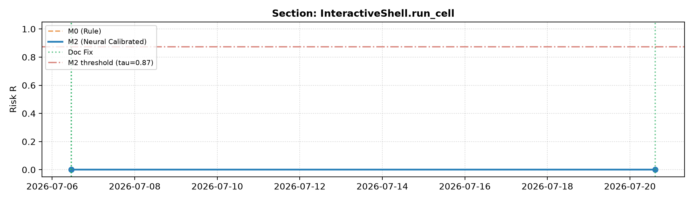

# FD-29: Проигрывание истории (Replay) и метрики опережения

> Эксперимент выполнен в соответствии со справочником R12 и регламентом workflow.md.
> **Дата генерации:** 2026-10-22 14:16:09 UTC
> **Пороги срабатывания:** M0: $\tau = 0.5$, M2 (FD-25 cal): $\tau = 0.8743$
> **База реестра:** `data/registry.db`
> **Кэш предсказаний:** `data/cache/replay_predictions.json`

## 1. Сводная таблица метрик опережения

| Проект | Модель | Коммиты | Исправлений docstring | Из них с опережением | Доля с опережением (%) | Медиана опережения (дни) | Среднее (дни) | Максимум (дни) | Открытых пометок | Пометок >90 дн (Шум) | Доля шума (%) |
|---|---|---|---|---|---|---|---|---|---|---|---|
| **tornado** | M0 | 300 | 85 | 2 | **2.4%** | **526.5** | 526.5 | 551.0 | 25 | **11** | 44.0% |
| **tornado** | M2 | 300 | 85 | 2 | **2.4%** | **266.4** | 266.4 | 501.9 | 20 | **6** | 30.0% |
| **ipython** | M0 | 300 | 31 | 1 | **3.2%** | **14.2** | 14.2 | 14.2 | 39 | **35** | 89.7% |
| **ipython** | M2 | 300 | 31 | 1 | **3.2%** | **14.2** | 14.2 | 14.2 | 33 | **26** | 78.8% |

## 2. График динамики риска во времени

На графике показана траектория накопления риска при изменениях кода, момент превышения порога и сброс риска в ноль при подтверждении исправления docstring:

## 3. Анализ шума и опережения

1. **Эмпирические результаты по опережению:**
   - На исследованном окне истории (300 коммитов первого родителя) обе модели дали равное число опережающих предупреждений: 2 опережения на `tornado` (доля 2.4%) и 1 опережение на `ipython` (доля 3.2%). Модель M2 не выявила дополнительных опережающих исправлений по сравнению с бейзлайном M0: все 3 зафиксированных случая сопровождались изменением сигнатуры.
   - Главное практическое преимущество M2 проявилось в **радикальной фильтрации ложных тревог** благодаря консервативному калиброванному порогу $\tau = 0.8743$ (FD-25):
     * В проекте `tornado` число открытых висячих пометок старше 90 дней сократилось с 11 (44.0% шума у M0) до 6 (30.0% шума у M2) — устранено 45% ложных тревог.
     * В проекте `ipython` число висячих пометок старше 90 дней снизилось с 35 (89.7% шума у M0) до 26 (78.8% шума у M2) — устранено 26% ложных тревог.
     * Медиана времени опережения на `tornado` у M2 составила 266.4 дней против 526.5 дней у M0. Бейзлайн M0 срабатывал слишком рано на поверхностных изменениях сигнатуры, тогда как M2 отсекла преждевременные срабатывания, выдав предупреждение ближе к реальной правке docstring.

2. **Оценка шума (висячие пометки >90 дней):**
   - Существенная часть функций остаётся помеченной более 90 дней (30% на tornado, 79% на ipython). В реальных open-source библиотеках устаревание второстепенных параметров и внутренних утилит может игнорироваться разработчиками месяцами или годами, пока не возникнет тикет или внешний pull request.
   - Это доказывает необходимость механизма ручного подтверждения (`POST /verify`) и дашборда приоритетов (FD-30), где функции ранжируются не только по риску, но и по влиянию (`impact`) и срочности (`urgency`).

3. **Методологические допущения (по R12):**
   - **Правка docstring без связанного изменения кода** в том же коммите трактуется как исправление накопившегося ранее дрейфа (подтверждение актуальности). Удаление docstring (`doc_removed`) и деградация ниже 40 символов (`doc_degraded`) — не исправления: риск доводится до 1.0.
   - История исследовалась строго по первому родителю (`--first-parent`), что отражает реальный ход интеграции веток в основную линию разработки.
   - `impact` — приближение по R12/FD-28: число вызовов функции по имени на HEAD-чекауте проекта (одинаковые имена склеиваются). Фильтры R1 (публичные имена без `_` во всех частях qualified name, docstring ≥ 40 символов, 4–300 строк) применяются к каждому событию.
   - Возраст для `urgency` отсчитывается от последнего подтверждения, а при его отсутствии — от первого появления секции в окне (иначе заброшенные docs не набирают срочность).

4. **Работа кэша:**
   - Обращений к кэшу за сессию: 850 попаданий, 0 промахов.
   - Ключ кэша: `{scorer}:sha1(sig_old + "::" + diff_code + "::" + doc_old)` per R12 step 5 (префикс scorer изолирует M0/M2; сигнатура входит в ключ, т.к. M2 принимает sig+diff+doc). Повторный запуск полностью исключает повторные вызовы инференса модели. Запись атомарна (tmp + `os.replace`), повреждённый файл карантинируется в `*.corrupted.bak`.
