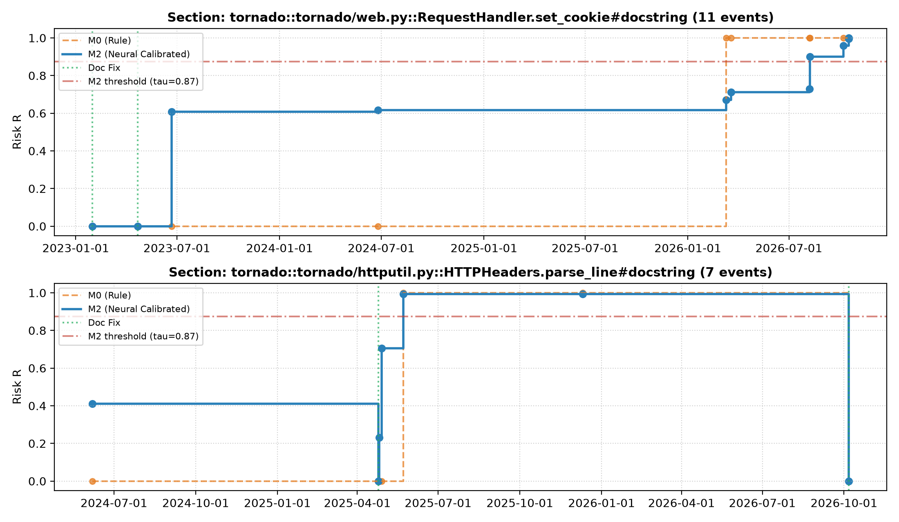
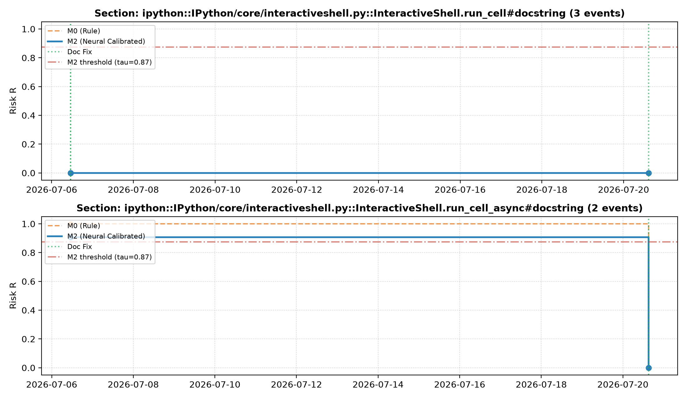
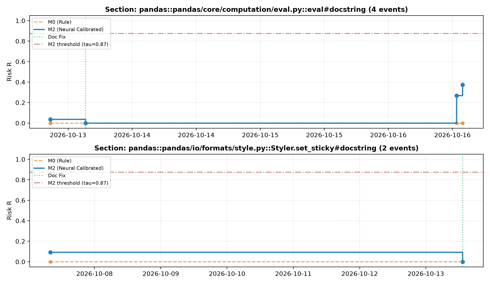
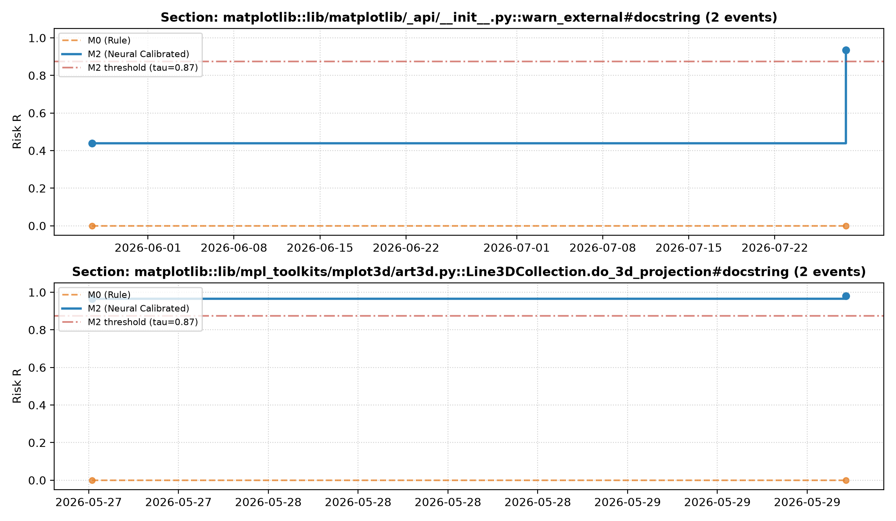
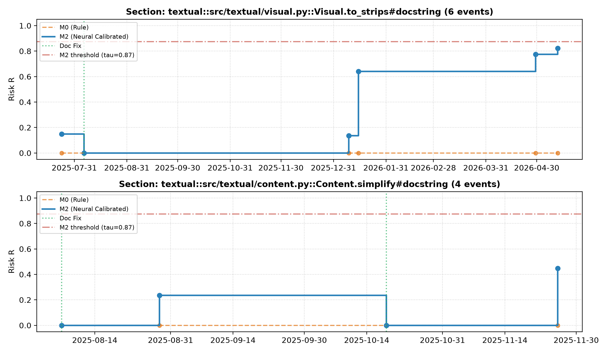

# FD-29: Проигрывание истории (Replay) и метрики опережения

> Эксперимент выполнен в соответствии со справочником R12 и регламентом workflow.md.
> **Дата генерации:** 2026-10-23 05:59:16 UTC
> **Пороги срабатывания:** M0: $\tau = 0.5$, M2 (FD-25 cal): $\tau = 0.8743$
> **Проекты фермы (5):** `tornado`, `ipython`, `pandas`, `matplotlib`, `textual`
> **База реестра:** `data/registry.db`
> **Кэш предсказаний:** `data/cache/replay_predictions.json`

## 1. Сводная таблица метрик опережения

| Проект | Модель | Коммиты | Исправлений docstring | Из них с опережением | Доля с опережением (%) | Медиана опережения (дни) | Среднее (дни) | Максимум (дни) | Открытых пометок | Пометок >90 дн (Шум) | Доля шума (%) |
|---|---|---|---|---|---|---|---|---|---|---|---|
| **tornado** | M0 | 300 | 84 | 2 | **2.4%** | **526.5** | 526.5 | 551.0 | 24 | **11** | 45.8% |
| **tornado** | M2 | 300 | 84 | 2 | **2.4%** | **266.4** | 266.4 | 501.9 | 20 | **6** | 30.0% |
| **ipython** | M0 | 300 | 29 | 1 | **3.5%** | **14.2** | 14.2 | 14.2 | 39 | **35** | 89.7% |
| **ipython** | M2 | 300 | 29 | 1 | **3.5%** | **14.2** | 14.2 | 14.2 | 33 | **26** | 78.8% |
| **pandas** | M0 | 300 | 44 | 0 | **0.0%** | **0.0** | 0.0 | 0.0 | 4 | **0** | 0.0% |
| **pandas** | M2 | 300 | 44 | 0 | **0.0%** | **0.0** | 0.0 | 0.0 | 5 | **0** | 0.0% |
| **matplotlib** | M0 | 300 | 34 | 0 | **0.0%** | **0.0** | 0.0 | 0.0 | 6 | **1** | 16.7% |
| **matplotlib** | M2 | 300 | 34 | 0 | **0.0%** | **0.0** | 0.0 | 0.0 | 7 | **1** | 14.3% |
| **textual** | M0 | 300 | 87 | 1 | **1.1%** | **271.1** | 271.1 | 271.1 | 16 | **16** | 100.0% |
| **textual** | M2 | 300 | 87 | 1 | **1.1%** | **271.1** | 271.1 | 271.1 | 14 | **14** | 100.0% |

## 2. Динамика риска по проектам

На графиках показана траектория накопления риска при изменениях кода, момент превышения порога и сброс риска в ноль при подтверждении исправления docstring (по 2 самые насыщенные функции с doc-фиксом на проект):

### tornado

### ipython

### pandas

### matplotlib

### textual

## 3. Анализ шума и опережения

1. **Эмпирические результаты по опережению:**
   - `tornado` (300 коммитов первого родителя): M0 — 2 опережений из 84 исправлений (2.4%), медиана 526.5 дн.; M2 — 2 из 84 (2.4%), медиана 266.4 дн.
     * Разложение исправлений M2: atomic_sync (код+doc в одном коммите) — 33, delayed_fix (doc-only после флага) — 51.
   - `ipython` (300 коммитов первого родителя): M0 — 1 опережений из 29 исправлений (3.5%), медиана 14.2 дн.; M2 — 1 из 29 (3.5%), медиана 14.2 дн.
     * Разложение исправлений M2: atomic_sync (код+doc в одном коммите) — 15, delayed_fix (doc-only после флага) — 14.
   - `pandas` (300 коммитов первого родителя): M0 — 0 опережений из 44 исправлений (0.0%), медиана 0.0 дн.; M2 — 0 из 44 (0.0%), медиана 0.0 дн.
     * Разложение исправлений M2: atomic_sync (код+doc в одном коммите) — 11, delayed_fix (doc-only после флага) — 33.
   - `matplotlib` (300 коммитов первого родителя): M0 — 0 опережений из 34 исправлений (0.0%), медиана 0.0 дн.; M2 — 0 из 34 (0.0%), медиана 0.0 дн.
     * Разложение исправлений M2: atomic_sync (код+doc в одном коммите) — 15, delayed_fix (doc-only после флага) — 19.
   - `textual` (300 коммитов первого родителя): M0 — 1 опережений из 87 исправлений (1.1%), медиана 271.1 дн.; M2 — 1 из 87 (1.1%), медиана 271.1 дн.
     * Разложение исправлений M2: atomic_sync (код+doc в одном коммите) — 47, delayed_fix (doc-only после флага) — 40.
   - Модель M2 не выявила дополнительных опережающих исправлений по сравнению с бейзлайном M0 (всего 4): зафиксированные случаи сопровождались изменением сигнатуры, где правило M0 уже срабатывает.
   - Практическое преимущество M2 — **фильтрация ложных тревог** благодаря консервативному калиброванному порогу $\tau = 0.8743$ (FD-25, против $\tau = 0.5$ у M0):
     * В проекте `tornado` число висячих пометок старше 90 дней: M0 — 11 (45.8% шума), M2 — 6 (30.0% шума) — устранено 5 (45% ложных тревог).
     * В проекте `ipython` число висячих пометок старше 90 дней: M0 — 35 (89.7% шума), M2 — 26 (78.8% шума) — устранено 9 (26% ложных тревог).
     * В проекте `pandas` число висячих пометок старше 90 дней: M0 — 0 (0.0% шума), M2 — 0 (0.0% шума) — устранено 0 (0% ложных тревог).
     * В проекте `matplotlib` число висячих пометок старше 90 дней: M0 — 1 (16.7% шума), M2 — 1 (14.3% шума) — устранено 0 (0% ложных тревог).
     * В проекте `textual` число висячих пометок старше 90 дней: M0 — 16 (100.0% шума), M2 — 14 (100.0% шума) — устранено 2 (12% ложных тревог).
     * Медиана опережения на `tornado`: M2 — 266.4 дн. против 526.5 дн. у M0. Более позднее срабатывание M2 означает отсечение преждевременных срабатываний на поверхностных изменениях сигнатуры.
     * Медиана опережения на `ipython` совпадает у M0 и M2 (14.2 дн.): обе модели сработали на одних и тех же изменениях сигнатуры.
     * Медиана опережения на `textual` совпадает у M0 и M2 (271.1 дн.): обе модели сработали на одних и тех же изменениях сигнатуры.
   - Итого по ферме висячих пометок старше 90 дней: M0 — 63, M2 — 47.

## 4. Выживаемость предупреждений (Kaplan-Meier, пул фермы)

X — дни от пометки, Y — доля всё ещё открытых алертов. Открытые пометки — правая цензура (учитываются в at-risk, кривую роняют только состоявшиеся исправления).

   - **M0**: событий 4, цензурировано 89; медиана дожития не достигнута (цензура).
   - **M2**: событий 4, цензурировано 79; медиана дожития не достигнута (цензура).
   - Событий мало (4), поэтому сильные заявления вида «95%» неуместны: ниже — только эмпирика и честная оговорка.

Доля исправленных к сроку (1 − S, по кривой):

| Модель | ≤30 дн | ≤60 дн | ≤90 дн | ≤180 дн |
|---|---|---|---|---|
| M0 | 1.4% | 1.4% | 1.4% | 1.4% |
| M2 | 1.5% | 3.1% | 3.1% | 3.1% |

Чувствительность доли шума к отсечке (открытые пометки старше T, пул фермы):

| Модель | >30 дн | >60 дн | >90 дн | >180 дн |
|---|---|---|---|---|
| M0 | 77.5% | 74.2% | 70.8% | 28.1% |
| M2 | 75.9% | 73.4% | 59.5% | 22.8% |

## 5. Шум по проектам

**Висячие пометки >90 дней:**
   - `tornado`: 6 из 20 открытых пометок M2 висят >90 дней (30.0%).
   - `ipython`: 26 из 33 открытых пометок M2 висят >90 дней (78.8%).
   - `pandas`: 0 из 5 открытых пометок M2 висят >90 дней (0.0%).
   - `matplotlib`: 1 из 7 открытых пометок M2 висят >90 дней (14.3%).
   - `textual`: 14 из 14 открытых пометок M2 висят >90 дней (100.0%).
   - В реальных open-source библиотеках устаревание второстепенных параметров и внутренних утилит может игнорироваться разработчиками месяцами или годами, пока не возникнет тикет или внешний pull request.
   - Это доказывает необходимость механизма ручного подтверждения (`POST /verify`) и дашборда приоритетов (FD-30), где функции ранжируются не только по риску, но и по влиянию (`impact`) и срочности (`urgency`).

**Методологические допущения (по R12):**
   - **Правка docstring без связанного изменения кода** в том же коммите трактуется как исправление накопившегося ранее дрейфа (подтверждение актуальности). Удаление docstring (`doc_removed`) и деградация ниже 40 символов (`doc_degraded`) — не исправления: риск доводится до 1.0.
   - История исследовалась строго по первому родителю (`--first-parent`), что отражает реальный ход интеграции веток в основную линию разработки.
   - `impact` — приближение по R12/FD-28: число вызовов функции по имени на HEAD-чекауте проекта (одинаковые имена склеиваются); переименования файлов (статус R в git) не отслеживаются и теряются как исчезнувшие функции.
   - Фильтры R1 (публичные имена без `_` во всех частях qualified name, docstring ≥ 40 символов, 4–300 строк) применяются к каждому событию; формула строк повторяет `miner.compare_pair` (нормализованный код + docstring).
   - Возраст для `urgency` отсчитывается от последнего подтверждения, а при его отсутствии — от первого появления секции в окне (иначе заброшенные docs не набирают срочность).

**Работа кэша:**
   - Обращений к кэшу за сессию: 1678 попаданий, 0 промахов; всего записей в файле: 1678.
   - Ключ кэша: `{scorer}:sha1(sig_old + "::" + diff_code + "::" + doc_old)` per R12 step 5 (префикс scorer изолирует M0/M2; сигнатура входит в ключ, т.к. M2 принимает sig+diff+doc). Повторный запуск полностью исключает повторные вызовы инференса модели. Запись атомарна (tmp + `os.replace`), повреждённый файл карантинируется в `*.corrupted.bak`.
   - 0 промахов означает полностью кэшированный повторный прогон; холодный прогон даёт misses > 0 (число инференсов модели).
