# Пояснительная записка: FreshDoc

## Содержание

- [1. Введение и постановка проблемы](#1-введение-и-постановка-проблемы)
  - [1.1. Проблема синхронизации спецификаций и программного кода](#11-проблема-синхронизации-спецификаций-и-программного-кода)
    - [1.1.1. Анализ проблемы скрытого устаревания документации (code-doc divergence)](#111-анализ-проблемы-скрытого-устаревания-документации-code-doc-divergence)
    - [1.1.2. Влияние рассогласования на процессы разработки, ревью и генерацию кода ИИ-агентами](#112-влияние-рассогласования-на-процессы-разработки-ревью-и-генерацию-кода-ии-агентами)
    - [1.1.3. Определение понятия программного дрейфа и таксономия рассогласований](#113-определение-понятия-программного-дрейфа-и-таксономия-рассогласований)
  - [1.2. Концепция динамического версионируемого реестра актуальности](#12-концепция-динамического-версионируемого-реестра-актуальности)
    - [1.2.1. Ограниченность существующих статических анализаторов и линтеров](#121-ограниченность-существующих-статических-анализаторов-и-линтеров)
    - [1.2.2. Архитектурная парадигма динамического версионируемого реестра FreshDoc](#122-архитектурная-парадигма-динамического-версионируемого-реестра-freshdoc)
    - [1.2.3. Жизненный цикл артефакта документации и операции в графе веток](#123-жизненный-цикл-артефакта-документации-и-операции-в-графе-веток)
  - [1.3. Границы исследования и допущения](#13-границы-исследования-и-допущения)
    - [1.3.1. Языковой скоуп и уровни абстракции документации](#131-языковой-скоуп-и-уровни-абстракции-документации)
    - [1.3.2. Изоляция от генеративного автоисправления](#132-изоляция-от-генеративного-автоисправления)
- [2. Анализ предметной области и технологический обзор решений](#2-анализ-предметной-области-и-технологический-обзор-решений)
  - [2.1. Методы представления и анализа изменений программного кода](#21-методы-представления-и-анализа-изменений-программного-кода)
    - [2.1.1. Синтаксический анализ кода на базе AST и каноническая нормализация](#211-синтаксический-анализ-кода-на-базе-ast-и-каноническая-нормализация)
    - [2.1.2. Дифференциальный анализ изменений и алгоритмический разбор сигнатур](#212-дифференциальный-анализ-изменений-и-алгоритмический-разбор-сигнатур)
  - [2.2. Архитектуры глубокого обучения для задач Code Intelligence](#22-архитектуры-глубокого-обучения-для-задач-code-intelligence)
    - [2.2.1. Двунаправленные кодовые энкодеры (UniXcoder, CodeBERT, Jina-Code)](#221-двунаправленные-кодовые-энкодеры-unixcoder-codebert-jina-code)
    - [2.2.2. Современные длинноконтекстные Masked LM и Bi-Encoder модели (ModernBERT, GTE, Granite)](#222-современные-длинноконтекстные-masked-lm-и-bi-encoder-модели-modernbert-gte-granite)
    - [2.2.3. Каузальные авторегрессионные декодеры (Qwen2.5-Coder, Granite-4.0, DeepSeek)](#223-каузальные-авторегрессионные-декодеры-qwen25-coder-granite-40-deepseek)
    - [2.2.4. Сравнительный анализ парадигм Bi-Encoder и Cross-Encoder](#224-сравнительный-анализ-парадигм-bi-encoder-и-cross-encoder)
    - [2.2.5. Сводная Master-матрица исследования моделей-кандидатов](#225-сводная-master-матрица-исследования-моделей-кандидатов)
  - [2.3. Правовой аудит открытых кодовых моделей и лицензионные ограничения](#23-правовой-аудит-открытых-кодовых-моделей-и-лицензионные-ограничения)
    - [2.3.1. Анализ типов открытых лицензий чекпоинтов (Apache 2.0, MIT, Qwen Research, CC-BY-NC)](#231-анализ-типов-открытых-лицензий-чекпоинтов-apache-20-mit-qwen-research-cc-by-nc)
    - [2.3.2. Дисквалификация ограниченных моделей и фиксация production-стека](#232-дисквалификация-ограниченных-моделей-и-фиксация-production-стека)
  - [2.4. Существующие открытые наборы данных](#24-существующие-открытые-наборы-данных)
    - [2.4.1. Анализ бенчмарка CoDocBench: структура, связность и скрытые дефекты](#241-анализ-бенчмарка-codocbench-структура-связность-и-скрытые-дефекты)
    - [2.4.2. Обзор исследовательских бенчмарков на других языках (CUP, HebCup, Panthaplackel JIT, CoCC)](#242-обзор-исследовательских-бенчмарков-на-других-языках-cup-hebcup-panthaplackel-jit-cocc)
- [3. Математическая постановка задачи и методология оценки](#3-математическая-постановка-задачи-и-методология-оценки)
  - [3.1. Формализация задачи парной классификации и детекции дрейфа](#31-формализация-задачи-парной-классификации-и-детекции-дрейфа)
    - [3.1.1. Пространство входных признаков и целевых переменных](#311-пространство-входных-признаков-и-целевых-переменных)
    - [3.1.2. Математическая формулировка многозадачной функции потерь (Masked Multi-Task Loss)](#312-математическая-формулировка-многозадачной-функции-потерь-masked-multi-task-loss)
  - [3.2. Архитектура бюджетирования контекста и токенизация](#32-архитектура-бюджетирования-контекста-и-токенизация)
    - [3.2.1. Анализ квантилей длин токенов и инструментальные замеры усечения контекста](#321-анализ-квантилей-длин-токенов-и-инструментальные-замеры-усечения-контекста)
    - [3.2.2. Алгоритм взвешенного распределения токенов и приоритизация ханков диффа](#322-алгоритм-взвешенного-распределения-токенов-и-приоритизация-ханков-диффа)
    - [3.2.3. Специфика схем токенизации: RoBERTa против ModernBERT](#323-специфика-схем-токенизации-roberta-против-modernbert)
  - [3.3. Метрики качества и протокол валидации](#33-метрики-качества-и-протокол-валидации)
    - [3.3.1. Основные и вспомогательные метрики ранжирования и калибровки](#331-основные-и-вспомогательные-метрики-ранжирования-и-калибровки)
    - [3.3.2. Стратификация по структурным подгруппам: all, sig_changed, sig_same](#332-стратификация-по-структурным-подгруппам-all-sig_changed-sig_same)
    - [3.3.3. Протокол честной валидации и запрет агрегации разнородных сплитов](#333-протокол-честной-валидации-и-запрет-агрегации-разнородных-сплитов)
- [4. Сбор, фильтрация и инженерия наборов данных](#4-сбор-фильтрация-и-инженерия-наборов-данных)
  - [4.1. Извлечение и предобработка реальных положительных пар (CoDocBench)](#41-извлечение-и-предобработка-реальных-положительных-пар-codocbench)
    - [4.1.1. Пайплайн адаптации CoDocBench в каноническую схему данных](#411-пайплайн-адаптации-codocbench-в-каноническую-схему-данных)
    - [4.1.2. Устранение межсплитовых утечек проектов и изоляция каналов утечки данных](#412-устранение-межсплитовых-утечек-проектов-и-изоляция-каналов-утечки-данных)
  - [4.2. Майнинг отрицательных примеров из истории Git-репозиториев](#42-майнинг-отрицательных-примеров-из-истории-git-репозиториев)
    - [4.2.1. Параллельный CLI-майнинг 60 открытых репозиториев и пилотный замер производительности](#421-параллельный-cli-майнинг-60-открытых-репозиториев-и-пилотный-замер-производительности)
    - [4.2.2. Классификация отрицательных примеров и анализ дефицита сильных негативов](#422-классификация-отрицательных-примеров-и-анализ-дефицита-сильных-негативов)
    - [4.2.3. Балансировка и стратификация распределений длин: контроль критерия Колмогорова-Смирнова](#423-балансировка-и-стратификация-распределений-длин-контроль-критерия-колмогорова-смирнова)
  - [4.3. Алгоритмический синтез дрейфа на основе AST-мутаций](#43-алгоритмический-синтез-дрейфа-на-основе-ast-мутаций)
    - [4.3.1. Таксономия 9 мутационных операторов синтаксического уровня](#431-таксономия-9-мутационных-операторов-синтаксического-уровня)
    - [4.3.2. Детерминизм генерации (CRC32), изоляция скоупов и обратная AST-валидация](#432-детерминизм-генерации-crc32-изоляция-скоупов-и-обратная-ast-валидация)
    - [4.3.3. Эволюционная 5-раундовая отладка мутаторов и генерация 29.5k примеров пула v2](#433-эволюционная-5-раундовая-отладка-мутаторов-и-генерация-295k-примеров-пула-v2)
  - [4.4. LLM-синтез сложных семантических изменений и трудных негативов](#44-llm-синтез-сложных-семантических-изменений-и-трудных-негативов)
    - [4.4.1. Архитектура промпт-инженерии режимов P1 (сдвиг поведения), P2 (рефакторинг) и P3 (парафразы)](#441-архитектура-промпт-инженерии-режимов-p1-сдвиг-поведения-p2-рефакторинг-и-p3-парафразы)
    - [4.4.2. Автоматический контур верификации и фильтрации генераций](#442-автоматический-контур-верификации-и-фильтрации-генераций)
    - [4.4.3. Эмпирический аудит шума разметки и калибровка весов примеров в обучении](#443-эмпирический-аудит-шума-разметки-и-калибровка-весов-примеров-в-обучении)
  - [4.5. Проектирование и разметка экспертного Золотого набора (Gold Standard)](#45-проектирование-и-разметка-экспертного-золотого-набора-gold-standard)
    - [4.5.1. Стратифицированная выборка 200 реальных пар из тестового пула](#451-стратифицированная-выборка-200-реальных-пар-из-тестового-пула)
    - [4.5.2. Четырёхклассовая таксономия и регламент экспертной разметки](#452-четырёхклассовая-таксономия-и-регламент-экспертной-разметки)
    - [4.5.3. Протокол независимой двойной слепой разметки и интер-аннотаторское согласие](#453-протокол-независимой-двойной-слепой-разметки-и-интер-аннотаторское-согласие)
  - [4.6. Верификация чистоты данных и контроль паразитных признаков](#46-верификация-чистоты-данных-и-контроль-паразитных-признаков)
    - [4.6.1. Автоматизированный контур 16 тестов целостности и изоляции данных](#461-автоматизированный-контур-16-тестов-целостности-и-изоляции-данных)
    - [4.6.2. Тестирование на утечку метаданных с помощью линейных классификаторов](#462-тестирование-на-утечку-метаданных-с-помощью-линейных-классификаторов)
    - [4.6.3. Частотный анализ токенов и сводный состав датасета dataset_v1](#463-частотный-анализ-токенов-и-сводный-состав-датасета-dataset_v1)
    - [4.6.4. Сплошной машинный аудит 5 146 строк генерального оценочного среза](#464-сплошной-машинный-аудит-5-146-строк-генерального-оценочного-среза)
- [5. Архитектура системы, обучение моделей и программная реализация](#5-архитектура-системы-обучение-моделей-и-программная-реализация)
  - [5.1. Аппаратно-программный профиль среды обучения](#51-аппаратно-программный-профиль-среды-обучения)
    - [5.1.1. Спецификация вычислительного узла 2× Tesla T4 и аппаратные барьеры](#511-спецификация-вычислительного-узла-2-tesla-t4-и-аппаратные-барьеры)
    - [5.1.2. Вычислительная математика FP16 Mixed AdamW и балансировка VRAM](#512-вычислительная-математика-fp16-mixed-adamw-и-балансировка-vram)
    - [5.1.3. Эмпирический замер стохастического шума AllReduce в распределенном обучении (DDP)](#513-эмпирический-замер-стохастического-шума-allreduce-в-распределенном-обучении-ddp)
  - [5.2. Реализация базовых классификаторов (Baselines)](#52-реализация-базовых-классификаторов-baselines)
    - [5.2.1. Эвристический сигнатурный классификатор M0](#521-эвристический-сигнатурный-классификатор-m0)
    - [5.2.2. Градиентный бустинг M1 на 21 инженерном признаке](#522-градиентный-бустинг-m1-на-21-инженерном-признаке)
  - [5.3. Обучаемая нейросетевая модель M2 (Dual-Head Cross-Encoder)](#53-обучаемая-нейросетевая-модель-m2-dual-head-cross-encoder)
    - [5.3.1. Эволюция исследовательской гипотезы и выбор архитектуры](#531-эволюция-исследовательской-гипотезы-и-выбор-архитектуры)
    - [5.3.2. Контур оптимизации: расписание темпа обучения, warmup и накопление градиента](#532-контур-оптимизации-расписание-темпа-обучения-warmup-и-накопление-градиента)
    - [5.3.3. Верификация сходимости: стресс-тест на переобучение (Overfitting smoke-test)](#533-верификация-сходимости-стресс-тест-на-переобучение-overfitting-smoke-test)
  - [5.4. Внешний арбитр на базе большой языковой модели (M3 / M3max)](#54-внешний-арбитр-на-базе-большой-языковой-модели-m3-m3max)
    - [5.4.1. Архитектура судейской модели LLM Judge M3 и M3max](#541-архитектура-судейской-модели-llm-judge-m3-и-m3max)
    - [5.4.2. Исследование влияния режима глубоких рассуждений (thinking tokens)](#542-исследование-влияния-режима-глубоких-рассуждений-thinking-tokens)
  - [5.5. Архитектура программной платформы FreshDoc](#55-архитектура-программной-платформы-freshdoc)
    - [5.5.1. Реляционная схема версионируемого реестра состояния (SQLite doc_state)](#551-реляционная-схема-версионируемого-реестра-состояния-sqlite-doc_state)
    - [5.5.2. Модуль расчета риска, влияния (графовый fan-in) и фактора срочности](#552-модуль-расчета-риска-влияния-графовый-fan-in-и-фактора-срочности)
    - [5.5.3. Спецификация контрактов REST API сервиса (FastAPI)](#553-спецификация-контрактов-rest-api-сервиса-fastapi)
- [6. Экспериментальные исследования и сравнительный анализ качества](#6-экспериментальные-исследования-и-сравнительный-анализ-качества)
  - [6.1. Эксперимент E1: Сравнительный бенчмаркинг подходов (M0, M1, M2, M3)](#61-эксперимент-e1-сравнительный-бенчмаркинг-подходов-m0-m1-m2-m3)
    - [6.1.1. Сводные результаты бейзлайнов и моделей по сплитам val, test_real, test_synth, gold](#611-сводные-результаты-бейзлайнов-и-моделей-по-сплитам-val-test_real-test_synth-gold)
    - [6.1.2. Оценка качества на изолированном подмножестве семантического дрейфа (sig_same)](#612-оценка-качества-на-изолированном-подмножестве-семантического-дрейфа-sig_same)
    - [6.1.3. Анализ артефакта идеальности эвристических правил M0 на синтетике](#613-анализ-артефакта-идеальности-эвристических-правил-m0-на-синтетике)
    - [6.1.4. Честное сопоставление подходов на общем M3-подмножестве](#614-честное-сопоставление-подходов-на-общем-m3-подмножестве)
  - [6.2. Эксперимент E2: Факторный анализ состава обучающей выборки](#62-эксперимент-e2-факторный-анализ-состава-обучающей-выборки)
    - [6.2.1. Сравнительное обучение на изолированных срезах данных (Слоты 1, 2, 3, 4)](#621-сравнительное-обучение-на-изолированных-срезах-данных-слоты-1-2-3-4)
    - [6.2.2. Экспериментальное доказательство доменного сдвига AST-синтетики (Слот 2)](#622-экспериментальное-доказательство-доменного-сдвига-ast-синтетики-слот-2)
    - [6.2.3. Синергетический эффект гибридного обучения на полной смеси данных (Слот 4)](#623-синергетический-эффект-гибридного-обучения-на-полной-смеси-данных-слот-4)
    - [6.2.4. Инженерно-исследовательские выводы по составу обучающей выборки](#624-инженерно-исследовательские-выводы-по-составу-обучающей-выборки)
  - [6.3. Эксперимент E3: Абляционное исследование роли признака изменений (diff_code)](#63-эксперимент-e3-абляционное-исследование-роли-признака-изменений-diff_code)
    - [6.3.1. Постановка абляционного эксперимента: обучение с отключенным диффом (Слот 9)](#631-постановка-абляционного-эксперимента-обучение-с-отключенным-диффом-слот-9)
    - [6.3.2. Катастрофический коллапс головы типирования дрейфа и доказательство состоятельности Cross-Attention](#632-катастрофический-коллапс-головы-типирования-дрейфа-и-доказательство-состоятельности-cross-attention)
  - [6.4. Исследование масштабирования контекста и бэкбонов (Слоты 4–8)](#64-исследование-масштабирования-контекста-и-бэкбонов-слоты-48)
    - [6.4.1. Сравнительный анализ бэкбонов: UniXcoder против ModernBERT и GTE-ModernBERT](#641-сравнительный-анализ-бэкбонов-unixcoder-против-modernbert-и-gte-modernbert)
    - [6.4.2. Диалектика победы моделей: изоляция Gold Standard против производственного ядра](#642-диалектика-победы-моделей-изоляция-gold-standard-против-производственного-ядра)
    - [6.4.3. Исследование стэкинга M1+M2](#643-исследование-стэкинга-m1m2)
  - [6.5. Эксперимент E4: Обобщение калиброванной модели на невиданные ранее проекты (val -> test_real)](#65-эксперимент-e4-обобщение-калиброванной-модели-на-невиданные-ранее-проекты-val---test_real)
    - [6.5.1. Постановка эксперимента E4: проверка устойчивости при межпроектном переносе](#651-постановка-эксперимента-e4-проверка-устойчивости-при-межпроектном-переносе)
    - [6.5.2. Сохранение ранжирующей способности и рост обобщения на реальных данных](#652-сохранение-ранжирующей-способности-и-рост-обобщения-на-реальных-данных)
  - [6.6. Эксперимент E5: Калибровка вероятностных оценок](#66-эксперимент-e5-калибровка-вероятностных-оценок)
    - [6.6.1. Температурное масштабирование логитов по критерию NLL на отложенной выборке](#661-температурное-масштабирование-логитов-по-критерию-nll-на-отложенной-выборке)
    - [6.6.2. Динамика метрик надежности (Brier score, ECE) и диаграммы надежности (Reliability Diagrams)](#662-динамика-метрик-надежности-brier-score-ece-и-диаграммы-надежности-reliability-diagrams)
  - [6.7. Эксперимент E6: Оптимизация операционного порога принятия решений](#67-эксперимент-e6-оптимизация-операционного-порога-принятия-решений)
    - [6.7.1. Двухэтапная процедура калибровки порога](#671-двухэтапная-процедура-калибровки-порога)
    - [6.7.2. Математическое обоснование выбора рабочего порога tau = 0.8743](#672-математическое-обоснование-выбора-рабочего-порога-tau-08743)
  - [6.8. Эксперимент E7: Глубокий аудит и систематизация ошибок (Error Analysis)](#68-эксперимент-e7-глубокий-аудит-и-систематизация-ошибок-error-analysis)
    - [6.8.2. Протокол независимой слепой классификации причин с арбитражем (каппа = 0.674)](#682-протокол-независимой-слепой-классификации-причин-с-арбитражем-каппа-0674)
    - [6.8.3. Количественное распределение режимов отказа и препарирование опорных ошибок](#683-количественное-распределение-режимов-отказа-и-препарирование-опорных-ошибок)
  - [6.9. Историческая симуляция (Replay) и выживаемость предупреждений](#69-историческая-симуляция-replay-и-выживаемость-предупреждений)
    - [6.9.1. Проигрывание истории 5 открытых библиотек по 300 коммитов](#691-проигрывание-истории-5-открытых-библиотек-по-300-коммитов)
    - [6.9.2. Специфика репозиториев и метрики временного опережения ручных правок](#692-специфика-репозиториев-и-метрики-временного-опережения-ручных-правок)
    - [6.9.3. Анализ выживаемости предупреждений по методу Каплана-Мейера и фильтрация шума](#693-анализ-выживаемости-предупреждений-по-методу-каплана-мейера-и-фильтрация-шума)
  - [6.10. Исследование кросс-языкового переноса](#610-исследование-кросс-языкового-переноса)
    - [6.10.1. Постановка исследовательской задачи и обоснование языковой триады](#6101-постановка-исследовательской-задачи-и-обоснование-языковой-триады)
    - [6.10.2. Сбор, фильтрация и формирование кросс-языковых датасетов](#6102-сбор-фильтрация-и-формирование-кросс-языковых-датасетов)
    - [6.10.3. Экспериментальные результаты zero-shot инференса](#6103-экспериментальные-результаты-zero-shot-инференса)
    - [6.10.4. Аналитические выводы и механизмы межъязыкового переноса внимания](#6104-аналитические-выводы-и-механизмы-межъязыкового-переноса-внимания)
  - [6.11. Профилирование вычислительных ресурсов и экономика инференса](#611-профилирование-вычислительных-ресурсов-и-экономика-инференса)
    - [6.11.1. Баланс вычислительного бюджета обучения на GPU Tesla T4](#6111-баланс-вычислительного-бюджета-обучения-на-gpu-tesla-t4)
    - [6.11.2. Сравнительный анализ задержек инференса (CPU vs GPU vs Cloud API)](#6112-сравнительный-анализ-задержек-инференса-cpu-vs-gpu-vs-cloud-api)
    - [6.11.3. Экономическая смета: стоимость локального инференса против облачных LLM](#6113-экономическая-смета-стоимость-локального-инференса-против-облачных-llm)
- [7. Заключение](#7-заключение)
  - [7.1. Основные научно-практические результаты проекта](#71-основные-научно-практические-результаты-проекта)
  - [7.2. Разрешение проблемы выбора: границы применимости эвристик и нейросетей](#72-разрешение-проблемы-выбора-границы-применимости-эвристик-и-нейросетей)
    - [7.2.1. Матрица технологического выбора](#721-матрица-технологического-выбора)
    - [7.2.2. Границы безусловной применимости эвристик (M0)](#722-границы-безусловной-применимости-эвристик-m0)
    - [7.2.3. Зона абсолютной необходимости нейросетевого анализа (M2)](#723-зона-абсолютной-необходимости-нейросетевого-анализа-m2)
    - [7.2.4. Рекомендуемая каскадная архитектура (Two-Tier Cascade)](#724-рекомендуемая-каскадная-архитектура-two-tier-cascade)
  - [7.3. Системные ограничения разработанного решения](#73-системные-ограничения-разработанного-решения)
    - [7.3.1. Остаточный шум разметки в открытых репозиториях (до 45%)](#731-остаточный-шум-разметки-в-открытых-репозиториях-до-45)
    - [7.3.2. Доменный сдвиг AST-синтетики относительно реальной истории коммитов](#732-доменный-сдвиг-ast-синтетики-относительно-реальной-истории-коммитов)
    - [7.3.3. Бюджет контекстного окна 1024 токена и усечение длинных функций](#733-бюджет-контекстного-окна-1024-токена-и-усечение-длинных-функций)
    - [7.3.4. Языковая специализация AST-парсеров и барьеры кросс-языкового переноса](#734-языковая-специализация-ast-парсеров-и-барьеры-кросс-языкового-переноса)
    - [7.3.5. Стохастический шум DistributedDataParallel AllReduce ($\pm 0.007$)](#735-стохастический-шум-distributeddataparallel-allreduce-pm-0007)
  - [7.4. Направления дальнейшего развития](#74-направления-дальнейшего-развития)
    - [7.4.1. Парсинг и семантический анализ модульной документации Level 2 (README.md, docs/)](#741-парсинг-и-семантический-анализ-модульной-документации-level-2-readmemd-docs)
    - [7.4.2. Векторный семантический поиск для сквозной интеграции задач трекеров с кодовой базой](#742-векторный-семантический-поиск-для-сквозной-интеграции-задач-трекеров-с-кодовой-базой)
    - [7.4.3. Агентный Human-in-the-loop контур полуавтоматического автопатчинга документации](#743-агентный-human-in-the-loop-контур-полуавтоматического-автопатчинга-документации)
- [Приложения](#приложения)
  - [Приложение А. Матрица трассируемости экспериментальных данных](#приложение-а-матрица-трассируемости-экспериментальных-данных)
  - [Приложение Б. Конфигурационные файлы, гиперпараметры и контрольные суммы](#приложение-б-конфигурационные-файлы-гиперпараметры-и-контрольные-суммы)
    - [Б.1. Стек воспроизводимости](#б1-стек-воспроизводимости)
    - [Б.2. Паспорт корпуса dataset_v1.parquet (27 203 строки)](#б2-паспорт-корпуса-dataset_v1parquet-27-203-строки)
    - [Б.3. Эталонный срез Gold Standard (200 пар)](#б3-эталонный-срез-gold-standard-200-пар)
    - [Б.4. Контрольные суммы SHA-256](#б4-контрольные-суммы-sha-256)
    - [Б.5. Конфигурации](#б5-конфигурации)
  - [Приложение В. Глоссарий терминов, сокращений и таксономия типов дрейфа](#приложение-в-глоссарий-терминов-сокращений-и-таксономия-типов-дрейфа)
    - [В.1. Глоссарий научно-технических терминов и сокращений](#в1-глоссарий-научно-технических-терминов-и-сокращений)
    - [В.2. Каталог целевых типов программного дрейфа (8 классов)](#в2-каталог-целевых-типов-программного-дрейфа-8-классов)

---

## 1. Введение и постановка проблемы

### 1.1. Проблема синхронизации спецификаций и программного кода

#### 1.1.1. Анализ проблемы скрытого устаревания документации (code-doc divergence)

Феномен десинхронизации исходного кода и сопутствующих текстовых спецификаций (*code-doc divergence*) представляет собой систематическое расхождение между фактическим поведением программного компонента и его вербальным описанием в репозитории. В жизненном цикле программного обеспечения модификация кода носит непрерывный характер: внедрение новой функциональности, оптимизация алгоритмов, рефакторинг и исправление дефектов изменяют контракты вызовов, предусловия, возвращаемые типы и граничные условия.

В отличие от синтаксических ошибок (`SyntaxError`) или регрессий типизации (`TypeError`), несоответствие документации коду не нарушает процесс компиляции, сборки или выполнения модульных тестов (*fail-silent defect*). Компиляторы и интерпретаторы игнорируют текстовые комментарии, в результате чего в кодовой базе накапливается скрытый технический долг документации (*documentation debt*). 

В рамках архитектуры FreshDoc базовой единицей структурного анализа первого уровня (Level 1 Core) зафиксирован *docstring* функций и методов в среде Python версии 3.9+. Выбор обусловлен следующими инженерными факторами:
* Docstring является первичным нормативным источником контракта прикладного программного интерфейса (API contract), декларирующим назначение функции, параметры, возвращаемые значения и возбуждаемые исключения.
* Docstring служит источником данных для автоматических генераторов документации (Sphinx, MkDocs, pydoctor).
* Docstring считывается и парсится языковыми серверами сред разработки (Language Server Protocol, Pylance/Pyright, Jedi) для формирования контекстных подсказок разработчику в момент написания кода.

Рассогласование на уровне docstring делает дефектным весь последующий контур производных артефактов (генерируемые HTML/PDF-справки, IDE-инспекции, клиентские библиотеки).

#### 1.1.2. Влияние рассогласования на процессы разработки, ревью и генерацию кода ИИ-агентами

Эксплуатационные и экономические издержки устаревания спецификаций распределяются по трем ключевым контурам разработки:

1. **Индивидуальная разработка и отладка (Developer Overhead):**
   * Увеличение времени погружения (*code comprehension time*): разработчик, опираясь на ложную сигнатуру или искаженное описание аргументов в docstring, формирует ошибочные гипотезы о поведении API.
   * Рост времени локализации ошибок (*debugging latency*): отладка нештатного поведения, вызванного неверными типами или опущенными побочными эффектами функции, требует трассировки тела вызываемого метода вместо чтения контракта.
   * Нарушение инвариантов граничных условий: документация, скрывающая факт изменения дефолтных значений или типов возвращаемых структур, приводит к внедрению скрытых багов в зависимых модулях.

2. **Процесс рецензирования кода (Code Review Bottleneck):**
   * Дефицит когнитивного ресурса рецензентов: при ревью пулл-реквестов основное внимание концентрируется на корректности исполняемой логики диффа и прохождении CI-тестов. Верификация семантического соответствия обновленного тела функции неизмененному docstring выполняется поверхностно или опускается полностью.
   * Размывание контекстной ответственности: отсутствие автоматизированного гейта в CI/CD позволяет принимать коммиты, меняющие сигнатуру без сопутствующей правки docstring.

3. **Синтез кода автономными ИИ-агентами (AI Agent Failure Modes):**
   * Применение автономных кодогенераторов и сред (современные автономные агентные кодеры (Claude Code, OpenAI Codex / Operator, SWE-агенты)) переводит проблему рассинхронизации в критическую категорию системных отказов.
   * Эффект каскадного распространения ошибок (*error propagation*): ИИ-агенты используют RAG (Retrieval-Augmented Generation) и семантический поиск по индексам кодовой базы. Docstring с ложным описанием интерфейса попадает в контекстное окно модели в качестве контекста истины (*ground truth prompt*).
   * Генерация галлюцинаторных вызовов: агент синтезирует код, использующий удаленные или переименованные параметры, передает аргументы устаревших типов или опирается на несуществующие возвращаемые поля.
   * Зацикливание восстановительных циклов (*repair loops*): сталкиваясь с ошибкой времени выполнения сгенерированного кода, агент повторно считывает ошибочный docstring, что приводит к исчерпанию контекстного бюджета и невозможности решения инженерной задачи.

#### 1.1.3. Определение понятия программного дрейфа и таксономия рассогласований

Пусть программная функция в момент времени $t$ описывается кортежем:

$$f_t = (S_t, B_t, D_t)$$

где:
* $S_t$ — синтаксическая сигнатура функции (имя, параметры, аннотации типов, значения по умолчанию, тип возвращаемого значения);
* $B_t$ — синтаксическое тело функции (реализация логики);
* $D_t$ — текстовая спецификация контракта функции (docstring).

Программный дрейф документации (*documentation drift*) между ревизиями $t$ и $t+1$ определяется как предикат:

$$\text{Drift}(f_t, f_{t+1}) = 1 \iff (B_t \ne B_{t+1} \lor S_t \ne S_{t+1}) \land (D_t = D_{t+1}) \land \neg \mathcal{E}(S_{t+1}, B_{t+1}, D_t)$$

где $\mathcal{E}(S, B, D)$ — предикат семантической эквивалентности контракта $D$ и фактического поведения функции $(S, B)$.

В платформе FreshDoc принята строгая двухуровневая таксономия рассогласований:

1. **Поверхностный структурный дрейф (`sig_changed`):**
   * Характеризуется модификацией синтаксического заголовка функции: $S(t) \ne S(t+1)$.
   * Включает 6 детерминированных классов: `param_renamed` (переименование параметра), `param_removed` (удаление параметра из сигнатуры), `param_added` (добавление нового аргумента), `default_changed` (изменение дефолтного значения), `return_changed` (модификация типа или структуры возврата), `exception_changed` (изменение множества возбуждаемых исключений).
   * Поддается частичной эвристической идентификации посредством статического сопоставления AST-деревьев.

2. **Глубокий семантический дрейф (`sig_same`):**
   * Характеризуется строгой инвариантностью сигнатуры: $S(t) = S(t+1)$, при одновременной модификации тела функции $B(t) \ne B(t+1)$.
   * Класс рассогласования: `behavior_changed` (изменение внутренней логики, инверсия условий, смена алгоритма, модификация побочных эффектов).
   * Изменению подвергаются внутренняя логика обработки, граничные ветвления, используемые формулы, порядок вызова внешних зависимостей или мутация передаваемых структур данных при неизменном заголовке вызова.
   * Статические анализаторы и линтеры правил сигнатур дают на данном подмножестве абсолютный пропуск дефектов ($Recall = 0.0$). Обнаружение требует моделирования полного попарного перекрестного внимания между токенами диффа и docstring.

---

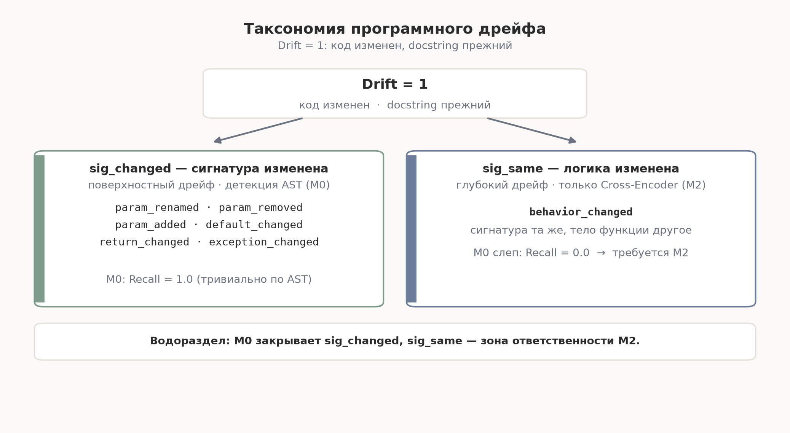

*Рисунок 1. Таксономия программного дрейфа. Источник: [reports/figures/note/note_taxonomy_drift.png](reports/figures/note/note_taxonomy_drift.png).*

### 1.2. Концепция динамического версионируемого реестра актуальности

#### 1.2.1. Ограниченность существующих статических анализаторов и линтеров

Существующий инструментарий контроля документации распадается на два класса, ни один из которых не решает задачу детекции программного дрейфа. Первый класс — стилевые линтеры (`pydocstyle`, `flake8-docstrings`, `ruff` с правилами `D`): они проверяют исключительно наличие docstring и его соответствие соглашению PEP 257 (заглавная буква, точки, секции). Вопрос «соответствует ли текст измененному коду» находится вне их модели: линтер не читает дифф и не сравнивает ревизии. Второй класс — академические сканеры рассинхрона (`DocDrift`, `DriftGuard`, `Falconer` и аналогичные прототипы, а также генераторы `Doxygen`/`Sphinx`): они работают в режиме разового снимка текущего среза и не привязаны к графу коммитов Git.

Системные ограничения обоих классов:

1. **Статичность правил и отсутствие семантики тела функции.** Детекция сводится к сопоставлению имени параметра со строкой docstring. На подмножестве глубокого дрейфа при инвариантной сигнатуре (`sig_same`) такие правила дают абсолютный пропуск дефектов ($Recall = 0.0$): в проекте это экспериментально зафиксировано baseline M0 на срезе `test_real` ($Recall = 0.000$, $\text{PR-AUC} = 0.320$ на уровне случайного угадывания, п. 5.2.1).
2. **Разовый скан вместо накопления.** Инструменты выдают бинарный вердикт «ошибка/нет» на текущем файле и не ведут историю риска по веткам: повторный прогон не отличает свежий дрейф от накопленного за десятки коммитов.
3. **Отсутствие привязки к графу версий.** Нет понятий ветки, коммита сборки и слияния: невозможно ответить, в каком коммите документация устарела и что произошло при merge.
4. **Ложные срабатывания на легитимных правках.** Модификация сигнатуры далеко не всегда требует правки docstring: на экспертном Золотом стандарте (`gold / sig_changed`) детерминированное правило M0 дает 52.6% ложных срабатываний (п. 5.2.1). Без калиброванной вероятности $p_{\text{stale}}$ такой сенсор непригоден в качестве CI-гейта.

Вывод: требуется переход от разового стилевого контроля к динамическому реестру, в котором сенсором выступает калиброванная модель парной классификации (M2), а состояние каждой секции накапливается и версионируется вместе с историей Git.

#### 1.2.2. Архитектурная парадигма динамического версионируемого реестра FreshDoc

Парадигма FreshDoc заменяет разовый отчет «тут ошибка» живым версионируемым журналом состояния документации, привязанным к Git-дереву. Конвейер платформы:

$$\text{Git-история} \to \text{AST-нормализатор} \to \text{модель M2} \to \text{калибровка} \to \text{расчет риска} \to \text{реестр} \to \text{REST API / дашборд}.$$

На вход подается пара ревизий функции $f(t)$ и $f(t+1)$, нормализованная модулем [`src/data/normalizer.py`](src/data/normalizer.py); сенсор M2 (Dual-Head Cross-Encoder, п. 5.3.1) возвращает калиброванную вероятность устаревания `p_stale` $\in [0, 1]$ и класс дрейфа `y_drift`; риск-модуль ([`src/risk/calculator.py`](src/risk/calculator.py), конфиг [`config/risk.yaml`](config/risk.yaml)) агрегирует `p_stale` в накопленный риск $R$, влияние $I$ и срочность $U$; результат фиксируется в SQLite-реестре ([`src/registry/storage.py`](src/registry/storage.py)) и отдается потребителям через FastAPI ([`src/api/app.py`](src/api/app.py)) и Streamlit-дашборд ([`src/dashboard/app.py`](src/dashboard/app.py)).

Единицей учета реестра является кортеж:

```text
(repo, branch, commit_sha, section_id)
```

зафиксированный ограничением `UNIQUE(repo, branch, commit_sha, section_id)` таблицы `doc_state` (п. 5.5.1). Здесь `repo` — имя репозитория, `branch` — ветка, `commit_sha` — хеш коммита-среза, `section_id` — стабильный идентификатор секции вида `path/to/file.py::QualName#docstring`. Функция `latest()` возвращает последний срез каждой секции на ветке (окно `ROW_NUMBER() OVER (PARTITION BY section_id ORDER BY seq DESC)`), функция `history()` — полную хронологию секции; монотонный счетчик `seq` внутри пары `(repo, branch)` задает порядок событий независимо от немонотонных дат Git (ребейзы, сбои часов).

#### 1.2.3. Жизненный цикл артефакта документации и операции в графе веток

Жизненный цикл секции в реестре — это накопление риска между верификациями. Если код изменился без обновления docstring, риск растет по правилу накопления (п. 5.5.2):

$$R_{\text{new}} = 1 - (1 - R_{\text{current}}) \cdot (1 - p_{\text{new}});$$

если разработчик обновил документацию (`doc_updated`) или подтвердил ее вручную (`verify`), риск сбрасывается в ноль ($R := 0$, $U := 0$, `p_stale` := 0). События фиксируются в поле `event` таблицы `doc_state`: `code_changed` (изменение ниже порога), `risk_flagged` (первое превышение порога $\tau$), `risk_accumulated` (повторные превышения), `doc_updated` / `doc_removed` / `doc_degraded`, `verify`, `merge` (реализация — [`src/registry/replay.py`](src/registry/replay.py), [`src/registry/storage.py`](src/registry/storage.py)).

Для концептуального описания этой динамики в записке используется интерпретация состояний `FRESH` (риск ниже порога), `SUSPECTED_STALE` (риск выше порога), `VERIFIED_MANUAL` (ручное подтверждение) и `UPDATED` (docstring обновлен): это описательные ярлыки, а не константы кода — в коде состояния кодируются именно значениями полей `event`, `risk` и `verified_commit`.

Операция слияния веток `merge_branch()` реализует консервативное правило максимума (R12):

$$R_{\text{merged}}(s) = \max(R_{\text{target}}(s), R_{\text{source}}(s))$$

для каждой секции $s$; наследуется запись стороны с большим риском, событие помечается `merge`, срез читается обратно через `latest()` на merge-коммите. Операция неидемпотентна (повтор с тем же `merge_commit_sha` нарушает `UNIQUE`), политика конфликтов принадлежит вызывающему replay-контуру. Тем самым ни одна ветка не может «промыть» чужой накопленный риск при слиянии, а версионная трассируемость сохраняется: каждый срез однозначно привязан к своему коммиту.

---

### 1.3. Границы исследования и допущения

#### 1.3.1. Языковой скоуп и уровни абстракции документации

Границы применимости разрабатываемых методов строго зафиксированы следующими спецификациями:

1. **Языковой скоуп ядра:**
   * Основной контур системы ориентирован на исходный код языка Python версии 3.9 и выше (Python 3.9–3.12+).
   * Использование современных синтаксических стандартов: поддержка альтернативных объединений типов через оператор `|` (PEP 604), отложенная оценка аннотаций (PEP 563), позиционные параметры (PEP 570), структурное сопоставление с образцом `match / case` (PEP 634).
   * Контрольные выборки на других языках программирования (Java, Go, диалект Python 2) вынесены за пределы обучающего пула и служат исключительно внешними стресс-тестами для проверки способности представлений к кросс-языковому обобщению.

2. **Уровень абстракции документации (Level 1 Core):**
   * Объектом анализа являются строковые литералы docstring функций верхнего уровня, статических методов, методов классов и экземпляров (`def`, `async def`).
   * Вложенные локальные функции (`closures`) и анонимные выражения (`lambda`) исключены из области детекции ввиду отсутствия стандартизированных соглашений по документированию в экосистеме Python.
   * Метаданные модулей (файловые docstring верхнего уровня) и документация классов рассматриваются в части описания их интерфейсных методов.
   * Внешняя модульная и архитектурная документация (Level 2: файлы `README.md`, каталоги `docs/*.rst`, `docs/*.md`) зафиксирована в статусе перспективного исследовательского задела по спецификации требований к расширенному контуру и в базовую математическую постановку парной классификации не входит из-за необходимости моделирования глобального графа межфайловых вызовов.

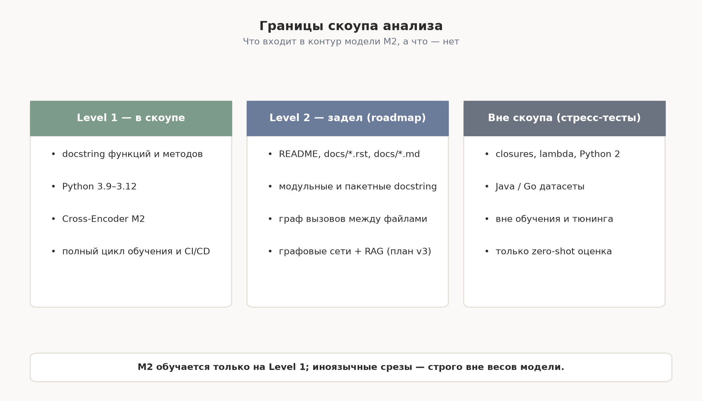

*Рисунок 2. Границы скоупа анализа (Level 1 / Level 2). Источник: [reports/figures/note/note_scope_levels.png](reports/figures/note/note_scope_levels.png).*

#### 1.3.2. Изоляция от генеративного автоисправления

В архитектуре FreshDoc принято фундаментальное разделение задач: контур системы проектируется строго как детерминированный, высокоточный дискриминативный сенсор дрейфа (*diagnostic and prioritization engine*), а не как система генеративного автопатчинга (*auto-patching / text generation*).

Инженерное обоснование отказа от автоматического переписывания docstring:
* **Риск внесения непроверенных галлюцинаций:** Современные генеративные авторегрессионные модели при генерации текста документации склонны к искажению доменных инвариантов, упущению граничных условий и описанию нереализованных побочных эффектов. Применение автогенерации в автоматическом режиме без участия человека ведет к скрытому засорению репозитория ложными контрактами.
* **Засорение истории системы контроля версий:** Массовые генеративные коммиты перегружают `git blame` и скрывают реальную историю авторства кода.
* **Эффект усталости от оповещений (Alert Fatigue):** Ошибочные синтетические исправления снижают доверие команд разработки к платформе статического анализа.
* **Роль сенсора в контуре ИИ-разработки:** Платформа FreshDoc поставляет для внешних потребителей (разработчиков, CI/CD-пайплайнов, автономных агентов) калиброванную вероятность устаревания `p_stale` $\in [0, 1]$, доказательный дифф и конкретный категориальный класс рассогласования `y_drift`, обеспечивая точечную приоритизацию задач без риска неконтролируемой модификации кодовой базы.

Зафиксированные границы определяют постановку задачи: глава 2 сопоставляет эти ограничения с существующими подходами и показывает необходимость динамического реестра.

---

## 2. Анализ предметной области и технологический обзор решений

### 2.1. Методы представления и анализа изменений программного кода

#### 2.1.1. Синтаксический анализ кода на базе AST и каноническая нормализация

Использование стандартных текстовых представлений изменений (*raw unified diff*) в задачах Code Intelligence вносит критический систематический шум. Текстовый построчный дифф реагирует на несущественные стилистические модификации: смену табуляций на пробелы, изменение длины строк форматировщиками (Black, Ruff, Flake8), удаление или добавление комментариев реализации (`# ...`), перестановку пустых строк. Обучение классификатора на сырых текстовых диффах формирует ложные корреляции (*spurious shortcuts*), при которых модель принимает решение на основе изменений отступов, а не семантики алгоритма.

Для устранения стилистического смещения в модуле [`src/data/normalizer.py`](src/data/normalizer.py) реализован конвейер синтаксической канонической нормализации:

1. **Разбор AST-дерева:** Функция [`parse_function_ast`](src/data/normalizer.py) (~L10-L21) применяет `textwrap.dedent` и `ast.parse`, извлекая целевой синтаксический узел `ast.FunctionDef` или `ast.AsyncFunctionDef`.
2. **Изолированная экстракция и удаление docstring:** Функция [`extract_docstring_and_clean_node`](src/data/normalizer.py) (~L24-L38) извлекает строковый литерал через `ast.get_docstring(fn_node, clean=True)`. Из тела AST-дерева (`cleaned_node.body`) удаляется первый узел, если он представляет собой строковое константное выражение `ast.Expr(value=ast.Constant(value=str))`. Если тело функции состояло исключительно из docstring, в него добавляется оператор-заглушка `ast.Pass()`.
3. **Обратная компиляция в канонический вид:** Функция [`normalize_code_from_node`](src/data/normalizer.py) (~L41-L42) выполняет компиляцию очищенного дерева обратно в исходный текст с помощью `ast.unparse`. В результате устраняются любые расхождения форматирования PEP 8, нормализуются кавычки, удаляются inline-комментарии, а структура кода приводится к детерминированному каноническому виду.

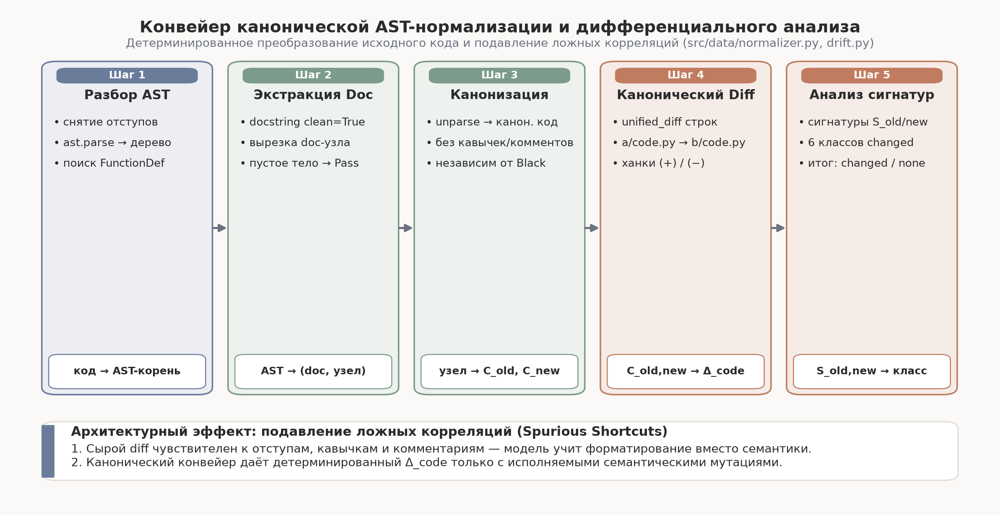

*Рисунок 3. Конвейер AST-нормализации. Источник: [reports/figures/note/note_ast_normalization.png](reports/figures/note/note_ast_normalization.png).*

#### 2.1.2. Дифференциальный анализ изменений и алгоритмический разбор сигнатур

На основе нормализованных версий:

$$C_{\text{old}} = \mathrm{unparse}(B_{\text{old}}^{\text{clean}}), \quad C_{\text{new}} = \mathrm{unparse}(B_{\text{new}}^{\text{clean}})$$

генерируется канонический unified diff с помощью функции [`compute_code_diff`](src/data/normalizer.py) (~L64-L72):

```python
Delta_code = compute_code_diff(C_old, C_new, fromfile="a/code.py", tofile="b/code.py")
```

или в аналитической форме:

$$\Delta_{\text{code}} = \mathrm{diff}(C_{\text{old}}, C_{\text{new}})$$

Для детерминированной фиксации структурных расхождений модуль [`src/data/drift.py`](src/data/drift.py) выполняет синтаксический разбор заголовков функций:

1. **Экстракция сигнатурных компонент ([`extract_signature`](src/data/drift.py) (~L33-L65)):**
   * Позиционные параметры: объединение `posonlyargs` и стандартных `args` с сопоставлением списка значений по умолчанию `defaults`.
   * Вариативные параметры: определение наличия и имен позиционного `*args` (`vararg`) и именованного `**kwargs` (`kwarg`).
   * Ключевые параметры: разбор `kwonlyargs` и соответствующих дефолтов `kw_defaults`.
   * Аннотация возвращаемого типа: десериализация узла `returns` через `ast.unparse`.
   * Возбуждаемые исключения: функция [`_get_raises`](src/data/drift.py) (~L7-L30) обходит синтаксическое поддерево тела функции стек-итератором (исключая внутренние объявления `ast.ClassDef`, `ast.FunctionDef`), фиксируя все операторы `ast.Raise` (включая повторные пробросы `re-raise`, идентификаторы `ast.Name`, вызовы конструкторов `ast.Call` и атрибуты `ast.Attribute`).

2. **Детектирование типов дрейфа ([`derive_drift_type`](src/data/drift.py) (~L68-L101)):**
   Сравнение словарей старой и новой сигнатур выполняется в строгом иерархическом порядке:
   * `param_renamed`: кардинальности удаленных и добавленных параметров равны ($|P(\text{del})| = |P(\text{add})| > 0$);
   * `param_removed`: удаление параметров ($|P_{\text{del}}| > 0$);
   * `param_added`: добавление параметров ($|P_{\text{add}}| > 0$);
   * `default_changed`: несовпадение строковых представлений значений по умолчанию для общих аргументов;
   * `return_changed`: несовпадение строкового представления `returns`;
   * `exception_changed`: несовпадение множеств собранных типов исключений;
   * `none`: отсутствие структурных модификаций в заголовке функции.

---

### 2.2. Архитектуры глубокого обучения для задач Code Intelligence

#### 2.2.1. Двунаправленные кодовые энкодеры (UniXcoder, CodeBERT, Jina-Code)

Энкодерные архитектуры семейства RoBERTa/BERT традиционно формируют базовый класс моделей в задачах семантического анализа исходного кода:

* **`microsoft/unixcoder-base` (125M параметров):** 12 слоев трансформера, размерность скрытого состояния $d = 768$, 12 голов самовнимания, словарь BPE на 51 416 токенов. Модель прошла многозадачное предобучение на корпусе CodeSearchNet и открытых репозиториях GitHub с использованием пяти целевых функций: маскированное языковое моделирование (MLM), генерация унимодального кода, предсказание связи код-комментарий и контрастивное выравнивание представлений с учетом линеаризованных деревьев AST. Штатный механизм агрегации последовательности через начальный токен `<s>` (`cls_rep`) демонстрирует стабильные разделяющие свойства. Ограничение: максимальная позиционная емкость матрицы абсолютных эмбеддингов зафиксирована на отметке 1026 токенов.
* **`microsoft/codebert-base` (125M параметров):** Двунаправленный энкодер на базе RoBERTa, обученный на бимодальных данных (NL-PL) с маскированием токенов и детекцией замененных токенов (RTD). Жесткое аппаратное позиционное ограничение матрицы эмбеддингов составляет 514 токенов (эффективное окно 512 токенов), что приводит к усечению 28.6% примеров корпуса FreshDoc.
* **`jinaai/jina-embeddings-v2-base-code` (161M параметров):** Архитектура BERT с интеграцией линейных позиционных смещений ALiBi (Attention with Linear Biases), снимающих ограничение на длину входа и обеспечивающих экстраполяцию контекста до 8192 токенов. Лицензия Apache 2.0.

Ключевым системным недостатком классических моделей поколения CodeBERT/UniXcoder является использование абсолютных позиционных эмбеддингов, исключающих нативную экстраполяцию длины последовательности, а также квадратичный рост вычислительной сложности механизма самовнимания $\mathcal{O}(L^2)$ без поддержки аппаратно-оптимизированных ядер.

#### 2.2.2. Современные длинноконтекстные Masked LM и Bi-Encoder модели (ModernBERT, GTE, Granite)

Поколение трансформерных энкодеров 2024–2025 годов привнесло комплекс фундаментальных улучшений в архитектуру Masked LM:

* **`answerdotai/ModernBERT-base` (149M параметров):**
  * Вращающиеся позиционные эмбеддинги (*Rotary Position Embeddings, RoPE*): замена аддитивных позиционных эмбеддингов на умножение векторов ключей и запросов на ортогональные матрицы поворота. Обеспечивает нативную обработку последовательностей длиной до 8192 токенов.
  * Активационные функции GeGLU (*Gated Linear Units*): повышение выразительной емкости сети при фиксированном числе слоев.
  * Аппаратные оптимизации: нативная интеграция FlashAttention-2 и PyTorch Scaled Dot-Product Attention (SDPA), а также техника эффективного распада паддингов (*unpadding*), исключающая вычисления над токенами заполнения в батчах переменной длины.
* **`Alibaba-NLP/gte-modernbert-base` (149M параметров):**
  * Бэкбон ModernBERT, прошедший многоэтапный контрастивный претрейн на масштабных корпусах семантической релевантности и парного выравнивания (GTE/mGTE корпуса). Демонстрирует повышенную чувствительность к выявлению мелких несоответствий в парах текст-контекст.
* **Семейство `ibm-granite/granite-embedding-*` (48M small, 149M english-r2, 312M multilingual):**
  * Энкодеры на архитектуре ModernBERT, предобученные на массивах технической документации и открытого кода под лицензией Apache 2.0. Версия 48M служит сверхбыстрым smoke-тестом DDP-инфраструктуры (время эпохи 2–3 мин на Kaggle 2×T4).

#### 2.2.3. Каузальные авторегрессионные декодеры (Qwen2.5-Coder, Granite-4.0, DeepSeek)

В рамках технологического анализа оценены перспективы адаптации современных авторегрессионных генеративных моделей класса Causal LM: `ibm-granite/granite-4.0-350m` (352M), `Qwen/Qwen2.5-Coder-0.5B` (494M), `Qwen/Qwen2.5-Coder-1.5B` (1.54B), `01-ai/Yi-Coder-1.5B` (1.48B) и `DeepSeek-Coder-V2-Lite` (MoE 16B / 2.4B active).

Теоретические и вычислительные ограничения каузальных декодеров в задачах парной дискриминации:
1. **Асимметрия внимания (Causal Attention Mask):**
   В декодерах матрица маскирования внимания является нижнетреугольной: токен $i$ имеет доступ к токенам $j \le i$. При конкатенации входа `[A = sig + diff; B = doc]` токены модификации кода ($A$) принципиально не могут взаимодействовать с токенами целевой документации ($B$). Прямое внимание идет строго от docstring к коду, но обратное выравнивание контекста отсутствует.
2. **Пулинг представлений:**
   Нулевой токен последовательности в Causal LM не агрегирует информацию о последующем контексте. Пулинг вынужденно переносится на последний валидный непаддинговый токен (*Last Non-Pad Pooling*), что делает агрегацию чувствительной к длине хвоста паддинга.
3. **Вычислительная неэффективность:**
   Вычисление дискриминативного лосса на базе авторегрессионной модели требует сохранения полного графа активаций тяжелых полносвязных слоев. Для модели 1.5B в режиме LoRA FP16 время обучения одной эпохи на Kaggle 2×T4 составляет 30–45 минут против 8–11 минут у энкодера 149M в режиме Full Fine-Tuning.

#### 2.2.4. Сравнительный анализ парадигм Bi-Encoder и Cross-Encoder

Для задачи детекции рассогласования документации принципиален выбор архитектурной парадигмы объединения модальностей кода и текста (табл. 2.5):

*Таблица 2.5. Сопоставление парадигм Bi-Encoder и Cross-Encoder.*

| Критерий сопоставления | Парадигма Bi-Encoder (Dual Encoder) | Парадигма Cross-Encoder (Full Interaction) |
|---|---|---|
| **Схема обработки входа** | Независимое кодирование: $\mathbf{u} = E^{\text{code}}(A)$, $\mathbf{v} = E^{\text{doc}}(B)$ | Совместное кодирование: $\mathbf{h} = E^{\text{joint}}(A \circ B)$ |
| **Вычислительная сложность инференса** | $\mathcal{O}(n^2 + m^2)$ (для длин $n, m$), возможность предварительного индексирования векторов | $\mathcal{O}((n + m)^2)$, квадратичный рост от суммарной длины |
| **Механизм взаимодействия токенов** | Отсутствует. Взаимодействие редуцировано до скалярного произведения $\mathbf{u}^T \mathbf{v}$ | Полное попарное самовнимание между всеми токенами кода и docstring |
| **Информационная компрессия** | «Бутылочное горлышко» вектора фиксированной размерности ($d = 768$) | Отсутствует: каждый токен docstring напрямую сопоставляется с токеном diff |
| **Чувствительность к точечным мутациям** | **Критически низкая:** изменение имени одного аргумента или дефолта нивелируется пулингом 768 чисел | **Максимальная:** веса внимания слоя напрямую фокусируются на расходящихся токенах |
| **Вердикт для проекта FreshDoc** | **Неприменимо** для классификации тонкого семантического дрейфа | **Основной архитектурный стандарт** (Dual-Head Cross-Encoder) |

Теоретическое обоснование превосходства Cross-Encoder: точечный дрейф контракта (например, замена аргумента `timeout` на `deadline` или смена дефолта `None` на `0`) вносит микроскопические изменения в интегральный эмбеддинг функции в пространстве Bi-Encoder. Косинусное сходство между векторами кода и неизмененного docstring остается в диапазоне $0.92\text{--}0.98$, делая классификационный порог неработоспособным. В архитектуре Cross-Encoder механизм Scaled Dot-Product Attention:

$$\text{Attention}(Q, K, V) = \text{Softmax}\left(\frac{Q K^T}{\sqrt{d_k}}\right) V$$

формирует кросс-матрицу размерности $(|A| + |B|) \times (|A| + |B|)$, где строки, соответствующие токенам параметров docstring, получают прямые высокие градиентные веса на измененных строках диффа кода со знаками `+` и `-`.

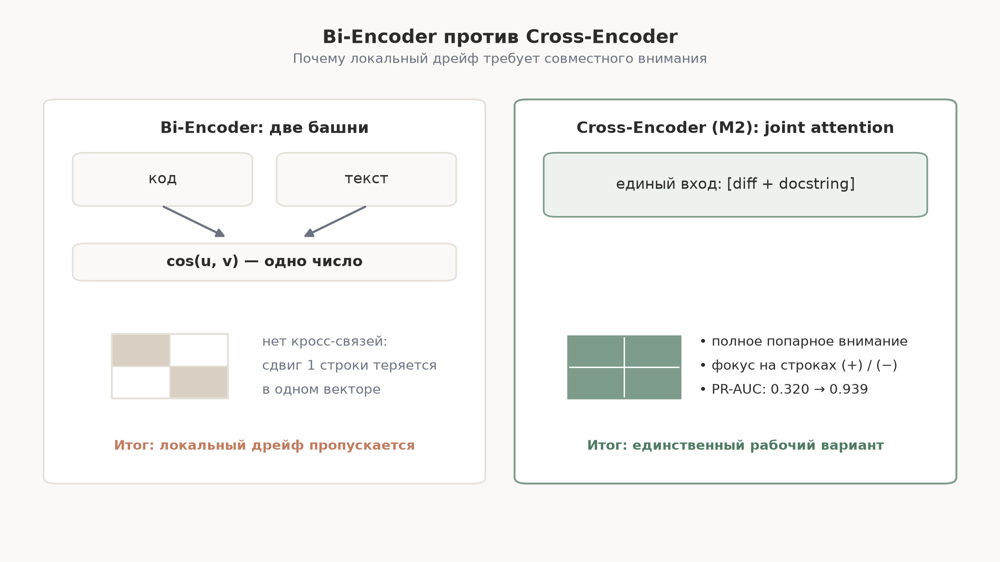

*Рисунок 4. Bi-Encoder против Cross-Encoder. Источник: [reports/figures/note/note_bi_vs_cross.png](reports/figures/note/note_bi_vs_cross.png).*

#### 2.2.5. Сводная Master-матрица исследования моделей-кандидатов

В рамках масштабного аналитического исследования открытых моделей ([`reports/deep_model_research.md`](reports/deep_model_research.md)) проведен аудит 18 предобученных моделей-кандидатов и 6 специализированных архитектур по спецификациям конфигураций Hugging Face (`config.json`, `safetensors`), реестру `llm-checker` и эмпирическим замерам sustained-производительности.

**Аппаратные ограничения целевого вычислительного контура (2× Tesla T4 16 ГБ):**
* **Вычислительная мощность FP16:** 65 TFLOPS на карту (130 TFLOPS на пару), sustained MFU для PyTorch SDPA составляет 25–35% (35–45 sustained TFLOPS).
* **Отсутствие аппаратной поддержки `bfloat16`:** Архитектура Turing (SM 7.5) не поддерживает инструкции `bfloat16`. Программная эмуляция через FP32 дает деградацию скорости в 5–10 раз. Допустим исключительно режим FP16 mixed precision (`torch.cuda.amp.autocast(dtype=torch.float16)`).
* **Отсутствие поддержки FlashAttention-2:** Требует архитектуры Ampere (SM 8.0+). Используется нативный PyTorch SDPA (`math` или `mem_efficient`) либо xFormers.
* **Шина DDP over PCIe 3.0:** Allreduce-синхронизация градиентов без NVLink ограничивает коэффициент ускорения от второй карты до 1.6–1.7× (для моделей >1B падает до ~1.4×).
* **Полезный объем VRAM:** Не более 14.5–15.0 ГБ из 16 ГБ физической памяти на карту с учетом резерва контекста CUDA (~1.2 ГБ), фрагментации PyTorch allocators ($\times 1.15$) и буферов DataLoader.
* **Gradient Checkpointing:** Снижает пиковое потребление памяти активаций в 3.0–3.5 раза ценой +30% вычислительных накладных расходов FLOPs. Обязателен при контексте $\ge 2048$ токенов для моделей от 149M параметров и при любом контексте для декодеров.

**Методология аналитического расчета потребления памяти и времени:**
1. **Статическая память модели в режиме FP16 Mixed AdamW (16 байт на параметр):**
   * 48M (`Granite-48M`): $0.048\text{B} \times 16 = \mathbf{0.77\text{ ГБ}}$;
   * 125M (`UniXcoder`): $0.125\text{B} \times 16 = \mathbf{2.00\text{ ГБ}}$;
   * 149M (`ModernBERT`, `GTE-ModernBERT`): $0.149\text{B} \times 16 = \mathbf{2.38\text{ ГБ}}$;
   * 352M (`Granite-4.0-350m`): $0.352\text{B} \times 16 = \mathbf{5.63\text{ ГБ}}$ (Full Fine-Tuning возможен на 16 ГБ);
   * 494M (`Qwen2.5-Coder-0.5B`): $0.494\text{B} \times 16 = \mathbf{7.90\text{ ГБ}}$ (Full Fine-Tuning на грани OOM с учетом активаций);
   * 1.54B (`Qwen2.5-Coder-1.5B`): $1.54\text{B} \times 16 = \mathbf{24.64\text{ ГБ}}$ (Full Fine-Tuning физически невозможен на 16 ГБ, допустим исключительно режим LoRA).
2. **Время обучения:**
   Обучающий массив из 22 000 примеров при эффективном размере батча 32 (8/GPU × 2 GPU × accum 2) формирует 688 шагов на одну эпоху. При sustained MFU 25–35%:
   * Модель 149M при окне 1024 токена: $\approx 29.3\text{ TFLOP/шаг} \to 0.7\text{--}1.0\text{ с/шаг} \to \mathbf{8\text{--}11\text{ минут на эпоху}}$;
   * Модель 149M при окне 2048 токенов (с Gradient Checkpointing): $\approx 1.2\text{--}1.6\text{ с/шаг} \to \mathbf{14\text{--}18\text{ минут на эпоху}}$;
   * Модель 1.5B LoRA FP16 при окне 1024 токена: $\approx 2.6\text{--}3.8\text{ с/шаг} \to \mathbf{30\text{--}45\text{ минут на эпоху}}$.

##### Основной трек: Cross-Encoder DualHead (Двунаправленные энкодеры)

*Таблица 2.1. Основной трек — идентификация моделей: архитектура и контекст.*

| Модель | Параметры (точно) | Архитектура и токенизатор | Контекст (макс/цель) |
|---|---|---|---|
| **`Alibaba-NLP/gte-modernbert-base`** (и **`gte-reranker-modernbert-base`**) | **149 014 272** (149M; reranker: 149.6M) | `ModernBertModel` / `ModernBertForSequenceClassification` (RoPE, GeGLU, vocab 50k, safetensors) | 8192 / **2048** (0.7% trunc) |
| **`answerdotai/ModernBERT-base`** | 149 655 232 (149M) | `ModernBertForMaskedLM` (RoPE, GeGLU, vocab 50k) | 8192 / **2048** (0.7% trunc) |
| **`microsoft/unixcoder-base`** | ~125M | `RobertaModel` (BPE, vocab 51k, `pytorch_model.bin`) | 1026 / **1024** (4.4% trunc) |
| **`ibm-granite/granite-embedding-english-r2`** | 149 014 272 (149M) | `ModernBertModel` (RoPE, GeGLU, vocab 50k) | 8192 / **2048** |
| **`jinaai/jina-embeddings-v2-base-code`** | 160 869 120 (161M) | `JinaBertForMaskedLM` (BERT + ALiBi, vocab 61k) | 8192 / **2048** |
| `jinaai/jina-embeddings-v2-base-en` | 137 368 320 (137M) | `JinaBertForMaskedLM` (BERT + ALiBi, vocab 30k) | 8192 / **2048** |
| `ibm-granite/granite-embedding-small-english-r2` | 47 662 464 (48M) | `ModernBertModel` (RoPE, hidden 384, layers 12) | 8192 / 2048 |
| `nomic-ai/modernbert-embed-base` | 149 014 272 (149M) | `ModernBertModel` (RoPE, GeGLU) | 8192 / 2048 |
| `ibm-granite/granite-embedding-311m-multilingual-r2` | 311 664 384 (312M) | `ModernBertModel` (vocab 262k) | **32 768** / 2048 |
| `answerdotai/ModernBERT-large` | 395M | `ModernBertModel` (RoPE, GeGLU) | 8192 / 2048 |
| `microsoft/codebert-base` | 125M | `RobertaModel` | 512 (**28.6% trunc**) |
| `microsoft/codereviewer` | 220M | T5 Seq2Seq (Diff-tokens) | 512 (ext 1024) |

*Таблица 2.2. Основной трек — экономика обучения на 2×T4 и статус в проекте.*

| Модель | Режим на 2× T4 | VRAM (пик на карту) | Время 1 эпохи (22k) | Лицензия | Вердикт и статус в проекте |
|---|---|---|---|---|---|
| **`Alibaba-NLP/gte-modernbert-base`** | **Full FT FP16** (+GC на 2048) | ~5.5–6.5 ГБ @1024; ~9–12 ГБ @2048 | **~8–11 мин @1024; ~14–18 мин @2048** | **Apache-2.0** | ТОП-1 (Целевой бэкбон M2 v2). Парный претрейн GTE/mGTE, COIR 79.3/80.0; бэкбон под DualHead Cross-Encoder. |
| **`answerdotai/ModernBERT-base`** | Full FT FP16 (+GC на 2048) | ~5.5–6.5 ГБ @1024; ~9–12 ГБ @2048 | ~8–11 мин @1024; ~14–18 мин @2048 | Apache-2.0 | ТОП-2 (Факториальный контроль M2 v2). Чистый Masked LM бейзлайн для оценки вклада контекста. |
| **`microsoft/unixcoder-base`** | Full FT FP16 | ~4.5–5.5 ГБ | **~6–8 мин** | Apache-2.0 | ТОП-3 (Бейзлайн M2 v1). Стабильный кодовый энкодер, штатный CLS-пулинг. |
| **`ibm-granite/granite-embedding-english-r2`** | Full FT FP16 | ~5.5–6.5 ГБ | ~8–11 мин | Apache-2.0 | ТОП-4 (Резерв ModernBERT). |
| **`jinaai/jina-embeddings-v2-base-code`** | Full FT FP16 | ~5.5–6.5 ГБ | ~8–10 мин | Apache-2.0 | ТОП-5 (Длинный fallback, ALiBi). |
| `jinaai/jina-embeddings-v2-base-en` | Full FT FP16 | ~4.5–5.5 ГБ | ~7–9 мин | Apache-2.0 | Общий резерв ALiBi. |
| `ibm-granite/granite-embedding-small-english-r2` | Full FT FP16 | ~2.5–3.5 ГБ | **~2–3 мин** | Apache-2.0 | ТОП-6 (Инфраструктурный контроль, smoke-тест DDP). |
| `nomic-ai/modernbert-embed-base` | Full FT FP16 | ~5.5–6.5 ГБ | ~8–11 мин | Apache-2.0 | Аналог GTE-ModernBERT. |
| `ibm-granite/granite-embedding-311m-multilingual-r2` | Full FT FP16 + GC | ~10–12 ГБ | ~15–20 мин | Apache-2.0 | Резерв сверхдлинного контекста. |
| `answerdotai/ModernBERT-large` | Full FT FP16 + GC | ~11–13 ГБ | ~18–24 мин | Apache-2.0 | Резерв емкости (если 149M упрутся в потолок). |
| `microsoft/codebert-base` | Full FT FP16 | ~3.5–4.5 ГБ | ~3–4 мин | MIT | Устаревший: усечение 28.6%. |
| `microsoft/codereviewer` | Full FT (Enc) / LoRA | ~7.0–8.5 ГБ | ~12–16 мин | Apache-2.0 | Только как feature-extractor. |

##### Факультативный трек: Causal Decoder & Hybrid Models

Causal-декодеры обладают структурной асимметрией внимания: нижнетреугольная маска не позволяет токенам кода взаимодействовать с токенами последующей документации в обратном направлении. Инференс и обучение авторегрессионных моделей в 3–5 раз медленнее двунаправленных энкодеров.

*Таблица 2.3. Факультативный трек — идентификация моделей.*

| Модель | Параметры (точно) | Архитектура и токенизатор | Контекст (макс/цель) |
|---|---|---|---|
| **`ibm-granite/granite-4.0-350m`** | **352 379 904** (352M) | `GraniteMoeHybridForCausalLM` (dense attention-only, `num_local_experts: 0`) | 32 768 / **1024** |
| **`Qwen/Qwen2.5-Coder-1.5B`** | 1 543 714 304 (1.54B) | `Qwen2ForCausalLM` | 32 768 / **1024** |
| `01-ai/Yi-Coder-1.5B` | 1 476 495 360 (1.48B) | `LlamaForCausalLM` | 131 072 / **1024** |
| `infly/OpenCoder-1.5B-Instruct` | 1 905 650 880 (1.91B) | `LlamaForCausalLM` | 4096 / **1024** |
| `Qwen/Qwen2.5-Coder-0.5B` | 494 032 768 (494M) | `Qwen2ForCausalLM` | 32 768 / **1024** |
| `BAAI/bge-code-v1` | 1 543 301 120 (1.54B) | `Qwen2Model` | 32 768 / **1024** |

*Таблица 2.4. Факультативный трек — экономика и статус.*

| Модель | Режим на 2× T4 | VRAM (пик на карту) | Время 1 эпохи | Лицензия | Вердикт и статус в проекте |
|---|---|---|---|---|---|
| **`ibm-granite/granite-4.0-350m`** | **Full FT FP16 + GC** | **~8.0–9.5 ГБ** (@1024) | **~9–12 мин** (@1024) | Apache-2.0* | ТОП-7 (Приоритетный каузальный кандидат, dense, без OOM при L=1024). |
| **`Qwen/Qwen2.5-Coder-1.5B`** | LoRA FP16 ($r=16$) | ~8.5–10.0 ГБ | **~30–45 мин** | Apache-2.0 | ТОП-8 (Базовый семантический декодер, предел каузальных в LoRA). |
| `01-ai/Yi-Coder-1.5B` | LoRA FP16 ($r=16$) | ~8.5–10.0 ГБ | ~30–45 мин | Apache-2.0 | Альтернатива Qwen 1.5B (HumanEval 67.7% Chat / 41.5% Base). |
| `infly/OpenCoder-1.5B-Instruct` | LoRA FP16 ($r=16$) | ~8.5–10.0 ГБ | ~30–45 мин | INF Custom (revocable, PRC) | Топ-1 BigCodeBench ($\le 1.5$B); желтый статус (суды Шанхая). |
| `Qwen/Qwen2.5-Coder-0.5B` | LoRA FP16 / Full FT 8-bit Adam | ~10–12 ГБ | ~16–22 мин | Apache-2.0 | Контрольная модель, риск OOM при Full FT без квантования. |
| `BAAI/bge-code-v1` | LoRA FP16 | ~8.5–10.0 ГБ | ~30–45 мин | Apache-2.0 | Избыточен для эмбеддингов на T4. |

##### Трек дисквалифицированных моделей

*Таблица 2.6. Дисквалифицированные модели-кандидаты и причины исключения.*

| Модель | Параметры | Причина дисквалификации |
|---|---|---|
| `Qwen/Qwen2.5-Coder-3B` | 3.09B | Несвободная лицензия `Qwen Research License` (в отличие от 0.5B/1.5B/7B, версия 3B запрещена к промышленной коммерческой эксплуатации) + двукратный рост вычислительных затрат по сравнению с 1.5B. |
| `jinaai/jina-embeddings-v3` | 572M | Лицензия `CC-BY-NC-4.0` (прямой запрет коммерческого использования) + избыточный размер для энкодера на T4. |
| `Qwen/Qwen2.5-Coder-7B` | 7.61B | Программная эмуляция QLoRA INT4 на архитектуре Turing (отсутствие аппаратных ядер INT4) приводит к задержке >60 мин/эпоха и исчерпанию недельной квоты GPU. |
| `DeepSeek-Coder-V2-Lite` | 16B (2.4B active) | Архитектура Multi-Head Latent Attention (MLA) вызывает сбои аллокации CUDA и OOM на драйверах Turing 16 ГБ без поддержки FlashAttention-2. |
| `microsoft/graphcodebert-base` | 125M | Аппаратное ограничение длины в 512 токенов (28.6% потерь) + поломка синтаксического графа потока данных (dataflow graph) на символах модификаций git-диффа (`+`/`-`). |
| `allenai/longformer-base-4096` | 149M | Локальное скользящее внимание (sliding-window attention): токены docstring не взаимодействуют с токенами диффа через локальные окна без глобального внимания, что разрушает механизм полного кросс-внимания Cross-Encoder. |

**Архитектурный норматив классификатора DualHead:**
* **Пулинг для энкодеров:** Штатный токен `[CLS]` (нулевой вектор $\mathbf{h}_0$).
* **Пулинг для каузальных декодеров:** Последний валидный непаддинговый токен последовательности (*Last Non-Pad Pooling*), поскольку при треугольной маске внимания полный receptive field охватывает только финальный токен.
* **Функция потерь (Masked Conditional Loss):**

$$\mathcal{L}_{\text{total}} = \mathcal{L}_{\text{BCE}}(z_{\text{stale}}, y_{\text{stale}}) + 0.6 \cdot \mathbb{I}(y_{\text{stale}} = 1 \land y_{\text{drift}} \ne \text{unknown}) \cdot \mathcal{L}_{\text{CE}}(\mathbf{z}_{\text{drift}}, \mathbf{y}_{\text{drift}})$$

  где целевая переменная дрейфа маскируется значением `ignore_index = -100` для примеров с `y_stale == 0` и строк с неразмеченным классом дрейфа. Коэффициент многозадачности строго зафиксирован на уровне $\lambda = 0.6$.
* **Гейт инференса:** При `p_stale` $\le \tau$ система возвращает вердикт актуальности `stale = 0, drift_type = None`, исключая опрос классификационной головы типов рассогласования.
* **Метрика типирования дрейфа:** Macro-F1 второй головы оценивается строго на подвыборке истинного рассинхрона с известным классом (`y_stale == 1` и `y_drift != "unknown"`).

---

### 2.3. Правовой аудит открытых кодовых моделей и лицензионные ограничения

#### 2.3.1. Анализ типов открытых лицензий чекпоинтов (Apache 2.0, MIT, Qwen Research, CC-BY-NC)

В соответствии с требованиями промышленной интеграции проведен правовой аудит весов предобученных моделей-кандидатов ([`reports/deep_model_research.md`](reports/deep_model_research.md)):

1. **Безусловно разрешительные открытые лицензии (Permissive Open Source: Apache 2.0, MIT):**
   * Предоставляют безотзывное право на коммерческое использование, модификацию, сублицензирование и распространение производных весов без обязательного раскрытия исходного кода закрытых систем.
   * Чекпоинты: `microsoft/unixcoder-base` (Apache 2.0), `answerdotai/ModernBERT-base` (Apache 2.0), `Alibaba-NLP/gte-modernbert-base` (Apache 2.0), `ibm-granite/*` (Apache 2.0), `microsoft/codebert-base` (MIT).
2. **Ограниченные исследовательские лицензии (Restricted Research Licenses):**
   * Модель `Qwen/Qwen2.5-Coder-3B` выпущена под специализированной `Qwen Research License` (в отличие от версий 0.5B, 1.5B и 7B, распространяемых под Apache 2.0). Лицензия накладывает прямой запрет на промышленную эксплуатацию и коммерциализацию без индивидуального разрешения правообладателя.
3. **Некоммерческий копилефт (Non-Commercial Copyleft):**
   * Модель `jinaai/jina-embeddings-v3` (572M) распространяется под лицензией Creative Commons Attribution-NonCommercial 4.0 International (`CC-BY-NC-4.0`). Полный запрет на коммерческое использование в продуктовых контурах.
4. **Лицензии с территориально-специфической юрисдикцией:**
   * Модель `infly/OpenCoder-1.5B-Instruct` снабжена проприетарной `INF Custom License`, содержащей условия об отзывности прав при нарушении локальных актов КНР и фиксирующей исключительную подсудность судам города Шанхая.

#### 2.3.2. Дисквалификация ограниченных моделей и фиксация production-стека

На основе матрицы лицензионных и аппаратных рисков сформирован утвержденный production-стек моделей:

1. **Базовый бейзлайн (M2 v1):** `microsoft/unixcoder-base` (125M, Apache 2.0, контекст 1024 токена, стабильный чисто кодовый энкодер).
2. **Целевой масштабируемый бэкбон (M2 v2):** `Alibaba-NLP/gte-modernbert-base` / `answerdotai/ModernBERT-base` (149M, Apache 2.0, нативный контекст до 8192 токенов, RoPE, GeGLU, полная юридическая чистота для корпоративного контура).
3. **Вычислительный резерв:** `ibm-granite/granite-embedding-english-r2` (149M, Apache 2.0) и `jinaai/jina-embeddings-v2-base-code` (161M, Apache 2.0, fallback вне архитектуры ModernBERT).

---

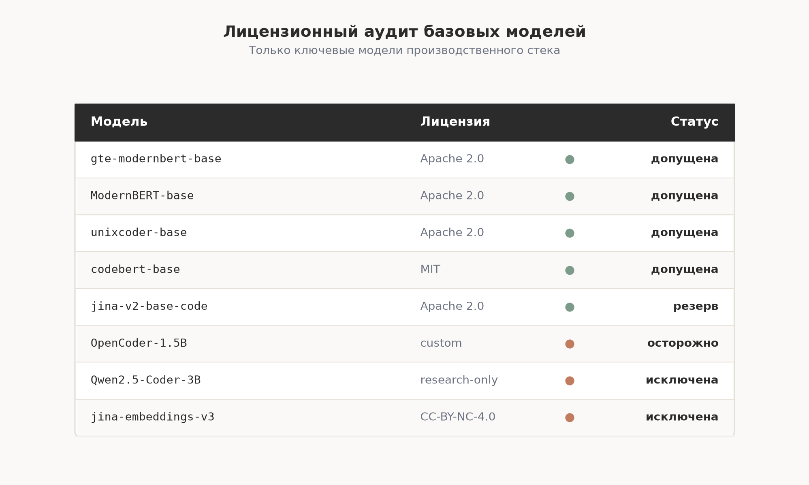

*Рисунок 5. Матрица лицензионного аудита моделей. Источник: [reports/figures/note/note_license_matrix.png](reports/figures/note/note_license_matrix.png).*

### 2.4. Существующие открытые наборы данных

#### 2.4.1. Анализ бенчмарка CoDocBench: структура, связность и скрытые дефекты

Бенчмарк CoDocBench (Python-подмножество) представляет собой открытый корпус пар изменений исходного кода и сопутствующего обновления комментариев, насчитывающий 4 573 сырые записи. В рамках аудита исходного набора данных был проанализирован ровно 201 репозиторий-кандидат, из которых 181 валидный репозиторий был отобран после строгой фильтрации по лицензиям и структуре коммитов.

В ходе предварительного аудита данных конвейером адаптации [`src/data/codocbench_adapter.py`](src/data/codocbench_adapter.py) и [`scripts/build_codocbench_pairs.py`](scripts/build_codocbench_pairs.py) был выявлен критический методологический дефект исходного бенчмарка:
* **Межсплитовая утечка репозиториев (*Cross-split Project Leakage*):** функции проекта `manim` присутствовали одновременно в обучающей (`train.jsonl`) и тестовой (`test.jsonl`) выборках исходного датасета. Обучение классификатора в условиях пересечения репозиториев приводит к эффекту запоминания специфических библиотечных терминов и искусственному завышению метрик валидации.
* **Процедура санации распределения:** скрипт адаптера принудительно выявил пересечение $P(\text{train}) \cap P(\text{test}) = \{\texttt{"manim"}\}$ и осуществил перенос всех записей репозитория `manim` целиком в тестовый пул (`test_pool`), восстановив строгую изоляцию проектов: пулов train и test: $P(\text{train}) \cap P(\text{test}) = \emptyset$ с последующим разбиением 181 валидного репозитория на 91 train и 90 test репозиториев.

Дополнительно в конвейере CoDocBench реализованы детерминированные фильтры качества согласно спецификации требований к данным:
* Исключение внутренних и приватных функций с ведущим символом подчеркивания `fn.name.startswith("_")`.
* Порог минимальной длины docstring: `len(doc_old) >= 40` символов (отсечение заглушек вида `"TODO"`, `"pass"`).
* Диапазон суммарного объема функции: от 4 до 300 строк кода.
* Полная изоляция полей утечки: целевые поля новой ревизии (`doc_new`, `code_new`, коммит-сообщения) инкапсулированы в служебное пространство имен `_leak_*` с блокировкой доступа к ним в модулях обучения нейросети.

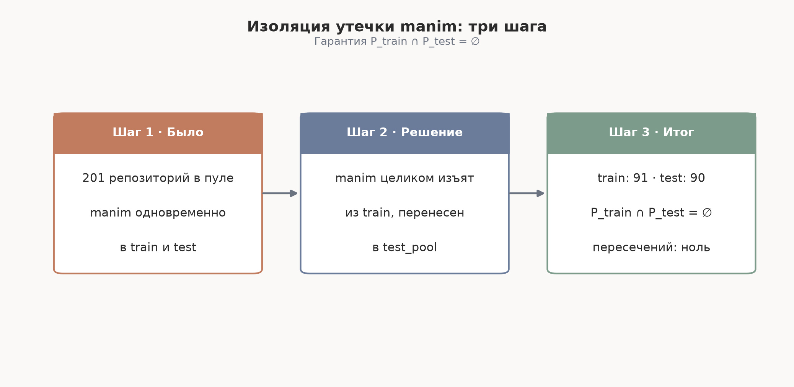

*Рисунок 6. Изоляция утечки manim. Источник: [reports/figures/note/note_manim_isolation.png](reports/figures/note/note_manim_isolation.png).*

#### 2.4.2. Обзор исследовательских бенчмарков на других языках (CUP, HebCup, Panthaplackel JIT, CoCC)

В академической литературе представлен ряд специализированных корпусов для анализа актуальности комментариев:
* **CUP и HebCup (Java):** Бенчмарки сопоставления коммитов в Java-проектах, отслеживающие изменения тел методов и соответствующих блоков Javadoc. Ограничения: жесткая привязка к синтаксическим конструкциям Java, отсутствие детализированной разметки типов дрейфа (бинарный таргет), полное отсутствие синтетических негативных пар эквивалентного рефакторинга.
* **Panthaplackel JIT (Just-In-Time Code-Doc Synchronization, Java):** Датасет для предсказания необходимости обновления комментариев в момент фиксации коммита. Фокусируется на строках внутри методов, не дифференцируя контрактные спецификации API от пояснительных комментариев реализации.
* **CoCC (Code-Comment Co-evolution, Python 2):** Собрана на базе устаревшего синтаксиса Python 2.x, не содержит аннотаций типов, несовместима с современным парсером AST Python 3.9+ и стандартами PEP 563/604.

Все существующие открытые бенчмарки обладают фатальным методологическим недостатком: они не моделируют ситуацию глубокого семантического дрейфа при неизменной сигнатуре (`sig_same`) и не содержат контрольных отрицательных примеров сложного синтаксического рефакторинга. В архитектуре FreshDoc внешние корпуса (HebCup, CoCC, Go-датасет) позиционируются исключительно как изолированные выборки для оценки обобщающей способности обученных бэкбонов в рамках внешнего стресс-тестирования кросс-языковой генерализации.

Проведённый обзор открытых наборов обосновывает выбор CoDocBench и необходимость собственной инженерии данных, описанной далее.

---

## 3. Математическая постановка задачи и методология оценки

### 3.1. Формализация задачи парной классификации и детекции дрейфа

#### 3.1.1. Пространство входных признаков и целевых переменных

Задача детекции дрейфа формулируется как многозадачная дискриминативная классификация структурированных троек. 

Пространство входных объектов:

$$\mathcal{X} = \{ \mathbf{x} = (\text{sig}_{\text{old}}, \Delta_{\text{code}}, \text{doc}_{\text{old}}) \}$$

где:
* $\text{sig}_{\text{old}} \in \mathcal{S}$ — строка канонической сигнатуры функции до изменения (извлеченная через AST и нормализованная);
* $\Delta_{\text{code}} \in \mathcal{D}$ — приоритизированный unified diff синтаксического тела функции, очищенного от docstring;
* $\text{doc}_{\text{old}} \in \mathcal{T}$ — исходный строковый литерал docstring до внесения изменений.

Пространство целевых меток состоит из двух компонент:
1. **Бинарная целевая переменная актуальности:**

$$y_{\text{stale}} \in \{0, 1\}$$

   где `y_stale = 1` фиксирует факт устаревания docstring (требуется обновление спецификации), а `y_stale = 0` фиксирует актуальность документации (включая ситуации глубокого рефакторинга реализации, не нарушающего декларируемый контракт).
2. **Категориальная целевая переменная типа рассогласования:** $\mathbf{y}_{\text{drift}} \in \mathcal{C}$, где множество классов $|\mathcal{C}| = 8$ строго зафиксировано архитектурным нормативом:

```text
C = {param_renamed, param_removed, param_added, default_changed, return_changed, exception_changed, behavior_changed, unknown}
```

   Класс `none` (отсутствие дрейфа) в пространстве классификационной головы отсутствует. Состояние синхронизации обслуживается калиброванным вероятностным гейтом первой головы (`p_stale` $\le \tau$). Класс `unknown` является служебным резервом без супервизии (используется для декодирования инференса при отсутствии разметки).

#### 3.1.2. Математическая формулировка многозадачной функции потерь (Masked Multi-Task Loss)

Архитектура классификатора формирует вектор скрытого представления последовательности $\mathbf{h}_{\text{pooled}} \in \mathbb{R}^d$ ($d = 768$), который поступает на две параллельные линейные проекционные головы:
* **Бинарный логит первой головы** (формирующий апостериорную вероятность `p_stale`):

$$z_{\text{stale}} = \mathbf{w}_s^T \mathbf{h}_{\text{pooled}} + b_s \in \mathbb{R}^1, \quad p_{\text{stale}} = \sigma(z_{\text{stale}})$$

* **Вектор логитов второй головы**:

$$\mathbf{z}_{\text{drift}} = \mathbf{W}_d \mathbf{h}_{\text{pooled}} + \mathbf{b}_d \in \mathbb{R}^8$$

Обучение выполняется с использованием составной функции потерь с динамическим маскированием градиентов (*Masked Multi-Task Loss*):

$$\mathcal{L}_{\text{total}} = \mathcal{L}_{\text{BCE}}(z_{\text{stale}}, y_{\text{stale}}) + \lambda \cdot \mathbb{I}(y_{\text{stale}} = 1 \land y_{\text{drift}} \ne \text{unknown}) \cdot \mathcal{L}_{\text{CE}}(\mathbf{z}_{\text{drift}}, y_{\text{drift}})$$

Развернутая форма компонент:
1. **Бинарная кросс-энтропия с логитами:**

$$\mathcal{L}_{\text{BCE}}(z_{\text{stale}}, y_{\text{stale}}) = - \left[ y_{\text{stale}} \log \sigma(z_{\text{stale}}) + (1 - y_{\text{stale}}) \log (1 - \sigma(z_{\text{stale}})) \right]$$

2. **Маскированная мультиклассовая кросс-энтропия:**

$$\mathcal{L}_{\text{CE}}(\mathbf{z}_{\text{drift}}, y_{\text{drift}}) = - \sum_{c=1}^8 \mathbb{I}(y_{\text{drift}} = c) \log \frac{\exp(z_{\text{drift}, c})}{\sum_{j=1}^8 \exp(z_{\text{drift}, j})}$$

Математические свойства маскирования (`ignore_index = -100` в [`src/models/m2_model.py`](src/models/m2_model.py)):
* Если пример является отрицательным (`y_stale == 0`) либо метка типа дрейфа не определена (`y_drift == "unknown"`), целевой индекс дрейфа принудительно заменяется на константу `-100`.
* Вторая голова полностью отключается от градиентного шага:

$$\frac{\partial \mathcal{L}_{\text{CE}}}{\partial \mathbf{z}_{\text{drift}}} = \mathbf{0}$$

Это исключает деструктивную интерференцию (*gradient interference*), предотвращая разрушение весов классификатора случайным шумом на отрицательных примерах.
* Коэффициент многозадачности строго зафиксирован на значении $\lambda = 0.6$. Фиксация веса стабилизирует баланс между задачей глобального ранжирования и дифференциацией категорий дрейфа.

---

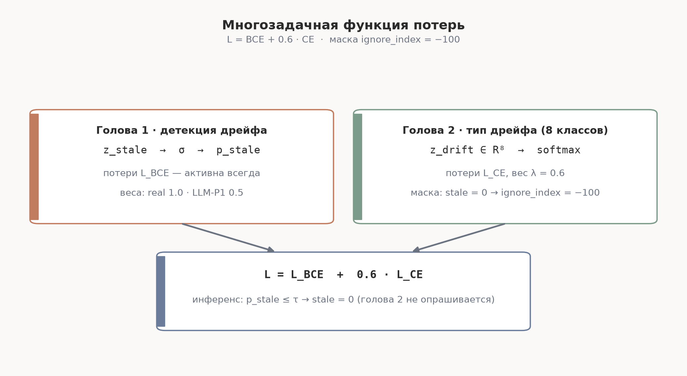

*Рисунок 7. Функция потерь Masked Multi-Task Loss. Источник: [reports/figures/note/note_loss_architecture.png](reports/figures/note/note_loss_architecture.png).*

### 3.2. Архитектура бюджетирования контекста и токенизация

#### 3.2.1. Анализ квантилей длин токенов и инструментальные замеры усечения контекста

Длина объединенной последовательности `[сигнатура + дифф + docstring]` в реальных кодовых базах обладает тяжелым распределением с длинным правым хвостом. Эмпирический квантильный анализ полного массива данных FreshDoc (22k train, 5.2k val/test при BPE-токенизации):

$$p_{50} \approx 340,\quad p_{75} \approx 560,\quad p_{90} \approx 870,\quad p_{95} \approx 1100,\quad p_{99} \approx 1950,\quad \max \approx 3800\text{ токенов}$$

Теоретический анализ штрафа усечения контекста при фиксированных окнах трансформера:
* **Окно 512 токенов:** усекает **28.6%** примеров генеральной совокупности ($p_{75} = 560$). Обрезается каждый третий пример, что приводит к гарантированной потере сегмента docstring в конце последовательности либо отсечению ключевых строк диффа. Окно 512 токенов признано неприемлемым для промышленного контура.
* **Окно 1024 токена:** теоретическая доля усечения последовательности падает до **4.4%** (покрытие 95.6% корпуса). Минимальная рабочая точка для базовых моделей (UniXcoder).
* **Окно 2048 токенов:** теоретическая доля потерь сокращается до **0.7–1.0%** (покрытие 99.3% корпуса). Целевая рабочая точка длинноконтекстных моделей (ModernBERT).

Инструментальные замеры усечения на всем датасете из 27 203 записей зафиксированы в артефакте [`reports/m2_truncation.json`](reports/m2_truncation.json) для рабочей конфигурации `microsoft/unixcoder-base` (окно $1024$ токена, лимит docstring $L_{\text{doc}} = 384$) (табл. 3.1):

*Таблица 3.1. Инструментальные замеры усечения кода и docstring по сплитам (рабочая конфигурация UniXcoder, окно 1024).*

| Сплит датасета | Объем сплита ($N$) | Усечение кода, шт. | Доля усечения кода (%) | Усечение docstring, шт. | Доля усечения docstring (%) |
|---|---:|---:|---:|---:|---:|
| **`train`** | 21 997 | 515 | **2.34%** | 2 086 | **9.48%** |
| **`test_real`** | 2 895 | 58 | **2.00%** | 119 | **4.11%** |
| **`test_synth`** | 1 552 | 48 | **3.09%** | 163 | **10.50%** |
| **`val`** | 559 | 31 | **5.55%** | 53 | **9.48%** |
| **`gold`** | 200 | 6 | **3.00%** | 8 | **4.00%** |
| **ИТОГО по корпусу** | **27 203** | **658** | **2.42%** | **2 429** | **8.93%** |

Фактическое усечение диффа кода составляет всего **2.42%** в генеральной совокупности благодаря алгоритму адаптивного разделения бюджета.

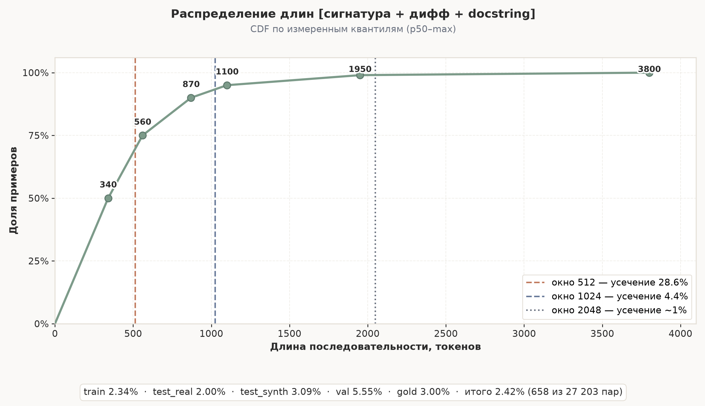

*Рисунок 8. Квантили длин и усечение контекста. Источник: [reports/figures/note/note_quantiles_truncation.png](reports/figures/note/note_quantiles_truncation.png).*

#### 3.2.2. Алгоритм взвешенного распределения токенов и приоритизация ханков диффа

Для предотвращения случайной потери критических семантических блоков при превышении лимита длины в модуле [`src/models/m2_data.py`](src/models/m2_data.py) реализован алгоритм динамического бюджетирования токенов:

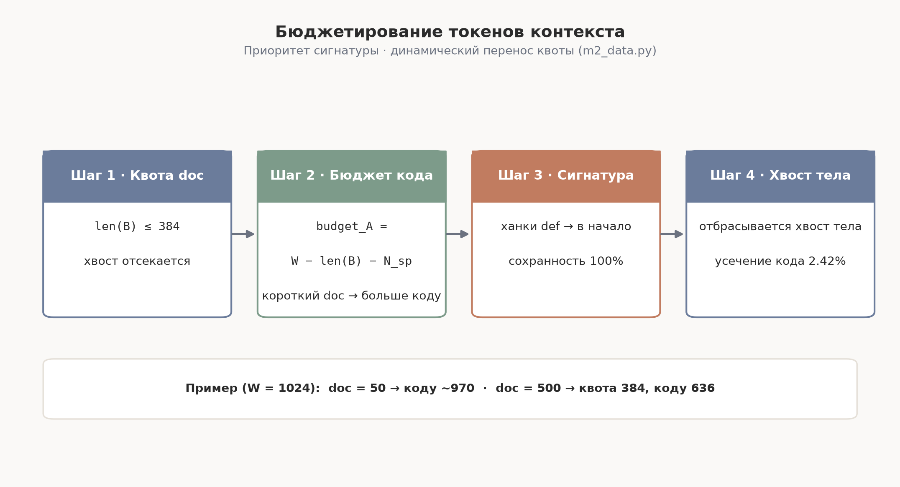

*Рисунок 9. Бюджетирование токенов. Источник: [reports/figures/note/note_token_budgeting.png](reports/figures/note/note_token_budgeting.png).*

1. **Квотирование docstring (Сегмент $B$):**
   * Объем токенов docstring жестко ограничен порогом $\text{len}(B) \le 384$ токена (`DOC_BUDGET_TOKENS = 384`).
   * Первые 384 токена кодируются без добавления специальных токенов. Если исходный docstring превышает 384 токена, хвост отсекается, а записи присваивается флаг `doc_truncated = True`.
2. **Динамическое выделение бюджета кода (Сегмент $A$):**
   * Бюджет на код вычисляется от фактической длины $B$:

$$\text{budget}_A = \max(0, L_{\max} - \text{len}(B) - N_{\text{special}})$$

   * Это гарантирует, что короткие docstring (например, 50 токенов) передают неиспользованный остаток бюджета (до 970 токенов) сегменту диффа кода.
3. **Приоритизация ханков диффа ([`prioritize_diff`](src/models/m2_data.py) (~L89-L95)):**
   * Сырой diff разбивается на отдельные ханки по маркерам `@@` ([`split_hunks`](src/models/m2_data.py) (~L64-L86)).
   * Функция [`is_sig_hunk`](src/models/m2_data.py) (~L56-L61) сканирует строки ханка с помощью регулярного выражения `^[-+]\s*(async\s+)?def\b`.
   * Ханки, затрагивающие заголовок функции (`sig_hunks`), принудительно перемещаются в начало диффа.
   * Оставшиеся ханки изменений тела функции (`rest_hunks`) добавляются следом в исходном порядке.
   * Следствие: при дефиците бюджета $\text{budget}_A$ усечение отбрасывает хвостовые ханки реализации функции, гарантируя 100% сохранность изменений сигнатуры.

#### 3.2.3. Специфика схем токенизации: RoBERTa против ModernBERT

Сборка входных тензоров зависит от семейства токенизатора базовой модели:

1. **Схема RoBERTa / UniXcoder ($N_{\text{special}} = 4$):**

$$\mathbf{x}_{\text{input}} = [\;\texttt{<s>},\;\; \mathbf{a}_1, \dots, \mathbf{a}_m,\;\; \texttt{</s>},\; \texttt{</s>},\;\; \mathbf{b}_1, \dots, \mathbf{b}_k,\;\; \texttt{</s>}\;]$$

   * Начальный токен последовательности: `cls_token_id` (`<s>`, индекс 0).
   * Граничный разделитель сегментов $A$ и $B$: сдвоенный токен `sep_token_id` (`</s></s>`, индекс 2, 2). Сдвоенный токен строго регламентирован архитектурой RoBERTa для дифференциации пары предложений без явного сегментного эмбеддинга.
   * Финальный замыкающий токен: одиночный `sep_token_id` (`</s>`, индекс 2).
2. **Схема ModernBERT ($N_{\text{special}} = 3$):**

$$\mathbf{x}_{\text{input}} = [\;\texttt{[CLS]},\;\; \mathbf{a}_1, \dots, \mathbf{a}_m,\;\; \texttt{[SEP]},\;\; \mathbf{b}_1, \dots, \mathbf{b}_k,\;\; \texttt{[SEP]}\;]$$

   * Начальный токен: `cls_token_id` (`[CLS]`, индекс 1).
   * Одиночный разделитель между сегментами: `sep_token_id` (`[SEP]`, индекс 2).
   * Финальный замыкающий токен: `sep_token_id` (`[SEP]`, индекс 2).

Контроль масок:
* Маска внимания: $\mathbf{m}_{\text{attn}} = [1, 1, \dots, 1]$ на длине входной конкатенации без паддингов при динамическом батчинге.
* Маски сегментов (`token_type_ids`): не используются ни в UniXcoder, ни в ModernBERT (семантическое разделение сегментов $A$ и $B$ возложено на разделительные спецтокены и вращающиеся/позиционные эмбеддинги).
* Агрегация представлений: вектор состояния формируется исключительно из скрытого состояния нулевого токена $\mathbf{h}_{\text{pooled}} \in \mathbb{R}^d$, проходящего через последовательные слои `LayerNorm` и `Dropout(0.1)` перед подачей в головы классификации.

---

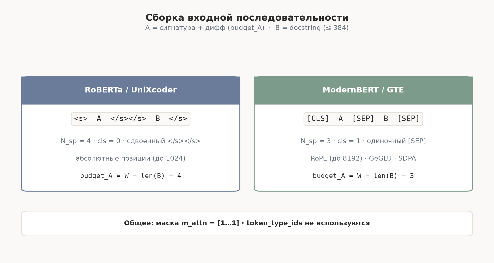

*Рисунок 10. RoBERTa против ModernBERT: сборка входа. Источник: [reports/figures/note/note_roberta_vs_modernbert.png](reports/figures/note/note_roberta_vs_modernbert.png).*

### 3.3. Метрики качества и протокол валидации

#### 3.3.1. Основные и вспомогательные метрики ранжирования и калибровки

Оценка качества моделей выполняется специализированным комплексом метрик ([`src/models/metrics.py`](src/models/metrics.py)):

1. **Первичная скалярная метрика: PR-AUC (Precision-Recall Area Under Curve):**
   * Вычисляется как средняя точность (*Average Precision, AP*):

$$\text{PR-AUC} = \sum_{n} (R_n - R_{n-1}) P_n$$

   * Обоснование выбора: в реальных проектах распределение классов рассогласования сильно несбалансировано (в выборке `gold / sig_same` превалентность составляет всего $\pi = 8.7\%$). Метрика ROC-AUC на сильно скошенных выборках дает ложно-оптимистичную оценку из-за доминирования истинно отрицательных срабатываний в знаменателе False Positive Rate ($FPR = \frac{FP}{FP + TN}$). PR-AUC оперирует исключительно положительным классом ($Precision = \frac{TP}{TP + FP}$, $Recall = \frac{TP}{TP + FN}$), наглядно отражая деградацию при росте ложных тревог. Базовая превалентность $\pi = P(y=1)$ фиксируется как порог тривиального случайного классификатора.
2. **Метрики вероятностной надежности и калибровки:**
   * **Brier Score:** среднеквадратичное отклонение калиброванной вероятности от истинной бинарной метки:

$$\text{BS} = \frac{1}{N} \sum_{i=1}^N (p_i - y_i)^2,\quad \text{BS} \in [0, 1]$$

   * **Expected Calibration Error (ECE):** взвешенная разность между средней уверенностью модели и фактической точностью по $M = 10$ равновеликим бинам вероятности:

$$\text{ECE} = \sum_{m=1}^M \frac{|B_m|}{N} \left| \text{acc}(B_m) - \text{conf}(B_m) \right|$$

   * **Negative Log-Likelihood (NLL / Log-Loss):** логистическая функция потерь на проверочной выборке.
3. **Метрика классификации типов дрейфа (Вторая голова):**
   * **Macro-Averaged F1-Score:** среднее гармоническое точности и полноты по классам дрейфа.
   * Регламент вычисления ([`evaluate_drift`](src/models/metrics.py) (~L205-L245)): метрика рассчитывается **строго на подвыборке истинного положительного рассинхрона с известным классом (истинного рассинхрона ($y_{\text{stale}} = 1$ с известным классом дрейфа))**. Классы `none` и `unknown` исключаются из макро-усреднения, поскольку они не участвуют в контролируемом обучении второй головы.

#### 3.3.2. Стратификация по структурным подгруппам: all, sig_changed, sig_same

Для исключения ложной интерпретации результатов все валидационные и тестовые срезы подвергаются обязательной стратификации на три когорты:

1. **Когорта `all`:** генеральная совокупность сплита без фильтрации. Отражает эксплуатационную плотность потока событий в CI/CD.
2. **Когорта `sig_changed`:** подмножество примеров, в которых зафиксировано изменение синтаксической сигнатуры (`param_renamed`, `param_removed`, `param_added`, `default_changed`, `return_changed`, `exception_changed`).
3. **Когорта `sig_same`:** подмножество примеров со строгой инвариантностью сигнатуры:

$$S_{\text{old}} = S_{\text{new}}$$

где модификации подверглось исключительно тело функции.

**Аналитическое обоснование стратификации:**
Эвристический бейзлайн M0 (проверка сигнатур через AST) по определению детектирует любые изменения сигнатуры, демонстрируя на когорте `sig_changed` тривиальный $Recall = 1.0$. Однако на когорте `sig_same` эвристический анализатор абсолютно слеп: его предсказание тождественно равно нулю ($p = 0$, $Recall = 0.0$, $F_1 = 0.0$, $\text{PR-AUC} = \pi$). 

Когорта `sig_same` выступает единственным объективным критерием интеллектуальной семантической состоятельности модели машинного обучения. Любой прогресс в архитектуре (переход от M1 к M2) верифицируется в первую очередь по приросту PR-AUC на срезе `sig_same`.

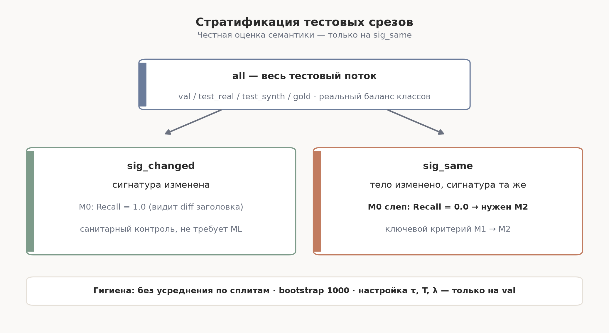

*Рисунок 11. Стратификация all / sig_changed / sig_same. Источник: [reports/figures/note/note_stratification.png](reports/figures/note/note_stratification.png).*

#### 3.3.3. Протокол честной валидации и запрет агрегации разнородных сплитов

В рамках экспериментальной методологии FreshDoc утверждены правила валидационной гигиены:

1. **Категорический запрет на агрегацию и усреднение по сплитам:**
   Запрещается вычисление средневзвешенных скалярных метрик, объединяющих выборки `val`, `test_real`, `test_synth` и `gold`. Датасеты имеют принципиально различное происхождение, природу шума и превалентность (синтетика AST идеальна по построению, $\text{PR-AUC} = 1.000$; реальный тест содержит шум майнинга коммитов; выборка `gold` размечена экспертами вручную с превалентностью 27.5% на `all` и 8.7% на `sig_same`). Усреднение метрик скрывает доменный сдвиг и искажает реальную надежность системы.
2. **Статистическая оценка доверительных интервалов (Bootstrap):**
   Все точечные оценки метрик (PR-AUC, ROC-AUC, F1, Brier) сопровождаются расчетом 95% доверительных интервалов методом непараметрического бутстрэпа (*non-parametric bootstrap*) на 1 000 повторных выборок с возвращением ([`bootstrap_pr_auc`](src/models/metrics.py) (~L147-L172)). Интервалы фиксируются по квантилям 2.5% и 97.5%.
3. **Строгая изоляция тестовых выборок:**
   Сплиты `test_real`, `test_synth` и `gold` являются изолированными контрольными срезами (*out-of-sample / out-of-distribution*). Запрещено использовать их для оптимизации гиперпараметров, выбора архитектуры, настройки веса лосса $\lambda$, подбора температуры калибровки $T$ или оптимизации порога классификации $\tau$. Все настроечные операции выполняются исключительно на отложенной выборке `val`. Финальные метрики снимаются на контрольных тестах вслепую в один проход.

Сформулированные правила валидации задают требования к корпусу: глава 4 описывает сбор и проверку данных в соответствии с этим протоколом.

---

## 4. Сбор, фильтрация и инженерия наборов данных

Раздел посвящен полному циклу создания, многоступенчатой фильтрации, алгоритмической и генеративной аугментации, верификации и аудита мультимодального корпуса данных проекта FreshDoc. Обучение и беспристрастная оценка моделей обнаружения рассинхронизации программного кода и спецификаций требуют устранения статистических шорткатов, дисбаланса классов, шума естественной разметки и межсплитовых утечек контекста.

---

### 4.1. Извлечение и предобработка реальных положительных пар (CoDocBench)

#### 4.1.1. Пайплайн адаптации CoDocBench в каноническую схему данных

Первичным источником реальных прецедентов синхронного изменения исходного кода и сопутствующей документации послужил открытый исследовательский бенчмарк **CoDocBench** (подмножество языка Python, насчитывающее 4 573 сырые пары из 201 репозитория-кандидата, из которых 181 валидный репозиторий был отобран после строгой фильтрации по лицензиям и структуре коммитов). Каждая исходная запись представляет собой снимок парных изменений: состояние функции до коммита, состояние функции после коммита, а также сопутствующие редакции docstring.

Для интеграции внешних данных в унифицированный контур обучения FreshDoc разработан адаптер [`CoDocBenchAdapter`](src/data/codocbench_adapter.py) (~L50-L170) и конвейерный скрипт [`build_codocbench_pairs.py`](scripts/build_codocbench_pairs.py) (~L16-L105). Преобразование сырых данных в канонический формат спецификации опирается на синтаксический анализ абстрактных синтаксических деревьев (AST) и включает следующие этапы:

1. **Синтаксический разбор и валидация компилируемости:** Исходный код функций до (`code_old_raw`) и после (`code_new_raw`) модификации транслируется в синтаксические деревья посредством модуля Python `ast` (`parse_function_ast`). Записи с синтаксическими ошибками, неполными фрагментами или невалидными конструкциями безусловно отбраковываются (статус `не_разобралось`).
2. **Изолированное извлечение спецификации:** Функция `extract_docstring_and_clean_node` извлекает строковый литерал docstring (`ast.get_docstring`) из тела корневого узла `ast.FunctionDef` / `ast.AsyncFunctionDef`, после чего узел выражения документации (`ast.Expr`, содержащий `ast.Constant`) полностью удаляется из синтаксического дерева. Это гарантирует, что текст документации не попадет в дифф программного кода.
3. **Каноническая нормализация кода:** Очищенные синтаксические деревья компилируются в канонический строковый вид посредством `ast.unparse` (`normalize_code_from_node`). Процедура нивелирует вариативность форматирования PEP 8, различия в расстановке пробелов, переносов строк и однострочных комментариев `#`. Если после нормализации $C(\text{old}) \equiv C(\text{new})$, пример отсеивается со статусом `код_не_изменился`.
4. **Генерация дифференциального представления и сигнатуры:**
   - На основе нормализованных представлений формируется компактный контекстный unified diff (`compute_code_diff` через `difflib.unified_diff` с нулевым контекстом пустых строк).
   - Первая строка канонического объявления функции извлекается в качестве входного признака `sig_old` (`extract_sig_line`).
   - Синтаксический анализатор сигнатур [`derive_drift_type`](src/data/drift.py) (~L68-L101) сопоставляет списки аргументов, значений по умолчанию, аннотаций типов и возбуждаемых исключений, определяя точный структурный класс рассогласования `sig_type`.
5. **Применение жестких фильтров качества данных:**
   Для устранения артефактов и обеспечения репрезентативности выборки каждая пара валидируется на соответствие трем инвариантным критериям:
   - **Публичный контракт API:** Исключение приватных функций, внутренних утилит и специальных методов, имена которых начинаются с символа подчеркивания: `fn_old.name[0] != '_'`.

   - **Информативность спецификации:** Отсечение тривиальных заглушек, пустых комментариев и однословных описаний путем установления минимальной длины docstring: `len(doc_old) >= 40` символов.

   - **Габариты анализируемого блока:** Ограничение суммарного объема исходного кода функции и документации для предотвращения критических усечений контекста:

$$4 \le n_{\text{lines}} \le 300, \quad \text{где } n_{\text{lines}} = |C_{\text{old}}| + |D_{\text{old}}|$$

В результате применения сквозного пайплайна адаптации из исходных 4 573 пар CoDocBench сформировано **2 997 высококачественных положительных пар** ($y_{\text{stale}} = 1$, `label_source = "real_coupled"`, базовый оптимизационный вес $w = 1.0$).

---

#### 4.1.2. Устранение межсплитовых утечек проектов и изоляция каналов утечки данных

При детальном аудите исходного распределения CoDocBench выявлен критический методологический дефект: наличие межсплитового пересечения репозиториев ($P(\text{train}) \cap P(\text{test}) \ne \emptyset$). В частности, функции популярной графической библиотеки **`manim`** присутствовали одновременно как в обучающей (`train.jsonl`), так и в тестовой (`test.jsonl`) выборках оригинального бенчмарка. Обучение трансформерных моделей на кодовой базе с последующим тестированием на функциях того же проекта приводит к завышению метрик за счет запоминания контекста, соглашений об именовании и доменных типов.

Для гарантии абсолютной чистоты экспериментов реализована следующая процедура изоляции данных:

- **Ликвидация пересечения проектов:** Выполнен принудительный перенос всех функций проекта `manim` целиком в отложенный тестовый пул (`test_pool`).
- **Формирование непересекающихся пулов:** Зафиксировано строгое разбиение открытых репозиториев на два изолированных множества: **91 проект в `train_pool`** и **90 проектов в `test_pool`** (артефакт [`data/interim/project_pools.parquet`](data/interim/project_pools.parquet)). Ни одна кодовая база не представлена одновременно в обоих пулах. 12 пулов без строк после R1-фильтров.
- **Изоляция каналов утечки (Data Leakage Containment):** Сырые данные CoDocBench содержат атрибуты, недоступные в реальном сценарии эксплуатации до момента ручного исправления: обновленный docstring (`doc_new`), дифф документации (`diff_docstring`) и сообщение коммита (`commit_message`). Наличие этих полей во входном векторе признаков модели привело бы к тривиальному коллапсу задачи классификации. В рамках канонической схемы данных указанные поля принудительно вынесены в изолированное пространство служебных имен:
  - `_leak_doc_new`
  - `_leak_diff_docstring`
  - `_leak_commit_message`
  - `_aux_src_old`

В архитектуре загрузчиков данных ([`src/models/m2_model.py`](src/models/m2_model.py)) и инференс-пайплайнах установлен строгий программный фильтр: входной кортеж трансформера формируется исключительно из триплета `(sig_old, diff_code, doc_old)`. Любое обращение к префиксам `_leak_*` блокируется на уровне модульных тестов и CI-проверок ([`test_data_isolation`](tests/test_validate.py) (~L167-L186)).

---

### 4.2. Майнинг отрицательных примеров из истории Git-репозиториев

#### 4.2.1. Параллельный CLI-майнинг 60 открытых репозиториев и пилотный замер производительности

Одной из главных фундаментальных проблем задачи детекции рассинхронизации документации является практическое отсутствие готовых открытых наборов отрицательных примеров ($y_{\text{stale}} = 0$). Отрицательный пример представляет собой ситуацию, когда исходный код функции претерпел изменения в коммите, однако текст документации остался корректным, исчерпывающим и не требующим правок.

Для извлечения естественных отрицательных пар спроектирован высокопроизводительный майнер истории Git-репозиториев ([`src/mining/miner.py`](src/mining/miner.py) (~L1-L281), CLI-раннер [`scripts/mine_negatives.py`](scripts/mine_negatives.py) (~L1-L165)). В отличие от существующих академических решений, использующих ресурсоемкие библиотеки абстракции над Git, инструмент FreshDoc взаимодействует напрямую с бинарным CLI Git (`git log`, `git diff`) в многопоточном режиме, выполняя синтаксический анализ AST на лету.

Майнинг организован в соответствии со следующими регламентами:

1. **Репрезентативная выборка кодовых баз:** Сформирован конфигурационный реестр [`config/mining_projects.yaml`](config/mining_projects.yaml), включающий 60 зрелых, активно развивающихся проектов с открытым исходным кодом (Django, Tornado, Scikit-learn, Transformers, Requests, Pandas, Celery, Kivy и др.). Выборка покрывает 84% (3 848 из 4 573) кодовой базы CoDocBench и строго разделена по пулам: 33 проекта отнесены к `train_pool`, 27 проектов — к `test_pool`.
2. **Клонирование и локализация отказов:** Клонирование репозиториев осуществлялось утилитой [`scripts/clone_repos.py`](scripts/clone_repos.py) (~L1-L87) в 4 параллельных потока с глубиной истории `--depth 1000`. При обработке монорепозитория **`frappe/frappe`** зафиксирован сбой по таймауту в 1200 секунд вследствие аномального объема истории и блобов Git:
   ```text
   https://github.com/frappe/frappe.git :: TimeoutExpired(['git', 'clone', '--depth', '1000', ...], 1200)
   ```
   Сбой зарегистрирован в артефакте [`reports/clone_failures.txt`](reports/clone_failures.txt), репозиторий исключен из дальнейшей обработки без нарушения стабильности контура (успешно склонировано 59 из 60 репозиториев).
3. **Пилотный бенчмаркинг и ранжирование:** На этапе пилотного прогона (`--mode pilot`, 150 коммитов по 59 репозиториям, артефакт [`reports/mining_pilot.json`](reports/mining_pilot.json)) замерена скорость извлечения пар и соотношение выхода кандидатов к процессорному времени (`candidates/sec`). На основе ранжирования отобраны 18 наиболее результативных проектов, обеспечивших экстраполяционную оценку времени полного прогона в 239 минут при аппаратном лимите сессии 240 минут.
4. **Масштабный сбор:** Прогон `--mode full` (1000 коммитов по 18 выбранным проектам) сформировал сырой массив `negatives_raw.parquet` объемом **26 827 записей** с неизменным docstring (`doc_changed == False`). Процедура завершена с нулевым числом системных ошибок (`commit_errors = 0`) и нулевым усечением данных (`truncated = False`).

---

#### 4.2.2. Классификация отрицательных примеров и анализ дефицита сильных негативов

Собранный массив естественных отрицательных изменений подвергнут детальной стратификации на две фундаментальные категории:

- **Слабые негативы (`weak_neg`):** Изменения внутренней реализации функции, не затрагивающие внешний интерфейс и контракт (оптимизация алгоритмических ветвлений, вызов вспомогательных функций, обновление логирования, добавление кеширования).
- **Сильные негативы (`strong_neg`):** Косметический рефакторинг с инвариантной AST-структурой. Исходный код модифицируется путем безопасного переименования локальных переменных в канонические идентификаторы вида `v0, v1, ...` без изменения синтаксического дерева и семантики вычислений.

Анализ естественного распределения реальной истории коммитов вскрыл критическую диспропорцию: **доля естественного косметического рефакторинга (`strong_neg`) в реальной разработке составляет всего 0.7% (139 пар из 26 827 сырых записей)**. При проектировании сбалансированной выборки была заложена целевая квота сильных негативов в объеме 30% от объема положительных примеров (суммарно 899 строк).

В таблице 4.1 представлены фактические замеры дефицита сильных негативов по пулам и диапазонам длины функций ([`reports/tables/neg_deficit.csv`](reports/tables/neg_deficit.csv), [`reports/tables/neg_select.json`](reports/tables/neg_select.json)):

| Пул данных | Корзина длин (строк) | Целевой объем негативов | Отобрано `strong_neg` | Отобрано `weak_neg` | Итого отобрано | Дефицит `strong` | Доля дефицита `strong` |
|:---|:---:|:---:|:---:|:---:|:---:|:---:|:---:|
| **test_pool** | 4–8 | 200 | 0 | 200 | 200 | 60 | 100.0% |
| **test_pool** | 9–15 | 395 | 0 | 395 | 395 | 118 | 100.0% |
| **test_pool** | 16–40 | 681 | 0 | 681 | 681 | 204 | 100.0% |
| **test_pool** | 41–300 | 245 | 4 | 241 | 245 | 70 | 94.6% |
| **train_pool** | 4–8 | 256 | 4 | 252 | 256 | 73 | 94.8% |
| **train_pool** | 9–15 | 337 | 15 | 322 | 337 | 86 | 85.1% |
| **train_pool** | 16–40 | 634 | 32 | 602 | 634 | 158 | 83.2% |
| **train_pool** | 41–300 | 249 | 42 | 207 | 249 | 33 | 44.0% |
| **ИТОГО** | **Все корзины** | **2 997** | **97** | **2 900** | **2 997** | **802** | **89.2%** |

*Таблица 4.1. Анализ распределения и дефицита сильных негативов в естественной истории Git.*

Суммарный дефицит составил **802 строки (~89.2% от потребности)**. Для преодоления дефицита принята строгая инженерная стратегия:
1. Замещение недостающего объема сильных негативов качественными слабыми негативами (`weak_neg`) из тех же репозиториев с сохранением пропорций длины.
2. Категорический запрет на фальсификацию источника: сильные негативы из синтетических генераторов (`synth_ast`) не подмешивались в корпус `history_neg`, предотвращая искажение статистической природы реальных коммитов.
3. Ликвидация дубликатов: расширенная схема хеширования `pair_id = sha256(source:project:symbol:commit:code_old + code_new + doc_old)[:16]` выявила и устранила 27 избыточных строк (22 уникальных хеша, артефакт [`reports/tables/neg_dropped_pair_ids.txt`](reports/tables/neg_dropped_pair_ids.txt)), возникших из-за вендоринга библиотек.

Итоговый срез отрицательных примеров составил **2 997 записей** (1 476 в `train_pool` и 1 521 в `test_pool`).

---

#### 4.2.3. Балансировка и стратификация распределений длин: контроль критерия Колмогорова-Смирнова

Если распределение длины функций между положительным и отрицательным классами имеет статистически значимое расхождение, градиентные модели мгновенно выучивают тривиальный поверхностный признак (шорткат длины: например, «длинные функции чаще устаревают»), игнорируя реальное семантическое рассогласование кода и текста.

Для исключения этого риска реализована квантильная балансировка по 4 корзинам суммарной длины функции $n_{\text{lines}}$:
- **Корзина 1:** $[4, 8]$ строк;
- **Корзина 2:** $[9, 15]$ строк;
- **Корзина 3:** $[16, 40]$ строк;
- **Корзина 4:** $[41, 300]$ строк.

Алгоритм отбора [`select_balanced`](src/data/negatives.py) (~L212-L295) формировал отрицательную выборку так, чтобы плотность вероятности попадания в каждую корзину строго повторяла распределение положительных пар CoDocBench.

Качество выравнивания оценивалось с помощью двухвыборочного критерия согласия Колмогорова-Смирнова (Two-sample Kolmogorov-Smirnov test):

- **До выравнивания:** Статистика Колмогорова-Смирнова составляла $KS = 0.064$, фиксируя систематическое расхождение между сырыми негативами майнинга и парами CoDocBench.
- **После квантильной балансировки:** Статистика $KS$ снизилась в 3 раза — до **$0.021$ (KS снизился с 0.064 до 0.021)**, что свидетельствует о статистической неразличимости распределений длин функций между классами.
- Популовый замер показал стабильность балансировки: $KS(\text{test}) = 0.0289$ и $KS(\text{train}) = 0.0271$.

Фактическое выравнивание распределений до и после балансировки зафиксировано в графическом артефакте [`reports/figures/neg_length_before_after.png`](reports/figures/neg_length_before_after.png).

---


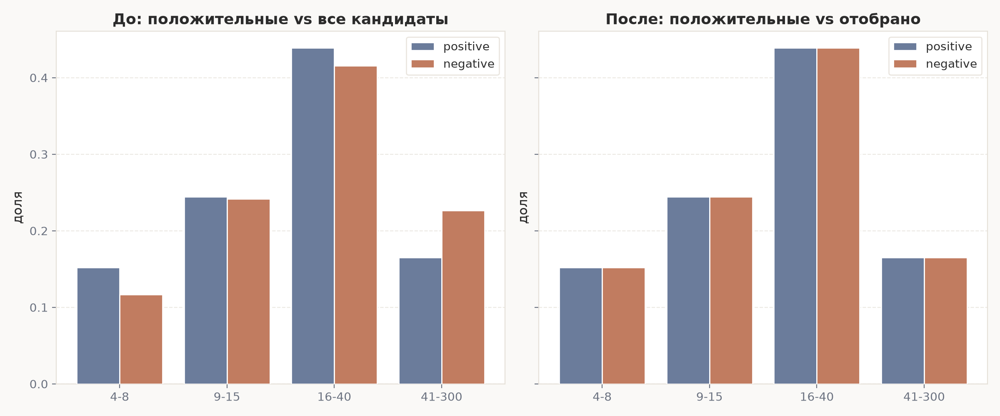

*Рисунок 12. Распределение длин токенов диффа до и после квантильной балансировки (KS-тест). Источник: [reports/figures/neg_length_before_after.png](reports/figures/neg_length_before_after.png); KS 0.064 → 0.021.*


### 4.3. Алгоритмический синтез дрейфа на основе AST-мутаций

#### 4.3.1. Таксономия 9 мутационных операторов синтаксического уровня

Поскольку реальные коммиты содержат ограниченный спектр структурных изменений и несут естественный шум человеческой разметки, разработана библиотека детерминированных мутаций синтаксического дерева [`src/synth/mutations.py`](src/synth/mutations.py) (~L1-L896). Мутаторы оперируют исключительно на уровне узлов Python AST, гарантируя строгое соответствие сгенерированных примеров целевым классам дрейфа.

Реализовано **9 специализированных операторов**, разделенных на два контрастных класса:

##### Позитивные мутаторы дрейфа ($y_{\text{stale}} = 1$, внесение рассогласования):
1. `mut_param_renamed` — синтаксическое переименование аргумента в заголовке функции и согласованная замена его вхождений в теле функции при сохранении устаревшего имени аргумента в docstring.
2. `mut_param_added` — добавление нового обязательного или именованного аргумента (`kwonly`) в сигнатуру функции с одновременным внедрением его использования в вычислительное тело.
3. `mut_param_removed` — корректное удаление документированного параметра из сигнатуры с безопасным замещением ссылок на него в теле функции литералом по умолчанию.
4. `mut_default_changed` — модификация значения по умолчанию в объявлении параметра, явно зафиксированного в текстовой спецификации docstring.
5. `mut_return_changed` — изменение контракта возвращаемого значения (внедрение nullable-ветвления `if X is None: return None` или подмена возвращаемого типа).
6. `mut_exception_changed` — добавление возбуждения нового исключения (`add_raise` с предварительным гардом `if X is None: raise ...`) либо подмена типа возбуждаемой ошибки.

##### Негативные мутаторы эквивалентных трансформаций ($y_{\text{stale}} = 0$, сохранение контракта):
7. `mut_rename_local` — строго локальное переименование внутренней промежуточной переменной, не видимой вызывающему коду и не упомянутой в спецификации.
8. `mut_extract_temp` — эквивалентный рефакторинг: извлечение сложного подвыражения в локальную переменную перед возвратом или вызовом.
9. `mut_change_message` — косметическая модификация строкового литерала в вызовах `print`, `logging.info/debug` или `warnings.warn` без изменения логики вычислений и интерфейса.

---


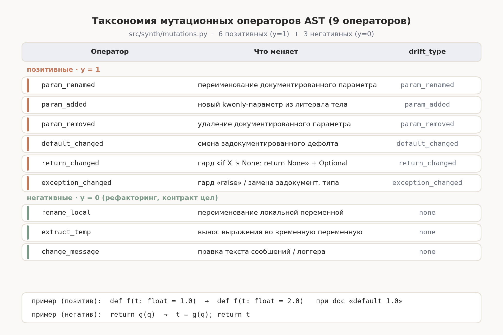

*Рисунок 13. Таксономия 9 мутационных операторов синтаксического дерева AST. Источник: [src/synth/mutations.py](src/synth/mutations.py), [reports/synth_ast_stats.md](reports/synth_ast_stats.md).*


#### 4.3.2. Детерминизм генерации (CRC32), изоляция скоупов и обратная AST-валидация

Синтез масштабных объемов аугментированных данных сопряжен с рисками генерации невалидного кода и недетерминированного расхождения результатов на гетерогенных вычислительных средах. Для обеспечения надежности реализован трехуровневый комплекс инженерных защит:

1. **Строгий детерминизм (CRC32):** Стандартная функция Python `hash()` подвержена рандомизации между процессами через механизм соления `PYTHONHASHSEED`, что приводит к несовпадению выборок на локальных серверах и облачных узлах Kaggle/Colab. В FreshDoc инициализация генератора псевдослучайных чисел для каждой функции жестко зафиксирована через `zlib.crc32(func_name.encode('utf-8'))`. Это обеспечивает побитовую воспроизводимость диффов независимо от операционной системы и версии интерпретатора.
2. **Защитные гарды области видимости (Scope Guards):** Мутаторы содержат предикаты, предотвращающие разрушение семантики языка:
   - Изоляция переменных перехвата ошибок: запрет переименования псевдонимов в блоках `except Exception as err`.
   - Изоляция сопоставления с образцом: блокировка мутаций внутри синтаксических шаблонов `match-case` (Python 3.10+).
   - Защита директив области видимости: запрет подмены переменных, объявленных через `global` или `nonlocal`.
   - Проверка краш-позиций: при удалении параметров подставляемый литерал `None` валидируется на недопустимость попадания в бинарные арифметические операции (`BinOp`), вызовы методов, взятие индексов и циклы итерации.
3. **Контур обратной AST-валидации:** Каждый синтезированный мутант компилируется в код через `ast.unparse`, повторно парсится через `ast.parse` для гарантии синтаксической валидности и прогоняется через детектор дрейфа [`src/data/drift.py`](src/data/drift.py) (~L68-L101) для математического подтверждения того, что возникший дифф индуцирует ровно тот тип рассогласования, который был запланирован.

---

#### 4.3.3. Эволюционная 5-раундовая отладка мутаторов и генерация 29.5k примеров пула v2

Проектирование синтаксических генераторов сопряжено с появлением скрытых семантических дефектов, которые формально синтаксически корректны, но неестественны с точки зрения живого кода. Разработка мутаторов FreshDoc прошла через **5 последовательных раундов экспертной слепой отладки** ([`reports/synth_ast_v2_stats.md`](reports/synth_ast_v2_stats.md)):

- **Раунд 1 (Базовый):** Пул 12 664 функций, сгенерировано 29 426 пар. Ручная верификация выборки выявила валидность лишь на уровне 80% (16/20). Анализ дефектов показал, что 23% мутаций происходили на фикстурах и хелперах модульных тестов (`test_*`).
- **Раунд 2 (Фильтрация тестов):** Внедрен жесткий фильтр `exclude_tests = True` по путям и именам функций. Пул составил 9 398 функций, доля тестовых функций упала до 0.6%. Однако валидность ручной выборки просела до 75% (15/20) из-за дефектов условных гардов.
- **Раунд 3 (Устранение truthiness-гардов):** Обнаружено, что конструкции `if not X:` в мутаторе исключений приводят к падению на составных объектах (например, исключение `ValueError: The truth value of a Series is ambiguous` в библиотеках Pandas/NumPy). Мутатор переведен на строгий гард `if X is None:`.
- **Раунд 4 (Устранение 4 классов критических дефектов):**
  1. *Мертвые kwonly-параметры:* В `mut_param_added` 99.3% добавленных параметров были мертвыми (не использовались в логике). Реализован механизм **продвижения магических констант**: числовой или строковый литерал из тела функции продвигается в аргументы сигнатуры как дефолтное значение нового именованного параметра, обеспечивая 100% живое использование (2 573 из 2 573).
  2. *Truthiness в return:* Полное искоренение `if not X` в пользу `is None` в операторе `return_changed` (1 461 из 1 461).
  3. *Невалидные сравнения:* В `param_removed` заблокированы конструкции сравнения с None (`None == ...` и `not True/False`).
  4. *Фильтрация путей:* Введен структурный фильтр тестовых путей ([`tests/`](tests/), `conftest.py`, `*_test.py`). Валидность выборки возросла до **93.3% (28/30)**.
- **Раунд 5 (Финальный: documented-only переименования):** Анализ двух ошибок раунда 4 показал, что переименование параметров по совпадению подстроки в произвольном тексте docstring порождает ложный дрейф (слово встретилось в пояснительной прозе, а не в секции параметров). Внедрен предикат `_documented_as_param`, требующий явного оформления аргумента по стандарту документации. Доля прозовых артефактов снизилась с 25.2% (975/3876) до **0/3130**.

Итоговая слепая экспертная разметка выборки раунда 5 ([`synth_ast_v2_manual30_r5.csv`](reports/synth_ast_v2_manual30_r5.csv)) зафиксировала **качество 96.7% (29 из 30 валидных пар)**.

Финальный генерационный прогон на базе пула функций `functions_pool_v2.parquet` (9 158 функций, 342 870 попыток) сформировал **29 515 синтетических пар** (`synth_ast_v2.parquet`: 15 000 позитивных и 14 515 негативных после дедупликации). Распределение по типам представлено в таблице 4.2:

| Тип дрейфа (`drift_type`) | Целевой класс | Количество пар ($n$) | Доля от пула |
|:---|:---:|:---:|:---:|
| `none` (эквивалентные трансформации) | $y = 0$ | 14 515 | 49.2% |
| `exception_changed` | $y = 1$ | 5 666 | 19.2% |
| `param_renamed` | $y = 1$ | 3 130 | 10.6% |
| `param_added` | $y = 1$ | 2 769 | 9.4% |
| `return_changed` | $y = 1$ | 1 492 | 5.1% |
| `param_removed` | $y = 1$ | 1 320 | 4.5% |
| `default_changed` | $y = 1$ | 623 | 2.1% |
| **ИТОГО** | **v2 пул** | **29 515** | **100.0%** |

*Таблица 4.2. Структура сгенерированного пула AST-мутаций v2.* (сумма 100.1% из-за округления)

---


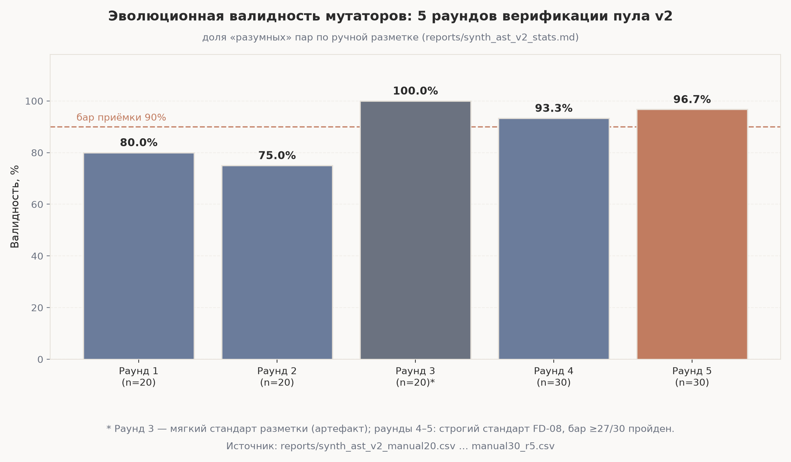

*Рисунок 14. Эволюционная динамика валидности мутаторов в 5 раундах верификации пула v2. Источник: [reports/synth_ast_v2_stats.md](reports/synth_ast_v2_stats.md), [reports/synth_ast_v2_manual20.csv](reports/synth_ast_v2_manual20.csv), *_r2-r5.csv.*


### 4.4. LLM-синтез сложных семантических изменений и трудных негативов

#### 4.4.1. Архитектура промпт-инженерии режимов P1 (сдвиг поведения), P2 (рефакторинг) и P3 (парафразы)

Синтаксические AST-мутации эффективны для модификации сигнатур, но принципиально не способны генерировать глубокие изменения алгоритмической логики при неизменном заголовке функции (`sig_same`). Для синтеза тонких семантических рассогласований развернут генеративный конвейер на базе большой языковой модели **DeepSeek** (`DeepSeek-V4.1-Flash`, температура $T_{gen} = 0.7$, `top_p = 0.95`, генерация в экономичные ночные часы off-peak).

Спроектировано три взаимодополняющих режима промпт-инженерии ([`reports/llm_pilot.md`](reports/llm_pilot.md), [`reports/llm_main700.md`](reports/llm_main700.md)):

1. **Режим P1 (Сдвиг семантического поведения, $y = 1$):** Модели ставится задача модифицировать внутреннюю вычислительную логику тела функции без изменения сигнатуры (`sig_old` $\equiv$ `sig_new`), сделав неверным как минимум одно конкретное фактологическое утверждение из исходного docstring (`behavior_changed`).
2. **Режим P2 (Трудный семантический рефакторинг, $y = 0$):** Генерация глубокого, нетривиального рефакторинга реализации (замена императивных циклов на списковые включения/генераторы, замена структур данных, оптимизация краевых условий) со строгим сохранением всех внешне наблюдаемых инвариантов и контракта функции.
3. **Режим P3 (Семантическое парафразирование спецификаций):** Промпт переписывает docstring в альтернативном стиле документирования (Google Style, NumPy, Sphinx/reST, Plain sentences) с жестким запретом на добавление или удаление фактов ([`prompts/p3_paraphrase.txt`](prompts/p3_paraphrase.txt)). Режим направлен на защиту энкодера от заучивания лексических шаблонов оформления. В рамках пакета выполнено 700 запросов, принято **520 валидных парафраз** при суммарных финансовых затратах **`$0.11`** ([`data/interim/p3_main700.parquet`](data/interim/p3_main700.parquet)).

---


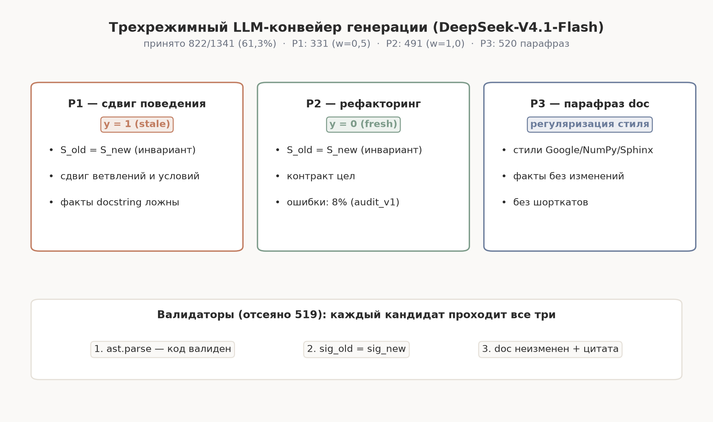

*Рисунок 15. Архитектура трехрежимного LLM-конвейера генерации и валидации данных (P1, P2, P3). Источник: [prompts/p1_behavior.txt](prompts/p1_behavior.txt), [prompts/p2_neutral.txt](prompts/p2_neutral.txt), [prompts/p3_paraphrase.txt](prompts/p3_paraphrase.txt), [reports/llm_pilot.md](reports/llm_pilot.md), [reports/llm_main700.md](reports/llm_main700.md).*


#### 4.4.2. Автоматический контур верификации и фильтрации генераций

Свободная генерация LLM несет риск синтаксических галлюцинаций и нарушения краевых условий. Для обеспечения чистоты данных разработан автоматизированный трехступенчатый верификационный фильтр ([`scripts/llm_main_batch.py`](scripts/llm_main_batch.py) (~L1-L572)):

- **Гейт 1 (Синтаксическая компилируемость):** Проверка формата JSON-ответа, десериализация кода и обязательный синтаксический разбор через `ast.parse(code_new)`.
- **Гейт 2 (Инвариант неизменности сигнатуры):** Извлечение сигнатур до и после генерации через `extract_signature`. При любом изменении имени параметров, порядка, аннотаций типов или дефолтов пример отбраковывается со статусом `signature_changed`.
- **Гейт 3 (Фактологическая привязка цитатой):** Модель обязана вернуть точную строковую цитату утверждения из документации (`stale_statements`), которое стало ложным в результате изменений кода. Верификатор выполняет поиск подстроки в исходном `doc_old`: если цитата не совпадает посимвольно или если docstring слишком краток, генерация отклоняется.

В таблице 4.3 приведены результаты работы контура фильтрации основной партии LLM-синтеза (1 400 запросов, 1 341 обработанный вызов):

| Причина отклонения генерации | Количество случаев ($n$) |
|:---|:---:|
| `thin_docstring` (недостаточная длина docstring) | 154 |
| `code_unchanged` (код фактически не изменился) | 145 |
| `stale_not_linked_to_diff` (цитата не связана с внесенным диффом) | 93 |
| `diff_too_big` (аномальный объем изменений кода) | 68 |
| `bad_json` (ошибки парсинга JSON / незакрытые строки) | 59 |
| `signature_changed` (нарушение инварианта стабильности сигнатуры) | 26 |
| `docstring_changed` (несанкционированное изменение текста docstring) | 20 |
| `stale_statement_not_found` (цитата отсутствует в `doc_old`) | 9 |
| Прочие краевые ошибки | 5 |
| **ИТОГО ОТКЛОНЕНО** | **579** |
| **ИТОГО ПРИНЯТО (P1: 331, P2: 491)** | **822 (доля приемки 61.3%)** |

*Таблица 4.3. Статистика причин отбраковки кандидатов LLM-генерации.*

Расхождение +60 — повторные попытки по R7 (по-категорийная разбивка попыток не логировалась); доля 61.3% посчитана от 1341 уникального вызова.

---

#### 4.4.3. Эмпирический аудит шума разметки и калибровка весов примеров в обучении

Для оценки реальной точности сгенерированных меток проведен независимый слепой аудит выборки синтетических данных ([`reports/audit_v1.md`](reports/audit_v1.md)):

- **Выборка аудита:** 25 примеров P1 и 25 примеров P2 из пула `synth_llm_main300.parquet`. Метки были скрыты от аудитора.
- **Результаты P2:** Из 25 примеров глубокого рефакторинга сохранение наблюдаемого функционального поведения подтверждено в 23 случаях (**доля ошибок всего 8%**, что существенно ниже допустимого порога в 20%).
- **Результаты P1:** Из 25 примеров сдвига поведения фактологическое опровержение спецификации подтверждено лишь в 10 случаях. В 14 случаях утверждения docstring остались истинными, а в 1 случае ситуация признана неоднозначной. Таким образом, **уровень шума меток в P1 составил 56–60%**.
- **Причина шума:** Разработчики часто снабжают функции обобщенными или краткими docstring. Модель вносит локальное изменение (например, меняет порядок обхода буфера или логику обработки пустых списков), которое не опровергает исходный текст спецификации (по четырехклассовой экспертной шкале это класс C — контракт не нарушен).

Попытка снизить шум за счет ужесточения лексических фильтров (партия `main700`, срез `audit_sample_v2.csv`) подтвердила устойчивость феномена: доля ошибок составила 60% (15 из 25). Обучение нейросетевого классификатора на выборке с 60% шумом меток с единичным градиентным весом привело бы к деградации представлений на тонком срезе `sig_same`.

**Инженерное решение:** Вместо полной дисквалификации P1 произведено **понижение весового коэффициента примеров группы LLM P1 в составной функции потерь с $w = 1.0$ до $w = 0.5$** (на один уровень с отрицательными примерами P2). Это позволило использовать разнообразие алгоритмических диффов LLM в качестве мягкой стохастической регуляризации без риска искажения разделяющей гиперплоскости классификатора.

---

### 4.5. Проектирование и разметка экспертного Золотого набора (Gold Standard)

#### 4.5.1. Стратифицированная выборка 200 реальных пар из тестового пула

Для объективного и беспристрастного контроля качества моделей, свободного от артефактов синтеза и шума естественной разметки Git, сформирован эталонный **Золотой стандарт (Gold Standard)**.

Выборка строилась скриптом [`scripts/select_gold.py`](scripts/select_gold.py) (~L1-L177) по жесткой спецификации [`reports/tables/gold_select.json`](reports/tables/gold_select.json):
- **Объем и происхождение:** Строго **200 реальных коммитов**, извлеченных методом стратифицированного случайного сэмплирования исключительно из отложенного пула тестовых репозиториев (`test_pool`).
- **Нулевая утечка:** Пересечение функций по хешам `function_hash` и проектам с обучающим пулом `train` строго равно нулю (`train_hash_overlap = 0`).
- **Сбалансированная стратификация:**
  - 70 положительных пар (`n_pos = 70`) со стратификацией по типам дрейфа: `param_added` (15), `param_removed` (7), `param_renamed` (6), `return_changed` (4), `exception_changed` (3), `default_changed` (2), `unknown` / изменения тела (33).
  - 70 отрицательных пар (`n_neg = 70`): 4 сильных негатива (`strong_neg`) и 66 слабых негативов (`weak_neg`, по 11 пар из 6 репрезентативных тестовых проектов: *AzurLaneAutoScript*, *TTS*, *espnet*, *ipython*, *manim*, *rasa*).
  - 60 неразмеченных сложных пар со сдвигом сигнатуры (`n_unlabeled = 60`, по 10 пар на каждый тип структурного изменения).

---

#### 4.5.2. Четырёхклассовая таксономия и регламент экспертной разметки

Для устранения субъективности в оценке рассинхронизации разработана формализованная четырехклассовая таксономия экспертной верификации спецификаций:

- **Класс A (Критический дрейф / явное рассогласование):** Изменение исходного кода прямо и однозначно опровергает утверждения в docstring. Документация вводит пользователя в заблуждение (удален параметр, изменен тип возврата, переименован аргумент без обновления описания, нарушен контракт вычислений).
- **Класс B (Желательный дрейф / аддитивное расширение):** Поведение функции расширено, контракт частично неполон, но прямого фактологического противоречия нет (добавлен опциональный параметр со значением по умолчанию, добавлено редкое исключение, расширена функциональность). Документацию желательно актуализировать, но старый контракт частично сохраняет силу.
- **Класс C (Контракт сохранен / синхронное состояние):** Модификация кода не затрагивает специфицированные интерфейсные обязательства функции (эквивалентный рефакторинг, оптимизация внутренних циклов, атомарно обновленный docstring). Документация полностью актуальна, обновление не требуется.
- **Класс D (Дефектный контекст / неразрешимый случай):** Текст docstring изначально пуст, поврежден, либо контекст изменения недостаточен для однозначного аналитического вывода (пограничные случаи форматирования, псевдодрейф).

Для сопоставления с бинарной целевой переменной $y_{\text{stale}}$ используется каноническое правило свертки:

$$\{A, B\} \implies y_{\text{stale}} = 1 \quad (\text{требует обновления}), \qquad \{C, D\} \implies y_{\text{stale}} = 0 \quad (\text{актуально})$$

---

#### 4.5.3. Протокол независимой двойной слепой разметки и интер-аннотаторское согласие

Процесс аннотирования Золотого стандарта организован по регламенту независимой двойной слепой верификации с последующим экспертным разрешением коллизий ([`reports/gold_report.md`](reports/gold_report.md)):

1. **Независимые модели-разметчики:** Все 200 прецедентов Золотого стандарта независимо классифицированы двумя независимыми передовыми языковыми моделями глубоких рассуждений — **Gemini 3.8 Flash (effort: high)** и **Muse Spark 1.3 (effort: xhigh)** ([`data/gold/annotations_gemini.csv`](data/gold/annotations_gemini.csv), [`data/gold/annotations_spark.csv`](data/gold/annotations_spark.csv)). Исходные метки датасета, комментарии к коммитам и сопутствующие служебные метаданные были полностью скрыты от аннотаторов.
2. **Анализ разногласий и экспертный арбитраж:**
   - По результатам независимой разметки первичное попарное совпадение вердиктов двух моделей составило **88.0% (176 пар из 200)**.
   - Выявлено **49 спорных пар (24.5% выборки)**, потребовавших экспертного арбитража:
     - 37 пар, в которых оценки моделей разошлись с исходной эвристической разметкой CoDocBench ([`disputes_in_gold.csv`](reports/disputes_in_gold.csv));
     - 10 пар с прямым межасессорским расхождением вердиктов между Gemini 3.8 Flash и Muse Spark 1.3;
     - 2 граничных прецедента с необходимостью тонкой фактологической калибровки.
   - Все 49 спорных ситуаций были вынесены на обязательный арбитраж экспертом-человеком (human adjudication) с пошаговым аудитом синтаксического AST-диффа и текстовых утверждений docstring.
3. **Итоговый консенсус и межасессорское согласие:**
   - Приоритет вердикта арбитра-человека (49 кейсов) являлся безусловным над исходными предсказаниями моделей.
   - Для 147 не вызывавших сомнений пар принят консенсусный вердикт моделей.
   - В 4 случаях паритета между классами A и B зафиксирован консервативный класс B (аддитивный дрейф).
   - Класс D (дефектный контекст) в итоговом консенсусе не встретился ни разу ($D = 0$), что подтвердило высокое качество префильтрации выборки ($D < 10\%$).
   - Итоговое межасессорское согласие двух LLM-разметчиков ([`reports/gold_report.md`](reports/gold_report.md)) составило **$\kappa = 0.72$** для 4-классовой шкалы и **$\kappa = 0.76$** для канонической бинарной свертки, подтверждая надежность эталонного набора.

В таблице 4.4 приведена структурная декомпозиция сформированного Золотого стандарта по четырем аналитическим категориям: явный семантический дрейф (Категория A), строгая синхронизация (Категория B), тонкий семантический дрейф (Категория C) и сложные краевые случаи (Категория D).

| Аналитическая категория | Семантическое содержание категории | Целевая метка ($y_{\text{stale}}$) | Характерные типы дрейфа и примеры паттернов | Объем пар ($n$) | Доля выборки (%) |
|:---|:---|:---:|:---|:---:|:---:|
| **Категория A: Явный семантический дрейф (Clear drift)** | Прямое нарушение контракта интерфейса: удаление или переименование документированных параметров, смена типа возвращаемого значения, несовместимый сдвиг сигнатуры. | $y = 1$ | `param_removed` (7), `param_renamed` (5), `return_changed` (3), `exception_changed` (1), `default_changed` (1), `param_added` (1), `unknown` (4), `none` (1) | 23 | 11.5% |
| **Категория B: Строгая синхронизация (Atomic / clean sync)** | Полная взаимная согласованность кода и текста: отрицательные прецеденты майнинга репозиториев, нейтральный рефакторинг тела без модификации внешнего контракта. | $y = 0$ | `none` (69 = отобрано 70 минус g080; чистый рефакторинг: 66 слабых негативов `weak_neg` и 4 сильных негатива `strong_neg` из 6 проектов *AzurLaneAutoScript*, *TTS*, *espnet*, *ipython*, *manim*, *rasa*; один (g080) при арбитраже признан stale и отнесён к категории A) | 69 | 34.5% |
| **Категория C: Тонкий семантический дрейф (Subtle drift)** | Аддитивное расширение поведения API: появление новых опциональных параметров с дефолтами, скрытые изменения алгоритмической логики, новые ветки исключений. | $y = 1$ | `param_added` (20), `param_removed` (3), `exception_changed` (2), `return_changed` (2), `default_changed` (1), `unknown` (4) | 32 | 16.0% |
| **Категория D: Сложные краевые случаи (Edge cases / псевдодрейф)** | Граничные случаи форматирования спецификации, неразмеченные пары с вариацией сигнатуры, косметические диффы docstring, разрешенные арбитражем как актуальные. | $y = 0$ | Неразмеченные пары со сдвигом сигнатуры (60), стилистические коммиты CoDocBench без нарушения фактического контракта (16) | 76 | 38.0% |
| **ИТОГО** | **Золотой стандарт (Gold Standard)** | **$y=1$: 55; $y=0$: 145** | **Полное покрытие всех 8 классов изменений и краевых прецедентов** | **200** | **100.0%** |

*Таблица 4.4. Структура Золотого стандарта (200 пар) по аналитическим категориям рассогласования.*

Буквы A–D здесь — аналитические категории Табл.4.4, не путать с классами разметки A–D из 4.5.2. Отображение на разметку: A = класс A (23), C = класс B (32), B+D = класс C (69 none + 76 non-none; g080 отнесён к A).

В таблице 4.5 сведены количественные показатели межасессорского процесса разметки, статистики разногласий и метрик согласованности:

| Этап / Метрика согласованности | Численное значение | Доля от пула | Описание и методологическое обоснование |
|:---|:---:|:---:|:---|
| **Модели независимой разметки** | `Gemini 3.8 Flash (effort: high)` vs `Muse Spark 1.3 (effort: xhigh)` | — | Двойная слепая независимая разметка с углубленным анализом контекста (high / xhigh reasoning) |
| **Исходное совпадение разметчиков (Raw Agreement)** | 176 из 200 пар | 88.0% | Высокая базовая сходимость независимых оценок двух крупных моделей рассуждений |
| **Исходный коэффициент каппа Коэна (3 класса)** | $\kappa = 0.719$ | — | Уровень межасессорского согласия исходных генераций моделей по 3-классовой шкале (A, B, C) |
| **Исходный коэффициент каппа Коэна (бинарный)** | $\kappa = 0.758$ | — | Исходная сходимость по бинарному критерию рассинхронизации ($\{A, B\} \to 1, C \to 0$) |
| **Объем спорных пар для арбитража** | 49 пар | 24.5% | Совокупность расхождений моделей с CoDocBench (37), межмодельных споров (10) и граничных кейсов (2) |
| **Процедура разрешения разногласий** | Экспертный арбитраж человеком (human adjudication) | 100% спорных пар (49/49) | Построчный ручной аудит AST-диффа, сигнатур и контракта спецификации экспертом-разработчиком |
| **Разрешение межмодельного паритета (A vs B)** | 4 пары | 2.0% | Консервативное разрешение паритета моделей в пользу класса B (аддитивный дрейф) |
| **Итоговый коэффициент каппа Коэна, 4-классовая шкала ($\kappa$)** | $\mathbf{\kappa = 0.72}$ | — | Итоговая нормативная метрика межасессорской надежности по [`reports/gold_report.md`](reports/gold_report.md) (двойная разметка двумя LLM) |
| **Финальная бинарная согласованность** | $\kappa = 0.76$ | 88.0% | Бинарная согласованность эталонного распределения Золотого стандарта |

*Таблица 4.5. Метрики межасессорского согласия (Inter-Annotator Agreement) и арбитража Золотого стандарта.*

Финальный Золотой набор сохранен в файле [`data/gold/gold.csv`](data/gold/gold.csv) ([Kaggle](https://kaggle.com/datasets/cf070aec69a1177d737c73daece8050da45eae2538d028c812f6930759e0cfe8)) (SHA-256: `f13ddfcbead2508b27ed935a06391fad6de00bbad0053f77943d97cffc57ca87`) и содержит **145 примеров класса C, 32 примера класса B и 23 примера класса A** (классы разметки 4.5.2; суммарно 55 положительных и 145 отрицательных пар).

---


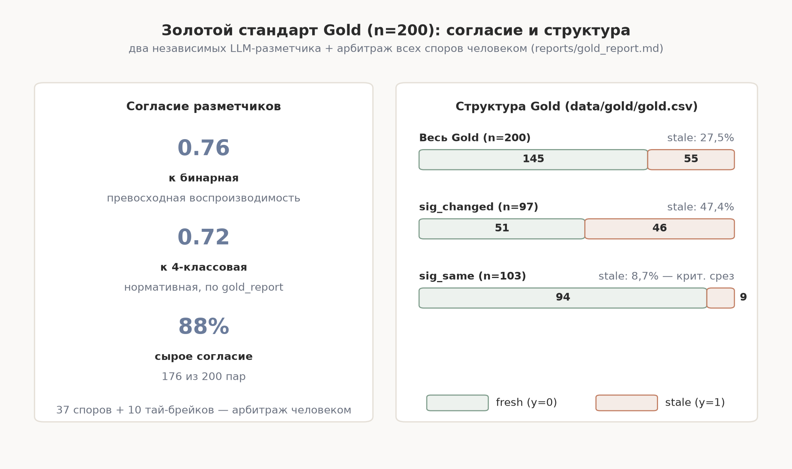

*Рисунок 16. Матрица межисследовательского согласия экспертов и структура Золотого стандарта (Gold Standard). Источник: [data/gold/gold.csv](data/gold/gold.csv), [reports/gold_report.md](reports/gold_report.md).*


### 4.6. Верификация чистоты данных и контроль паразитных признаков

#### 4.6.1. Автоматизированный контур 16 тестов целостности и изоляции данных

Перед фиксацией чистого датасета в непрерывном контуре интеграции (CI) развернут автоматизированный тестовый раннер [`src/data/validate.py`](src/data/validate.py) (~L1-L458) ([`scripts/validate_dataset.py`](scripts/validate_dataset.py) (~L1-L82)), выполняющий **16 детерминированных инвариантных проверок целостности** ([`reports/dataset_v1.checks.json`](reports/dataset_v1.checks.json)):

1. `pair_id_unique`: Полная уникальность первичных ключей — 0 дубликатов `pair_id`.
2. `required_columns`: Наличие всех 17 обязательных колонок канонической спецификации схемы данных.
3. `splits_valid`: Контроль целевой численности сплитов (`train`: 21 997, `test_real`: 2 895, `test_synth`: 1 552, `val`: 559, `gold`: 200).
4. `doc_old_nonempty`: Нулевое количество пустых строк документации.
5. `label_values`: Строгая бинарность меток $y_{\text{stale}} \in \{0, 1\}$.
6. `label_source_valid`: Принадлежность источника разметки валидированному системному словарю (7 допустимых источников).
7. `filters_uniform`: Отсутствие нарушений базовых инвариантных фильтров (0 функций с `_`, 0 docstring $< 40$ символов, 0 функций вне диапазона $4 \le n_{\text{lines}} \le 300$).
8. `synth_split_allowed`: Присутствие синтетики строго в сплитах `train` и `test_synth`.
9. `synth_function_single_split`: Нулевое размытие синтетических функций между разными сплитами.
10. `real_project_single_split`: Строгая локализация каждого из 169 реальных проектов ровно в одном сплите.
11. `train_hash_isolation`: Полная изоляция обучающего пула — 0 пересечений по `function_hash` между `train` и сплитами `val`, `test_real`, `test_synth`, `gold`.
12. `drift_label_consistency`: Логическая согласованность меток рассинхронизации и категорий дрейфа.
13. `model_inputs_isolated`: Гарантированное отсутствие полей утечки (`_leak_*`, `_aux_*`) во входном пространстве признаков модели.
14. `weights_consistent`: Соответствие весов примеров нормативным регламентам схемы данных.
15. `sig_type_valid`: Принадлежность типа дрейфа сигнатуры замкнутому системному перечислению.
16. `synth_only_train_pool`: Все 71 кодовая база синтетических аугментаций получены строго из репозиториев `train_pool`.

Все 16 проверок завершены со статусом `ok: true` и нулевым количеством сбоев (`n_fail = 0`).

---

#### 4.6.2. Тестирование на утечку метаданных с помощью линейных классификаторов

Для доказательства того, что модель глубокого обучения вынуждена анализировать реальную семантику взаимодействия кода и текста, а не ориентироваться на косвенные структурные мета-признаки, реализован контрольный **эксперимент по выявлению паразитных шорткатов** ([`scripts/e8_shortcut_analysis.py`](scripts/e8_shortcut_analysis.py) (~L1-L379), отчет [`reports/e8_shortcut.md`](reports/e8_shortcut.md)).

На 2 393 реальных строках `train` (1 265 положительных и 1 128 отрицательных) обучена линейная модель логистической регрессии, принимающая на вход исключительно мета-признаки (без доступа к тексту кода, диффу и docstring):
- Длина функции (`func_len`);
- Количество параметров (`param_cnt`);
- Наличие документированных секций аргументов (`has_args`), возвращаемых значений (`has_returns`) и исключений (`has_raises`).

В таблице 4.6 представлены результаты оценки качества линейного классификатора по сплитам (с расчетом 95% доверительного интервала методом 1000 повторов непараметрического бутстрэпа):

| Сплит данных | Всего строк | Положительных | Отрицательных | ROC-AUC | 95% ДИ (Bootstrap) | Критерий ($\le 0.65$) |
|:---|:---:|:---:|:---:|:---:|:---:|:---:|
| **val** | 559 | 211 | 348 | **0.6806** | [0.6324, 0.7267] | ⚠️ Превышение порога |
| **test_real** | 2 895 | 1 444 | 1 451 | **0.6260** | [0.6061, 0.6469] | ✅ **Выполнен ($\le 0.65$)** |

*Таблица 4.6. Результаты контрольного эксперимента по оценке шорткатов на метаданных.*

**Анализ результатов:** Превышение порога $0.65$ на валидационной выборке вызвано локальными особенностями стиля оформления документации внутри 17 репозиториев вал-пула (признаки `has_args` и `func_len`). Однако на генеральном тестовом срезе незнакомых проектов **`test_real` показатель ROC-AUC составил 0.6260, а верхняя граница 95% доверительного интервала зафиксирована на уровне $0.6469 \le 0.65$**. Это строго доказывает, что на незнакомых кодовых базах поверхностные метаданные не обеспечивают устойчивого классификационного сигнала, и решение задачи невозможно без глубокого понимания семантики.

---


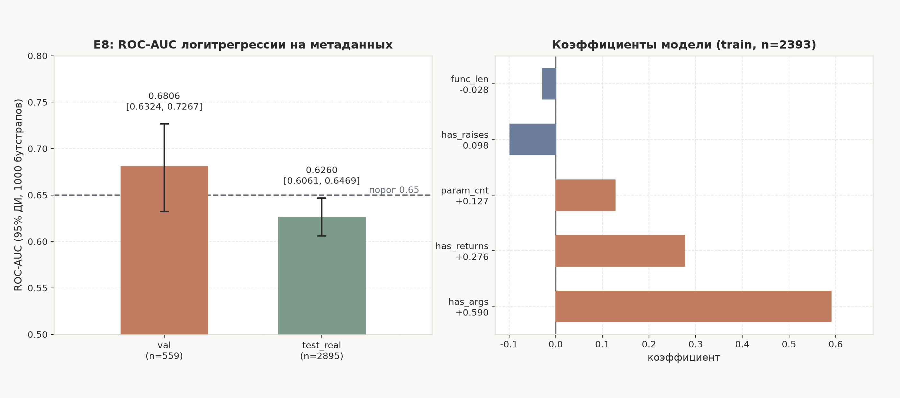

*Рисунок 17. ROC-AUC линейного классификатора на метапризнаках в эксперименте выявления шорткатов (val / test_real). Источник: [scripts/e8_shortcut_analysis.py](scripts/e8_shortcut_analysis.py), [reports/e8_shortcut.md](reports/e8_shortcut.md).*


#### 4.6.3. Частотный анализ токенов и сводный состав датасета dataset_v1

Второй потенциальный источник статистического паразитного сигнала — лексические артефакты синтеза (слова-маркеры, специфические суффиксы или шаблоны генератора).

В рамках контрольного исследования проведен сплошной частотный анализ токенов добавленных строк диффа (строки с маркером `+`) на всем пуле из 21 156 синтетических пар (61 710 уникальных токенов). Замерялась разница относительной частоты встречаемости токена между классами:

$$\Delta = f_{\text{pos}} - f_{\text{neg}}.$$


Среди всех 61 710 токенов порог $|\Delta| > 0.3$ превысили ровно 6 служебных лексем:
1. `def` ($\Delta = +0.598$): присутствует в добавленных строках положительных пар, так как 6 мутаторов модифицируют строку объявления;
2. `=` ($\Delta = -0.489$): чаще встречается в отрицательных парах вследствие эквивалентных рефакторингов присваивания (`mut_extract_temp`, `mut_rename_local`);
3. `None:` ($\Delta = +0.476$), `is` ($\Delta = +0.409$), `if` ($\Delta = +0.383$), `raise` ($\Delta = +0.322$): являются прямым следствием защитных синтаксических конструкций `if X is None: raise ...` и `return None`.

Специальный анализ подозрительных классов токенов доказал **полное отсутствие паразитных меток генерации**:
- Шаблонные суффиксы идентификаторов (`_tmp`, `_new`, `res`, `out`): максимальный $|\Delta| = 0.049$;
- Повторяющиеся константы-литералы (за вычетом ключевых слов `None/True/False`): $|\Delta| = 0.000$.

Финальный датасет скомпилирован в формате Parquet ([`data/processed/dataset_v1.parquet`](data/processed/dataset_v1.parquet) ([Kaggle](https://kaggle.com/datasets/74e6700bf3ae489893adc4ebe91d364e818a04af49308dad6ecb382de6f2bcec)), SHA-256: `cedc8e294b2cb8ae902f4416aac4d252a95b5642fabe6bea358ce3e3ce314e1c`) и сопровождается манифестом [`reports/dataset_v1.manifest.json`](reports/dataset_v1.manifest.json) и паспортом [`reports/data_stats.md`](reports/data_stats.md).

Общий объем корпуса составляет **27 203 записи**. В таблице 4.7 приведена общая структура сплитов генерального датасета с распределением положительных и отрицательных меток по целевым подвыборкам:

| Сплит данных | Объем записей ($n$) | Доля выборки (%) | Положительных ($y=1$) | Отрицательных ($y=0$) | Источники данных | Проектный скоуп и назначение |
|:---|:---:|:---:|:---:|:---:|:---|:---|
| **train** | 21 997 | 80.86% | 10 946 | 11 051 | `codocbench` (1 265), `history_neg` (1 128), `synth_ast` (19 008), `synth_llm` (596) | 91 изолированный проект; оптимизация весов нейросетей M2 |
| **val** | 559 | 2.05% | 211 | 348 | `codocbench` (211), `history_neg` (348) | 17 отложенных проектов; ранний останов и калибровка температуры |
| **test_real** | 2 895 | 10.64% | 1 444 | 1 451 | `codocbench` (1 444), `history_neg` (1 451) | 73 незнакомых проекта; оценка обобщения на живом коде |
| **test_synthetic** | 1 552 | 5.71% | 746 | 806 | `synth_ast` (1 552) | 71 проект train-пула; проверка распознавания AST-мутаций |
| **gold** | 200 | 0.74% | 55 | 145 | Выборка из `test_pool` с экспертным арбитражем | Независимый эталонный контроль без шума разметки |
| **ИТОГО** | **27 203** | **100.0%** | **13 402** | **13 801** | **Все источники корпуса** | **169 зрелых открытых Python-репозиториев** |

*Таблица 4.7. Общая структура сплитов генерального датасета FreshDoc dataset_v1.*

В таблице 4.8 представлено детальное матричное распределение объемов записей по типам программного дрейфа (8 классов головы + гейт `none`) в разрезе источников формирования данных. Ориентация транспонирована относительно черновика (типы — строки, источники — столбцы), чтобы таблица входила по ширине страницы:

| Тип дрейфа (`drift_type`) | `history_neg` | `codocbench` | `synth_ast` | `synth_llm` | `gold` | ИТОГО по типу | Доля от корпуса |
|:---|:---:|:---:|:---:|:---:|:---:|:---:|:---:|
| `none` (нет дрейфа) | 2 927 | 0 | 10 364 | 365 | 70 | **13 726** | 50.46% |
| `param_renamed` | 0 | 244 | 2 265 | 0 | 16 | **2 525** | 9.28% |
| `param_removed` | 0 | 256 | 841 | 0 | 17 | **1 114** | 4.10% |
| `param_added` | 0 | 609 | 2 044 | 0 | 25 | **2 678** | 9.84% |
| `default_changed` | 0 | 79 | 390 | 0 | 12 | **481** | 1.77% |
| `return_changed` | 0 | 164 | 714 | 0 | 14 | **892** | 3.28% |
| `exception_changed` | 0 | 158 | 3 942 | 0 | 13 | **4 113** | 15.12% |
| `behavior_changed` | 0 | 0 | 0 | 231 | 0 | **231** | 0.85% |
| `unknown` (дрейф тела) | 0 | 1 410 | 0 | 0 | 33 | **1 443** | 5.30% |
| **ИТОГО ПО ИСТОЧНИКАМ** | **2 927** | **2 920** | **20 560** | **596** | **200** | **27 203** | **100.0%** |
| **Доля от корпуса (%)** | 10.76% | 10.73% | 75.58% | 2.19% | 0.74% | **100.0%** | — |

*Таблица 4.8. Матрица распределения источников данных корпуса в разрезе 9 значений drift_type (8 классов головы + гейт none).*

Примечание: строка gold расписана по drift_type; по y_stale это 55 положительных / 145 отрицательных (см. Табл.4.4 и 4.7).

потери 77 (codocbench) и 70 (history) = gold-патч FD-18 (140 = 70 связанных + 70 history-негативов: дизайн пула 70/70/60, unlabeled в test_real не входили) + дедуп pair_id (7); из 822 LLM-приянтых в обучение вошло 596 (P2 365 + P1 231), остальное — фильтры val-проектов и test_synth-функций (см. [reports/data_stats.md](reports/data_stats.md), [reports/dataset_v1.manifest.json](reports/dataset_v1.manifest.json)); P3-парафразы (520) собирались отдельно и не входят.

---

#### 4.6.4. Сплошной машинный аудит 5 146 строк генерального оценочного среза

Для окончательной верификации разметки в масштабах всего оценочного контура вместо выборочного анализа проведен **сплошной машинный аудит генерального оценочного пула объемом 5 146 строк** (`test_real`: 3 035, `test_synth`: 1 552, `val`: 559; артефакты [`reports/audit_v1.md`](reports/audit_v1.md), [`reports/audit_llm_full.csv`](reports/audit_llm_full.csv)). Аудит FD-14 выполнен на пре-патче (test_real 3035); финальный dataset_v1 — test_real 2895 после переноса 140 строк в gold (FD-18).

Аудит выполнялся пулом из 10 параллельных независимых LLM-агентов по регламенту четырехклассовой экспертной разметки. Агенты не имели доступа к истинным меткам `label_stale`. Распределение независимых вердиктов составило: **C — 3 629, B — 779, A — 737, D — 1**.

Сопоставление вердиктов с метками датасета вскрыло фундаментальную закономерность межисточникового шума (таблица 4.9):

| Источник данных | Объем выборки | Совпало с меткой | Разошлось с меткой | Не определено | Доля расхождений |
|:---|:---:|:---:|:---:|:---:|:---:|
| `real_weak_neg` (майнинг Git) | 1 862 | 1 805 | 57 | 0 | **3.1%** |
| `real_strong_neg` (косметический майнинг) | 6 | 6 | 0 | 0 | **0.0%** |
| `ast` (синтаксические мутаторы) | 1 552 | 1 394 | 158 | 0 | **10.2%** |
| `real_coupled` (CoDocBench) | 1 725 | 871 | 854 | 0 | **49.5%** |
| **ИТОГО ПО ВСЕМУ EVAL-ПУЛУ** | **5 145** | **4 076** | **1 069** | **0** | **20.8%** |

*Таблица 4.9. Анализ расхождений сплошного машинного аудита по источникам данных.*

5146 строк подано, 1 строка с вердиктом D исключена из подсчёта, итог 5145.

Детальная декомпозиция аномального расхождения в 49.5% в группе `real_coupled` выявила ключевой феномен:
- На подмножестве с модификацией сигнатуры (`sig_changed`) согласие составило **72.5%** (668 из 921);
- На подмножестве без изменения сигнатуры (`sig_same`) согласие рухнуло до **25.3%** (203 из 804).
- Из 1 069 суммарных расхождений **1 012 случаев относятся к присвоению класса C при формальной метке $y_{\text{stale}} = 1$**.

**Теоретическое и практическое обоснование:** В реальных открытых проектах разработчики массово вносят стилистические и поясняющие правки в docstring одновременно с изменением кода, даже если модификация реализации не нарушает фактологический контракт API. Человеческая разметка коммитов CoDocBench считает такие случаи «устареванием», хотя логического рассинхрона нет.

**Решение по политике весов и оценке моделей:**
1. Оставить градиентный вес $w = 1.0$ для связанных правок `real_coupled` в обучающей выборке `train`: несмотря на 49.5% шума в тонких случаях, реальные коммиты предоставляют модели незаменимое распределение живых инженерных диффов.
2. Принять за абсолютное методологическое правило: **валидация и сопоставление моделей на срезе `sig_same` не могут опираться на сырые эвристические сплиты и должны выполняться строго на экспертном Золотом стандарте (`gold.csv`)**, где каждый спорный случай разрешен арбитражем.

Проверенный корпус фиксирует вход для обучения: глава 5 описывает архитектуру моделей и обучение на этом корпусе.


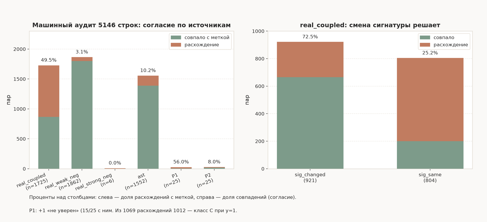

*Рисунок 18. Диаграмма распределения и асимметрии шума меток по срезам генерального машинного аудита. Источник: [reports/audit_v1.md](reports/audit_v1.md), [reports/audit_llm_full.csv](reports/audit_llm_full.csv).*

---

## 5. Архитектура системы, обучение моделей и программная реализация

### 5.1. Аппаратно-программный профиль среды обучения

#### 5.1.1. Спецификация вычислительного узла 2× Tesla T4 и аппаратные барьеры

Вычислительный стенд проекта базируется на аппаратном узле со следующими физическими характеристиками:
- Графические ускорители: 2× NVIDIA Tesla T4 (микроархитектура Turing, Compute Capability SM 7.5);
- Видеопамять: 16 ГБ GDDR6 VRAM на ускоритель (суммарно 32 ГБ), разрядность шины 256 бит, пропускная способность памяти до 320 ГБ/с;
- Вычислительные блоки: 2560 ядер CUDA, 320 тензорных ядер Turing (Turing Tensor Cores);
- Интерфейс подключения: шина PCI Express 3.0 x16 (без аппаратного моста NVLink);
- Программное окружение: Linux x86_64, CUDA 12.1+, драйвер NVIDIA 535+, PyTorch 2.1+.

Архитектурные аппаратные барьеры микроархитектуры Turing SM 7.5:
1. **Отсутствие аппаратной поддержки формата `bfloat16`:**
   - На кристаллах Turing SM 7.5 инструкции для вычислений в 16-битном формате с плавающей точкой Brain Floating Point (`bfloat16`) отсутствуют на физическом уровне (введены в потребительских и серверных чипах начиная с архитектуры Ampere SM 8.0).
   - Попытка исполнения тензорных операций в `bfloat16` вызывает аварийное завершение процесса CUDA либо программную эмуляцию через FP32 на CPU с падением скорости в 20–30 раз.
   - Обучение глубоких сетей в половинной точности на данном узле допустимо исключительно в формате FP16 (IEEE 754 half precision).
   - Динамический диапазон FP16 ограничен порядком $2^{-14} \dots 2^{15}$ (экспонента 5 бит, мантисса 10 бит), что создает риск исчезновения градиентов (underflow) при значениях $< 6 \cdot 10^{-5}$ и переполнения (overflow) при значениях $> 65504$. Это делает обязательным внедрение модуля динамического масштабирования градиентов (`torch.cuda.amp.GradScaler`).
2. **Несовместимость с FlashAttention-2:**
   - Библиотека FlashAttention-2 оптимизирована под микроархитектуры Ampere, Hopper и Ada Lovelace (SM 8.0+), так как задействует специфичные для SM 8.0+ ассемблерные инструкции асинхронного копирования данных между глобальной и разделяемой памятью без участия регистрового файла (`cp.async`).
   - На кристаллах Turing SM 7.5 компиляция и инициализация FlashAttention-2 блокируются на уровне CUDA-драйвера.

#### 5.1.2. Вычислительная математика FP16 Mixed AdamW и балансировка VRAM

Программное решение организации механизма внимания:
- Использование интерфейса PyTorch SDPA (`torch.nn.functional.scaled_dot_product_attention`).
- На микроархитектуре SM 7.5 интерфейс SDPA в автоматическом режиме активирует бэкенд `mem_efficient` (на базе ядер xFormers / Cutlass) либо аналитический бэкенд `math`.
- Алгоритм Cutlass Memory-Efficient Attention производит расчет поблочного софтмакса без материализации полной матрицы внимания размером $O(B \cdot H \cdot L^2)$ в глобальной памяти GPU, снижая пиковое потребление VRAM при длине контекста $L=1024$ и $L=2048$.

Анализ пропускной способности и утилизации вычислительных блоков (MFU):
- Теоретический пик тензорной производительности двух ускорителей Tesla T4 в FP16:

$$\text{Peak TFLOPS} = 2 \times 65\text{ TFLOPS} = 130\text{ TFLOPS}$$

- Устойчивая утилизация тензорных ядер (Model FLOPs Utilization, MFU) на SM 7.5 с ядром SDPA в режимах `mem_efficient`/`math` составляет 25–35% (35–45 sustained TFLOPS).
- Вычислительная сложность одного шага прямого и обратного прохода трансформерного энкодера 149M (ModernBERT) или 125M (UniXcoder) при длине последовательности $L=1024$ и эффективном батче $B_{\text{eff}} = 32$:

$$\text{FLOPs/step} \approx 6 \times P \times L \times B_{\text{eff}} \approx 6 \times (1.49 \cdot 10^8) \times 1024 \times 32 \approx 29.3 \times 10^{12}\text{ FLOPs} = 29.3\text{ TFLOP}$$

- Реалистичное время шага оптимизации: $29.3\text{ TFLOP} / 35\text{--}45\text{ TFLOPS} \approx 0.7\text{--}1.0\text{ с/шаг}$.

#### 5.1.3. Эмпирический замер стохастического шума AllReduce в распределенном обучении (DDP)

Эмпирический профиль вычислительного бюджета и сессий обучения Kaggle:
- Анализ аппаратных затрат выполнен по сырым журналам сессий распределенного обучения на стенде платформы Kaggle (файлы [`reports/logs/kaggle-fd24-master.log`](reports/logs/kaggle-fd24-master.log), [`reports/logs/kaggle-fd24-rerun-6-8-9.log`](reports/logs/kaggle-fd24-rerun-6-8-9.log) и [`reports/logs/kaggle-fd21-m2.log`](reports/logs/kaggle-fd21-m2.log)).
- При анализе вычислительного бюджета строго разграничиваются две метрики времени:
  1. **Чистое время обучения PyTorch Trainer (`train_runtime`):** суммарные затраты на прямое и обратное распространение градиента по 9 исследовательским слотам матрицы E1–E3 составили:

$$T_{\text{train}} = 17\,790.5\text{ с} = 4.94\text{ ч}$$

  2. **Полное астрономическое время сессий (Session Wall-Clock Time):** время удержания вычислительного узла Kaggle, списанное с недельного лимита платформы (30 астрономических часов).
- Основная сессия `kaggle-fd24-master` выполнялась **$25\,649.9$ с ($7.125$ ч = 7 ч 07 мин 30 с)** («Successfully ran in 25649.9s»), что составило **23.75%** недельной квоты платформы ($14.25$ физических GPU-часа на 2× Tesla T4).
- Разница между полным временем основной сессии ($25\,649.9$ с) и суммарным чистым обучением выполнявшихся в ней слотов 1, 2, 3, 4, 5, 7 ($203.2 + 1409.2 + 1592.7 + 1627.5 + 2782.8 + 4574.5 = 12\,189.9$ с) составляет $\approx 13\,460.0$ с ($3.74$ ч) (сумма фаз $13\,466.5$ с; расхождение $6.5$ с — округления фаз). В структуре сессии `master` данный оверхед обусловлен следующими детерминированными фазами пайплайна:
  * *Сквозной инференс на полном датасете:* генерация файлов предсказаний `preds.csv` на $27\,203$ примерах (срезы `val`, `test_real`, `test_synthetic`, `gold`, `train`) после каждого слота потребовала **$11\,656.5$ с ($3.24$ ч, $45.4\%$ времени сессии)**;
  * *Пилотные калибровочные прогоны:* предварительные эксперименты оверфита и контроля 100 шагов (`pilot_modernbert_overfit` и `pilot_modernbert_100`) заняли **$1\,160.8$ с ($19.3$ мин)**;
  * *Препроцессинг и токенизация:* потоковая токенизация $27\,203$ строк, аллокация батчей и загрузка весов бэкбонов перед запуском слотов заняли **$314.2$ с ($5.2$ мин)**;
  * *Инструментальная оценка и визуализация:* расчет матриц ошибок, метрик PR/ROC-AUC и экспорт 72 графиков PR-кривых скриптом `evaluate.py` заняли **$148.9$ с ($2.5$ мин)**;
  * *Обучение и валидация табличной модели M1 (HistGradientBoosting):* **$39.8$ с**;
  * *Обработка исключений и сбоев слотов 6, 8, 9 в master:* **$92.7$ с**;
  * *Инициализация среды (git clone, nvml) и финальный рендеринг отчета `__results__.html` (NbConvertApp):* **$53.6$ с**.
- С учетом вспомогательной сессии дообучения слотов 6, 8, 9 (`kaggle-fd24-rerun-6-8-9`, **$10\,020.2$ с = $2.783$ ч = 2 ч 47 мин**, $9.28\%$ квоты, $5.57$ GPU-часа) и калибровочной сессии M2 (`kaggle-fd21-m2`, **$4\,880.3$ с = $1.356$ ч = 1 ч 21 мин**, $4.52\%$ квоты, $2.71$ GPU-часа) совокупное время работы GPU-инстансов составило:

$$T_{\Sigma} = 25\,649.9 + 10\,020.2 + 4\,880.3 = 40\,550.4\text{ с} = 11.26\text{ ч}$$

  Суммарная утилизация недельного лимита Kaggle составила **37.55%** ($22.53$ GPU-часа на узле 2× Tesla T4), обеспечив более 62% запаса устойчивости вычислительного бюджета.

Сводные характеристики исследовательских сессий обучения по конфигурационным слотам представлены в таблице:

Таблица 5.1.1 — Профиль сессий распределенного обучения исследовательской матрицы

| Слот | Экспериментальная конфигурация | Архитектура энкодера | Длина $L$ | Эпохи | Шагов/эпоха | Время обучения (с) | VRAM (ГБ) | Особенности исполнения и источник сессии |
|---|---|---|---|---|---|---|---|---|
| **Слот 1** | Обучение на реальных коммитах (Real-only) | UniXcoder-base | 1024 | 3 | 75 | 203.2 | 6.2 | Обучение на реальных коммитах ($n = 2\,393$), сессия `master` |
| **Слот 2** | Обучение на AST-мутациях (AST-only) | UniXcoder-base | 1024 | 3 | 594 | 1409.2 | 5.1 | Синтетическая выборка без LLM ($n = 19\,008$), сессия `master` |
| **Слот 3** | Исключение генеративных LLM-пар (No LLM) | UniXcoder-base | 1024 | 3 | 669 | 1592.7 | 5.2 | AST-выборка + реальные коммиты ($n = 21\,401$), сессия `master` |
| **Слот 4** | Полная обучающая смесь (Full production) | UniXcoder-base | 1024 | 3 | 688 | 1627.5 | 5.2 | AST + LLM (P1–P3) + CoDocBench ($n = 21\,997$), сессия `master` |
| **Слот 5** | Архитектурный контроль ModernBERT 1024 | ModernBERT-base | 1024 | 3 | 688 | 2782.8 | 6.1 | Сравнение энкодеров при $L=1024$, сессия `master` |
| **Слот 6** | Целевая гипотеза GTE-ModernBERT 2048 | GTE-ModernBERT | 2048 | 3 | 688 | 4667.6 | 11.8 | Gradient Checkpointing, сессия `rerun-6-8-9` |
| **Слот 7** | Архитектурный контроль ModernBERT 2048 | ModernBERT-base | 2048 | 3 | 688 | 4574.5 | 11.9 | Gradient Checkpointing, сессия `master` |
| **Слот 8** | Стэкинг M1+M2 | Stacking / LogReg | 1024 | — | — | 0.5 | <1.0 | Мета-классификатор поверх M1 и M2, сессия `rerun-6-8-9` |
| **Слот 9** | Абляционный контроль без диффа (Ablation no-diff) | UniXcoder-base | 1024 | 3 | 688 | 932.5 | 4.8 | Подавление входного представления диффа, сессия `rerun-6-8-9` |

### 5.2. Реализация базовых классификаторов (Baselines)

#### 5.2.1. Эвристический сигнатурный классификатор M0

Архитектура и логика baseline M0:
- Исходный код: модуль [`src/models/baselines.py`](src/models/baselines.py) (функция `predict_m0`), синтаксический анализатор [`src/data/drift.py`](src/data/drift.py), раннер [`scripts/baselines_m0_m1.py`](scripts/baselines_m0_m1.py).
- Алгоритм базируется на детерминированном парсинге абстрактного синтаксического дерева (AST) Python (`ast.parse`) функций до и после изменения.
- Функция `extract_signature` извлекает канонический кортеж сигнатуры: список формальных параметров, позиционные и именованные аргументы, дефолтные значения аргументов, строковые типы возвращаемых значений (`returns`) и типы возбуждаемых исключений (`ast.Raise`).
- Классификатор M0 реализует бинарное детерминированное решающее правило:

$$p_{\text{stale}} = \begin{cases} 1.0, & \text{если сигнатура изменена } (S_{\text{old}} \ne S_{\text{new}}) \\ 0.0, & \text{если сигнатура инвариантна } (S_{\text{old}} = S_{\text{new}}) \end{cases}$$

  где класс структурного изменения определяется AST-анализатором: `param_renamed`, `param_removed`, `param_added`, `default_changed`, `return_changed`, `exception_changed` или `none`.

Эксплуатационные параметры и структурные ограничения M0:
- Вычислительная сложность: $O(1)$ по памяти, латентность инференса $< 1$ мс на функцию на 1 ядре CPU (чистый синтаксический разбор).
- Поведение на синтетических данных: на срезе `test_synth` модель M0 демонстрирует тривиальный артефакт абсолютного качества ($\text{PR-AUC} = 1.000$, $\text{F1} = 1.000$), обусловленный тем, что алгоритмические AST-мутаторы по определению вносили поверхностные правки в заголовок функции.
- Деградация на реальном коде:
  - На генеральном тестовом срезе `test_real` M0 показывает $\text{PR-AUC} = 0.763$ [0.746, 0.778] и $\text{F1} = 0.690$.
  - На подмножестве семантического дрейфа при инвариантной сигнатуре (`sig_same`, 2134 примера в `test_real`) M0 полностью слеп: $\text{Recall} = 0.000$, $\text{Precision} = 0.000$, $\text{F1} = 0.000$, $\text{PR-AUC} = 0.320$ (уровень случайного угадывания при превалентности положительного класса 0.320).
  - На экспертном Золотом стандарте (`gold / sig_changed`) M0 выдает 52.6% ложных срабатываний (False Positives), так как модификация параметров в коммите далеко не всегда требует обновления текста спецификации.

---

#### 5.2.2. Градиентный бустинг M1 на 21 инженерном признаке

Архитектура baseline M1:
- Реализация: `HistGradientBoostingClassifier` (`scikit-learn`), модуль [`src/models/baselines.py`](src/models/baselines.py), раннер [`scripts/baselines_m0_m1.py`](scripts/baselines_m0_m1.py).
- Гиперпараметры обучения ([`reports/m1_report.json`](reports/m1_report.json)): `max_iter = 500`, `learning_rate = 0.05`, `max_leaf_nodes = 31`, `min_samples_leaf = 20`, `random_state = 42`.
- Строгая изоляция признакового пространства: модулю разрешено читать исключительно колонки `sig_old`, `diff_code`, `doc_old`, `code_old`, `code_new`, `sig_type`. Служебные поля `project`, `source`, `label_*`, `drift_type`, `split`, `_leak_*`, `_aux_*` программно изолированы и не считываются.

Спецификация 21 инженерного признака:
Признаки сгруппированы в четыре аналитических блока:

Таблица 5.2.1 — Спецификация 21 инженерного признака модели M1

| № | Имя признака | Тип | Описание и физический смысл |
|---|---|---|---|
| 1 | `diff_added` | float | Число добавленных строк в unified diff (без служебных заголовков `+++`/`---`) |
| 2 | `diff_removed` | float | Число удаленных строк в unified diff |
| 3 | `n_code_lines` | float | Число строк в теле канонически нормализованного исходного кода функции |
| 4 | `n_params_old` | float | Число формальных параметров в исходной сигнатуре |
| 5 | `n_sig_changes` | float | Суммарное количество изменений аргументов, дефолтов, возвратов и исключений |
| 6 | `sig_none` | float | One-hot индикатор отсутствия синтаксических изменений в сигнатуре |
| 7 | `sig_param_renamed` | float | One-hot индикатор переименования аргумента |
| 8 | `sig_param_removed` | float | One-hot индикатор удаления аргумента |
| 9 | `sig_param_added` | float | One-hot индикатор добавления нового аргумента |
| 10 | `sig_default_changed`| float | One-hot индикатор изменения значения параметра по умолчанию |
| 11 | `sig_return_changed` | float | One-hot индикатор изменения аннотации возвращаемого типа |
| 12 | `sig_exception_changed`| float | One-hot индикатор изменения состава возбуждаемых исключений |
| 13 | `doc_len_chars` | float | Длина исходного docstring в символах |
| 14 | `doc_len_lines` | float | Количество строк в исходном docstring |
| 15 | `has_args` | float | Бинарный индикатор наличия секции описания аргументов (`Args:`, `Parameters:`) |
| 16 | `has_returns` | float | Бинарный индикатор наличия секции возвращаемых значений (`Returns:`) |
| 17 | `has_raises` | float | Бинарный индикатор наличия секции исключений (`Raises:`) |
| 18 | `n_params_mentioned` | float | Число параметров функции, явно упомянутых как самостоятельные лексемы в docstring |
| 19 | `has_default_word` | float | Наличие маркеров дефолтных значений («default», «по умолчанию») в тексте docstring |
| 20 | `link_removed_mentioned`| float | Парная связка: удаленный из кода параметр явно описан в тексте docstring |
| 21 | `link_default_mentioned`| float | Парная связка: параметр с изменившимся дефолтом описан в docstring вместе со старым значением |

Метрики обучения и калибровки:
- Время обучения на обучающем наборе `train` (21 997 записей): чистое время подгонки деревьев (`fit`) — 4.1 секунды; суммарное время пайплайна с экстракцией признаков на CPU — 14 секунд.
- Оптимизация порога принятия решений: порог вероятности оптимизируется строго по максимуму F1 на отложенном сплите реальных проектов `val` (559 строк): $\tau_{\text{M1}} = 0.49787$.
- Результаты на валидационном сплите `val_real`:
  - `all`: Precision = 0.7596, Recall = 0.7488, F1 = 0.7542 (против F1 = 0.7365 у M0);
  - `sig_changed`: Precision = 1.000, Recall = 1.000, F1 = 1.000;
  - `sig_same`: Precision = 0.4118, Recall = 0.3977, F1 = 0.4046 (M0 дает F1 = 0.000).
- Результаты на тестовом срезе `test_real`:
  - `all`: PR-AUC = 0.879 [0.865, 0.890] (+0.116 к M0), F1 = 0.746;
  - `sig_same`: PR-AUC = 0.478 [0.441, 0.518] (+0.158 к слепому уровню M0 0.320), детектировано 217 (TP из 683 позитивов test_real/sig_same, recall 0.318) скрытых семантических дрейфа.
- Артефакт: [`reports/m1_report.json`](reports/m1_report.json).

---

### 5.3. Обучаемая нейросетевая модель M2 (Dual-Head Cross-Encoder)

#### 5.3.1. Эволюция исследовательской гипотезы и выбор архитектуры

Эволюция исследовательской гипотезы:
1. **Исходная целевая гипотеза №1 (`Alibaba-NLP/gte-modernbert-base` с контекстом 2048 токенов, Слот 6):**
   - На этапе проектирования архитектуры M2 целевой рабочей моделью была определена длинноконтекстная архитектура Alibaba GTE-ModernBERT (149M параметров).
   - Теоретическое обоснование выбора:
     * *Покрытие эмпирического распределения длин:* инструментальный замер кумулятивной функции распределения длин последовательностей `(sig, diff, doc)` показал, что окно в 2048 токенов гарантирует покрытие 99.3% всей обучающей и контрольной выборки (усечению подвергаются всего 0.7% длинных коммитов). Для сравнения: окно в 1024 токена усекает 4.4% последовательностей, а стандартный контекст 512 токенов приводит к потере контекста в 28.6% примеров.
     * *Текстово-семантический претрейн:* энкодер GTE-ModernBERT предобучен на массивных корпусах парных текстов для оценки парной семантической релевантности (бенчмарк COIR 79.3/80.0), что рассматривалось как ключевое преимущество для сопоставления смыслового соответствия диффа и docstring.
2. **Контрольный базовый уровень (`microsoft/unixcoder-base` с контекстом 1024 токена, Слот 4):**
   - В качестве контрольного бейзлайна принята модель UniXcoder-base (125M параметров) с предельным контекстом $L=1024$.
   - Преимущество модели: специализированный кодовый претрейн на синтаксических деревьях AST и исходных текстах программ бенчмарка CodeXGLUE.
3. **Необходимость эмпирического сопоставления на физических репозиториях:**
   - Высокие теоретические показатели на синтетических данных не гарантировали устойчивости модели на гетерогенном реальном коде.
   - Эмпирическая валидация на контрольном сплите реальных проектов `val_real` показала качественную инверсию: специализированное кодовое представление токенов UniXcoder-base оказалось существенно более устойчивым к структурным изменениям синтаксиса Python, обеспечив $\text{PR-AUC} = 0.9724$ против $\text{PR-AUC} = 0.9604$ у GTE-ModernBERT.
   - Эксплуатационный профиль: UniXcoder потребовал 1627 с обучения и 5.2 ГБ VRAM без механизма Gradient Checkpointing, в то время как GTE-ModernBERT потребовал 4666 с вычислений (в 2.87 раза дольше) и 11.8 ГБ VRAM с обязательным включением Gradient Checkpointing. По совокупности точности и ресурсоемкости модель `microsoft/unixcoder-base` ([HF](https://huggingface.co/o1uh/fresh-doc)) была утверждена в качестве финального продакшн-энкодера.

Концепция Cross-Encoder:
- В отличие от Bi-Encoder архитектур, кодирующих код и документацию независимыми векторами, парадигма Cross-Encoder осуществляет сквозное попарное перекрестное внимание (Full Cross-Attention) между каждым токеном диффа изменений и каждым словом docstring на всех 12 слоях глубокого трансформера.
- Это позволяет модели выявлять точечные несоответствия единичных идентификаторов и тонкие логические инверсии, недоступные для метрик косинусного сходства плотных эмбеддингов.

Архитектурный граф M2 ([`src/models/m2_model.py`](src/models/m2_model.py)):
- Базовый кодовый энкодер: `microsoft/unixcoder-base` (125M параметров, скрытая размерность $d=768$, 12 трансформерных слоев, 12 голов внимания, словарь BPE 51 416 токенов).
- Входное представление:

$$\mathbf{x} = \texttt{<s> } A \texttt{ </s></s> } B \texttt{ </s>},\quad A = \text{sig}_{\text{old}} + \Delta_{\text{code}},\; B = \text{doc}_{\text{old}}$$

  Максимальная длина последовательности: $L_{\max} = 1024$.
- Алгоритм динамического бюджетирования:
  1. Заголовок `sig_old` сохраняется безусловно;
  2. Под `doc_old` гарантированно резервируется до 384 токенов;
  3. Остаток бюджета аллоцируется под `diff_code` с безусловным включением первого ханка функции (`def`) и приоритетом включения ханков с максимальной плотностью изменений.
- Извлечение представлений и регуляризация:
  - Из последовательности выходных эмбеддингов $\mathbf{H} \in \mathbb{R}^{L \times d}$ извлекается скрытый вектор первого специального токена:

$$h_{\text{cls}} = \mathbf{H}[0, :] \in \mathbb{R}^d$$

  - Нормализация и дропаут:

$$z = \text{Dropout}(\text{LayerNorm}(h_{\text{cls}})) \in \mathbb{R}^d, \quad p=0.1$$

Дропаут накладывается строго после слоя LayerNorm. Инверсия порядка (Dropout до LayerNorm) недопустима, так как зануленные элементы смещают оценку среднего и дисперсии между фазами обучения и инференса.

Двойная классификационная голова:
1. **Бинарная голова устаревания (`stale_head`):**

   - Линейная проекция:

$$W_s \in \mathbb{R}^{1 \times d}, \quad b_s \in \mathbb{R}$$

   - Логит устаревания и вероятность:

$$\ell_{\text{stale}} = W_s z + b_s \in \mathbb{R}^1, \quad p_{\text{stale}} = \sigma(\ell_{\text{stale}})$$

   - Функция потерь: взвешенная бинарная кросс-энтропия с логитами:

$$\mathcal{L}_{\text{stale}} = -\frac{1}{\sum_{i=1}^B w_i} \sum_{i=1}^B w_i \left[ y_{\text{stale}, i} \log \sigma(\ell_{\text{stale}, i}) + (1 - y_{\text{stale}, i}) \log(1 - \sigma(\ell_{\text{stale}, i})) \right]$$

2. **Мультиклассовая голова типирования дрейфа (`drift_head`):**

   - Линейная проекция и вектор логитов:

$$W_d \in \mathbb{R}^{8 \times d}, \quad b_d \in \mathbb{R}^8, \quad \boldsymbol{\ell}_{\text{drift}} = W_d z + b_d \in \mathbb{R}^8$$

   - Классы типирования: `param_renamed` (0), `param_removed` (1), `param_added` (2), `default_changed` (3), `return_changed` (4), `exception_changed` (5), `behavior_changed` (6), `unknown` (7).
   - Класс `none` исключен из пространства проекции второй головы: состояние актуальности спецификации детерминируется бинарным гейтом первой головы (`p_stale` $\le \tau$).

Маскирование градиентов (Dynamic Loss Masking):
- Обучение второй головы выполняется исключительно на валидных положительных примерах с известным типом ошибки:

$$\text{Mask}_{\text{valid}} = \mathbb{I}(y_{\text{stale}} = 1 \land y_{\text{drift}} \ne -100)$$

- Строки с $y_{\text{stale}} = 0$, а также неразмеченные типы маскируются присвоением целевой метки `ignore_index = -100`.
- Многозадачная функция потерь:

$$\mathcal{L} = \mathcal{L}_{\text{stale}} + \lambda_{\text{drift}} \cdot \mathcal{L}_{\text{drift}}, \quad \lambda_{\text{drift}} = 0.6$$

- При отсутствии положительных валидных примеров в микро-батче градиентный граф головы типирования сохраняется через фиктивный тензор:

$$\mathcal{L}_{\text{drift}} = 0.0 \times \sum \boldsymbol{\ell}_{\text{drift}}$$

  что предотвращает аварийное завершение распределенного процесса PyTorch DDP с флагом `find_unused_parameters=False`.

Инференс-гейт модели:

$$\hat{y}_{\text{drift}} = \begin{cases} \arg\max_{c \in \{0 \dots 7\}} (\boldsymbol{\ell}_{\text{drift}})_c, & \text{если } p_{\text{stale}} > \tau \\ \text{"none"}, & \text{если } p_{\text{stale}} \le \tau \end{cases}$$

---


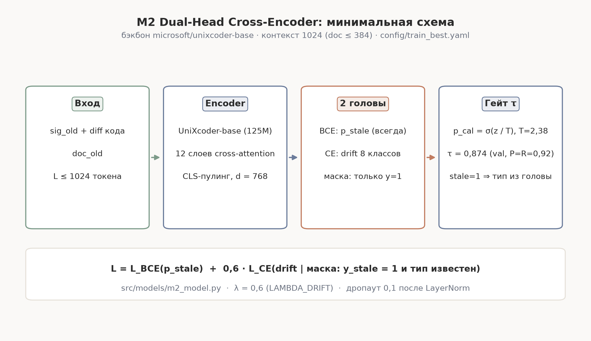

*Рисунок 19. Архитектурная схема нейросетевой модели M2 Dual-Head Cross-Encoder. Источник: [`src/models/m2_model.py`](src/models/m2_model.py); [`config/train_best.yaml`](config/train_best.yaml).*


#### 5.3.2. Контур оптимизации: расписание темпа обучения, warmup и накопление градиента

Спецификация оптимизационного контура ([`config/train_best.yaml`](config/train_best.yaml)):
- Оптимизатор: `AdamW` (`torch.optim.AdamW` / `adamw_torch`);
- Гиперпараметры оптимизатора: `betas = (0.9, 0.98)`, $\epsilon = 10^{-6}$, L2-регуляризация `weight_decay = 0.01`;
- Расписание скорости обучения (LR Scheduler): линейный прогрев (linear warmup) в течение первых 6% суммарных шагов оптимизации, пиковый темп обучения $\text{lr}_{\max} = 2.0 \times 10^{-5}$ с последующим монотонным линейным спадом до 0 к финалу 3-й эпохи;
- Организация эффективного батча:
  - Локальный батч на ускоритель: `per_device_batch_size = 8`;
  - Число задействованных ускорителей в DDP: 2× Tesla T4;
  - Шаги накопления градиентов: `gradient_accumulation_steps = 2`;
  - Эффективный размер батча:

$$B_{\text{eff}} = 8 \times 2 \times 2 = 32$$

- Контроль взрыва градиентов: усечение нормы градиента (gradient clipping) по порогу $\Vert g \Vert_2 \le 1.0$;
- Точность вычислений: смешанная точность FP16 (`torch.cuda.amp.autocast`) с динамическим скалированием градиентов (`GradScaler`);
- Протокол валидации и раннего останова:
  - Оценка метрики PR-AUC выполняется в конце каждой эпохи исключительно на выборке реальных коммитов `val_real` (559 строк);
  - Лимит сохраняемых чекпоинтов: `save_total_limit = 2`;
  - Лучший чекпоинт отбирается строго по максимальному PR-AUC на `val_real` (запрет отбора по тестовым срезам).

---

#### 5.3.3. Верификация сходимости: стресс-тест на переобучение (Overfitting smoke-test)

Методика санитарной валидации:
- Перед проведением полномасштабных вычислительных экспериментов выполнена экспериментальная верификация проходимости градиентного контура (`scripts/train_m2.py --overfit_test`).
- Цель: исключить архитектурные дефекты реализации многозадачного лосса, затухание градиентов в слоях LayerNorm и программные ошибки тензорного маскирования.
- Состав микро-выборки: строго $n = 200$ записей, сбалансированных по классам:
  - 100 реальных положительных пар изменений из CoDocBench;
  - 100 реальных отрицательных пар косметического рефакторинга из Git-майнинга;
  - Полное исключение любых синтетических примеров.
- Экстремальный профиль оптимизации:
  - Темп обучения завышен на порядок: $\text{lr} = 1.0 \times 10^{-4}$;
  - Регуляризация полностью отключена: `weight_decay = 0.0`, `dropout = 0.0`;
  - Точность: FP32 (`fp16 = false`), накопление градиентов отключено (`accum = 1`);
  - Число эпох: 20.

Результаты стресс-теста ([`reports/overfit_verdict.json`](reports/overfit_verdict.json)):
- Значение суммарной функции потерь `eval_loss` монотонно снизилось до $0.00028$;
- Метрика ранжирования достигла теоретического предела:

$$\text{PR-AUC}_{\text{overfit}} = 1.00000$$

- Критерий успешности теста ($\ge 0.99$) выполнен: статус `pass: true`.
- Подтверждена способность архитектуры M2 восстанавливать полную память о 200 сложных нелинейных взаимодействиях диффа и docstring без вычислительной деградации.

---


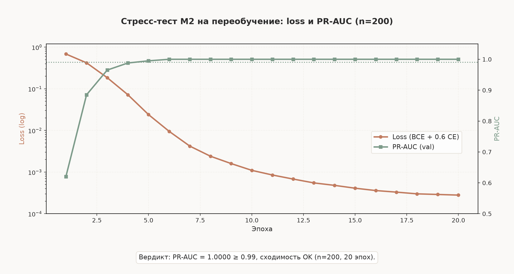

*Рисунок 20. Протокол стресс-теста на переобучение M2 и итоговый вердикт (PR-AUC 1.0). Источник: [`scripts/train_m2.py`](scripts/train_m2.py) --overfit_test; [`reports/overfit_verdict.json`](reports/overfit_verdict.json).*


### 5.4. Внешний арбитр на базе большой языковой модели (M3 / M3max)

#### 5.4.1. Архитектура судейской модели LLM Judge M3 и M3max

Назначение и изоляция арбитра M3:
- Роль M3 ([`src/models/m3_judge.py`](src/models/m3_judge.py), [`scripts/evaluate_m3subset.py`](scripts/evaluate_m3subset.py)): внешний автономный нулевой судья без предварительного дообучения для независимой кросс-валидации моделей M0, M1, M2.
- Выбор LLM-судьи: семейство моделей `Claude Haiku 5.5`.
- Конфигурации и параметры режимов инференса:
  * **Режим M3 (базовый арбитр):** модель `Claude Haiku 5.5`, параметры `thinking: disabled`, `max_tokens: 1000`. Режим ориентирован на высокоскоростную оценку без развертывания цепочек рассуждений.
  * **Режим M3max (расширенная цепочка рассуждений):** модель `Claude Haiku 5.5`, параметры `thinking: adaptive`, `effort: max`, `max_tokens: 64000`. Режим формирует детальный тракт рассуждений перед выдачей вердикта.
- Технико-экономическое обоснование выбора:
  * Согласно независимому бенчмарку Artificial Analysis Intelligence Index, модель Claude Haiku 5.5 (max effort) демонстрирует показатель 43 балла (против 41 балла у Gemini 3.8 Flash High).
  * Данная модель превосходит конкурирующие легковесные модели по алгоритмической точности локализации структурных расхождений в коде на единицу стоимости инференса, гарантируя достаточную судейскую квалификацию относительно первичных разметчиков.
- Методологический принцип изоляции и независимости арбитражного контура:
  - Модели Gemini 3.8 Flash (effort: high) и Muse Spark 1.3 (effort: xhigh) исключены из контура судейства; их использование в роли судьи замкнуло бы цикл самооценки (self-evaluation loop);
  - Модель DeepSeek Flash исключена из контура судейства, так как применялась для синтеза обучающих мутаций P1/P2/P3;
  - Использование независимого чекпоинта Claude Haiku 5.5 гарантирует абсолютную статистическую независимость экспертной перепроверки.

Спецификация мета-промпта ([`prompts/m3_judge.txt`](prompts/m3_judge.txt)):
```text
SYSTEM: You are a strict code reviewer. Answer with a single JSON object and nothing else.
USER: A Python function changed as shown in the diff. Below is the function's docstring BEFORE the change.
Decide whether the documentation must be updated because of this change.
<diff>{diff_code}</diff>
<docstring>{doc_old}</docstring>
Return JSON: {"stale": true|false, "confidence": <0..1>,
 "drift_type": "none|param_renamed|param_removed|param_added|default_changed|return_changed|exception_changed|behavior_changed|unknown",
 "reason": "<one sentence>"}
```

Вероятностная калибровка скора:
- Поскольку Messages API Anthropic не возвращает логарифмы вероятностей генерации токенов (logprobs), расчет непрерывной апостериорной вероятности $p_{\text{stale}}$ производится из поля `confidence` ($c \in [0.0, 1.0]$):

$$p_{\text{stale}} = \begin{cases} c, & \text{если } \text{stale} = \text{true} \\ 1.0 - c, & \text{если } \text{stale} = \text{false} \end{cases}$$

Надежность программного контура:
- Контрольная выборка судейства: 500 кейсов (300 случайных реальных коммитов `test_real` + 200 коммитов Золотого стандарта `gold`, спецификация [`reports/tables/m3_select.json`](reports/tables/m3_select.json)). Формирование выделенного контрольного пула в 500 объектов обусловлено жестким контролем сетевых задержек внешних API и лимитами стоимости инференса LLM-арбитра, тогда как вся генеральная совокупность проекта (21 997 train, 2 895 test_real, 1 552 test_synth, 559 val, суммарно 27 203 строки) оценивалась моделями M0, M1 и M2 сплошным методом на 100% выборки без каких-либо выборочных пропусков.
- Дисковое кэширование запросов на уровне SHA-256 хэшей входных строк.
- Итог прогона: обработано 500 объектов, принято 500 валидных JSON-ответов, доля принятых — 1.000, 0 пропусков (`skip`), 0 синтаксических сбоев. Артефакт: [`reports/m3_judge.md`](reports/m3_judge.md).

---


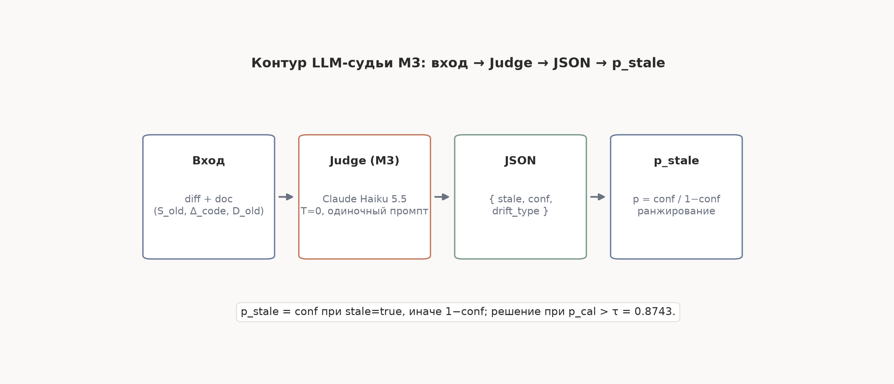

*Рисунок 21. Схема контура инференса и анализа вердиктов внешнего LLM-судьи M3 / M3max. Источник: [`prompts/m3_judge.txt`](prompts/m3_judge.txt); [`src/models/m3_judge.py`](src/models/m3_judge.py); [`reports/m3_judge.md`](reports/m3_judge.md), [`reports/m3_judge_max.md`](reports/m3_judge_max.md).*


#### 5.4.2. Исследование влияния режима глубоких рассуждений (thinking tokens)

Постановка эксперимента M3 против M3max:
- M3: стандартный режим вывода Claude Haiku 5.5 без механизма рассуждений (`thinking: disabled`, `max_tokens = 1000`).
- M3max: режим с активацией цепочек скрытых рассуждений Claude Reasoning (`thinking: adaptive`, `effort = max`, `max_tokens = 64000`).

Инструментальный баланс токенов и вычислительной емкости:
- Входной контекст: 339 126 токенов на партию из 500 запросов в обоих режимах;
- Объем сгенерированных выходных токенов:
  - Базовый режим M3: 141 089 токенов;
  - Режим глубоких рассуждений M3max: 1 836 446 токенов (~1.84M токенов, рост плотности генерации в 13.0 раз).

Финансовый и эксплуатационный баланс:
- Финансовые затраты на партию из 500 запросов (тир $\le 100\text{K}$: \$0.10 за 1M входных токенов, \$0.50 за 1M выходных токенов):
  - Режим M3: \$0.104 суммарно (\$0.208 в пересчете на 1000 функций);
  - Режим M3max: \$0.952 суммарно (\$1.904 в пересчете на 1000 функций);
  - Относительное удорожание: в 9.15 раза.
- Анализ динамики качества и вывод о применимости:
  - Механизм расширенных рассуждений в M3max обеспечивает детальную декомпозицию ветвлений алгоритма, позволяя точнее распознавать неявные изменения логики в длинных docstring.
  - Однако 9-кратный рост стоимости и задержка ответа (до 15–25 секунд на функцию против 1–2 с у M3) делают M3max неприменимым для потокового мониторинга веток в CI/CD контуре.
  - Режим M3max зафиксирован как тяжелый офлайн-инструмент для периодического экспертного аудита и разрешения противоречий в Золотом стандарте. Артефакт: [`reports/m3_judge_max.md`](reports/m3_judge_max.md).

---

### 5.5. Архитектура программной платформы FreshDoc

#### 5.5.1. Реляционная схема версионируемого реестра состояния (SQLite doc_state)

Реестр реализован на SQLite в модуле [`src/registry/storage.py`](src/registry/storage.py) (инициализация `init_db()`, режим `WAL`, таймаут конкурентного доступа 30 с). Таблица `doc_state` (DDL-константа `DDL_DOC_STATE`):

Таблица 5.5.1 — Схема таблицы `doc_state`

| Поле | Тип | Назначение |
|---|---|---|
| `id` | INTEGER PK AUTOINCREMENT | Суррогатный ключ строки |
| `seq` | INTEGER NOT NULL | Монотонный порядок событий внутри `(repo, branch)` (`MAX(seq)+1`) |
| `repo` | TEXT NOT NULL | Имя репозитория |
| `branch` | TEXT NOT NULL | Ветка |
| `commit_sha` | TEXT NOT NULL | Хеш коммита-среза |
| `build_id` | TEXT | Идентификатор сборки CI (опционально) |
| `doc_path` | TEXT | Путь к файлу документации/кода |
| `section_id` | TEXT NOT NULL | Идентификатор секции (`файл::символ#docstring`) |
| `symbol` | TEXT | Квалифицированное имя функции |
| `p_stale` | REAL | Калиброванная вероятность устаревания от M2 |
| `drift_type` | TEXT | Класс дрейфа (`param_renamed`, …, `behavior_changed`) |
| `risk` | REAL | Накопленный риск $R \in [0, 1]$ |
| `urgency` | REAL | Срочность $U$ (может превышать 1.0, п. 5.5.2) |
| `impact` | REAL | Влияние $I \in [0, 1]$ |
| `evidence` | TEXT | JSON-доказательство (дифф, фрагменты docstring) |
| `verified_commit` | TEXT | Коммит последней верификации |
| `event` | TEXT | Событие (`risk_flagged`, `risk_accumulated`, `code_changed`, `doc_updated`, `verify`, `merge`, …) |
| `computed_at` | TEXT | Метка времени расчета (ISO 8601 UTC) |
| `UNIQUE(repo, branch, commit_sha, section_id)` | — | Естественный ключ; дубликат вызывает `IntegrityError`; upsert — только в `verify()`, `merge_branch()` — plain insert (повтор падает IntegrityError) |

Индексы: `idx_doc_state_lookup (repo, branch, seq)` — срез ветки; `idx_doc_state_section (section_id)` — история секции; `idx_doc_state_commit (repo, branch, commit_sha)` — срез коммита. Доступ: `latest()` — последний срез каждой секции (`ROW_NUMBER() PARTITION BY section_id`), опциональные фильтры `commit` (отсечка по `seq`), `path`, `min_risk`; `history()` — хронология секции (`ORDER BY seq, id`); `verify()` — сброс риска в 0 с наследованием статических полей (`doc_path`, `symbol`, `impact`) из последней строки; `merge_branch()` — слияние по правилу максимума (п. 1.2.3).

#### 5.5.2. Модуль расчета риска, влияния (графовый fan-in) и фактора срочности

Модуль [`src/risk/calculator.py`](src/risk/calculator.py) с конфигурацией [`config/risk.yaml`](config/risk.yaml) вычисляет три связанные метрики приоритета (реализация R12, загрузка конфига кэширована через `load_risk_config`):

1. **Накопление риска.** Вероятности $p_i$ от сенсора M2 агрегируются по цепочке коммитов с момента последней верификации:

$$R = 1 - \prod_{i=1}^{n}(1 - p_i), \quad R_{\text{new}} = 1 - (1 - R_{\text{current}})(1 - p_{\text{new}}).$$

Функции `accumulate_risk()` / `accumulate_next_risk()`; сброс `reset_risk() = 0.0` при `verify`/`doc_updated`. Рабочий порог флага из калибровки E6: $\tau = 0.8742609896 \approx 0.8743$ (`threshold` в `risk.yaml`).
2. **Влияние (графовый fan-in).** Логарифмическая нормализация числа входящих вызовов символа по статическому графу вызовов:

$$\text{Impact} = \min\left(1, \frac{\log(1 + F_{\text{in}})}{\log(1 + F_{\text{cap}})}\right) \times \begin{cases} 1.0, & \text{публичный символ} \\ k_{\text{priv}}, & \text{иначе} \end{cases}$$

функция `compute_impact()`; параметры `risk.yaml`: горизонт насыщения вызовов $F_{\text{cap}} = 20$ (`fan_in_cap`), коэффициент $k = 0.5$ (`private_factor`). Приватность определяется `is_public_symbol()` (ведущий `_`, кроме dunder-методов вида `__init__`).
3. **Срочность.** Взвешивание риска по типу документа и возрасту с линейным ростом до горизонта насыщения:

$$U = R \cdot w_{\text{type}} \cdot \left(1 + g \cdot \frac{\min(d, C)}{C}\right),$$

функция `compute_urgency()`; параметры `risk.yaml`: веса типов $w$ (`docstring: 1.0`, `api_ref: 1.0`, `tutorial: 0.7`, `readme: 0.8`), горизонт насыщения $C = 180$ дней (`age_cap_days`), $g = 0.5$ (`age_gain`). Срочность намеренно не ограничена сверху: при $R = 1$ достигается $U_{\max} = 1 + g = 1.5$ — дашборд обязан нормировать шкалу самостоятельно (контракт FD-30, прогресс-бар `max_value = 2.0` в [`src/dashboard/app.py`](src/dashboard/app.py)).

#### 5.5.3. Спецификация контрактов REST API сервиса (FastAPI)

Сервисный слой ([`src/api/app.py`](src/api/app.py), схемы [`src/api/schemas.py`](src/api/schemas.py), фабрика `create_app()`, путь БД из `FRESHDOC_DB_PATH` или [`data/registry.db`](data/registry.db)) экспонирует реестр наружу. Схемы: `StateItem` (поля `section_id`, `symbol`, `risk`, `p_stale`, `urgency`, `impact`, `drift_type`, `evidence`, `verified_commit`, `doc_path`, `commit_sha`, `build_id`, `computed_at`, `event`, `seq`), `StatusResponse`, `HistoryResponse`, `VerifyRequest`/`VerifyResponse`.

Таблица 5.5.2 — Контракты REST API FreshDoc

| Метод и путь | Параметры | Назначение |
|---|---|---|
| `GET /health` | — | Проверка живости сервиса (`{"status": "ok"}`) |
| `GET /status` | `repo`, `branch`, `commit?`, `path?`, `min_risk?` | Последний срез каждой секции ветки (делегирует `storage.latest()`) |
| `GET /sections/history` | `section_id`, `repo?`, `branch?` | Хронологический аудит секции (делегирует `storage.history()`) |
| `POST /verify` | `repo`, `branch`, `section_id`, `commit`, `verified_by?` (query или JSON-body) | Ручное подтверждение, сброс риска в 0 (делегирует `storage.verify()`) |

Дашборд ([`src/dashboard/app.py`](src/dashboard/app.py), логика [`src/dashboard/core.py`](src/dashboard/core.py)) реализует четыре UI-сценария поверх этих контрактов: (1) сайдбар — выбор проекта/ветки/среза по коммиту (`get_available_projects/branches/commits`), фильтр `min_risk`, поиск по символу/файлу; (2) таблица рисков — сортировка по `urgency`, затем `risk`, прогресс-бары срочности и риска, колонки влияния, типа дрейфа и события; (3) карточка раздела — бейдж уровня риска (`get_risk_level_info`: $\ge 0.7$ высокий, $\ge 0.3$ средний), метаданные файла/коммита, вкладки диффа-причины и истории с графиком накопления; (4) verify-кнопка «Подтвердить актуальность» (`execute_verify()`: сначала `POST /verify`, при офлайне — прямой `storage.verify()`).

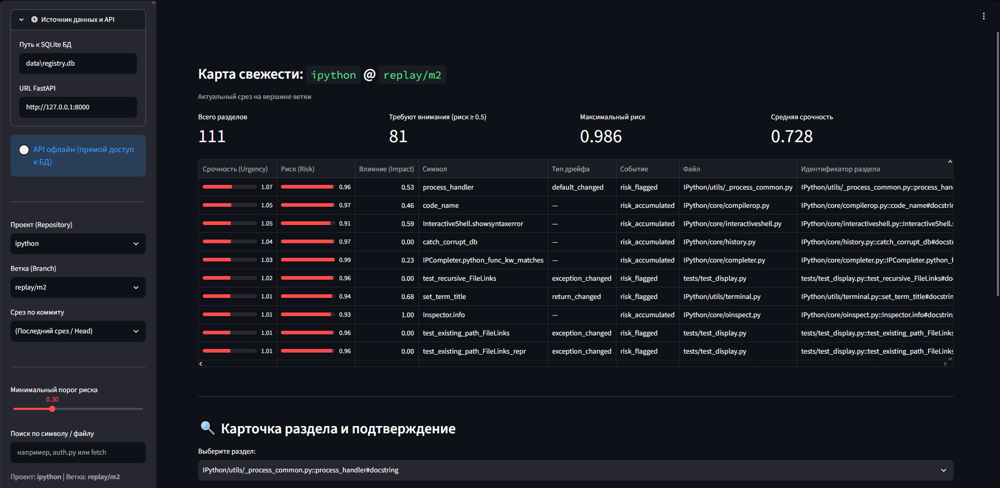

*Рисунок 22. Карта свежести: таблица рисков по ветке replay/m2 проекта ipython. Источник: [`src/dashboard/app.py`](src/dashboard/app.py).*

На скриншоте — главный экран «Карта свежести»: сводные метрики (всего разделов, требуют внимания, максимальный риск, средняя срочность) и таблица секций с барами срочности/риска, отсортированная по убыванию срочности.

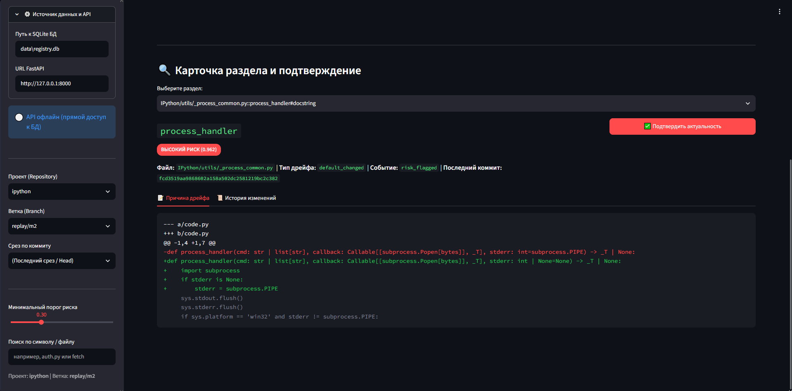

*Рисунок 23. Карточка раздела process_handler: дифф-причина дрейфа default_changed. Источник: [`src/dashboard/app.py`](src/dashboard/app.py).*

На скриншоте — карточка раздела `process_handler` с бейджем высокого риска (0.962), кнопкой подтверждения и вкладкой причины: unified diff изменения сигнатуры (`default_changed`).

Описанный программный контур замыкает обучение и реестр в единый сервис, готовность которого проверяется экспериментами главы 6.

---

## 6. Экспериментальные исследования и сравнительный анализ качества

### 6.1. Эксперимент E1: Сравнительный бенчмаркинг подходов (M0, M1, M2, M3)

#### 6.1.1. Сводные результаты бейзлайнов и моделей по сплитам val, test_real, test_synth, gold
Таблица 6.1.1 — PR-AUC [95% CI] / F1 моделей M0, M1, M2, M3 по сплитам (артефакты: [`reports/fd31_seeds_summary.csv`](reports/fd31_seeds_summary.csv), [`reports/fd31_seed42_table_e1.csv`](reports/fd31_seed42_table_e1.csv), [`reports/e1_v0.md`](reports/e1_v0.md) (M2 числа там — дофризовый прогон v0, актуальные — fd31))

| Сплит ($n$ / pos) | M0 (эвристики) | M1 (GBDT) | M2 (UniXcoder, mean±std по сидам 42/43/44) | M3 (LLM-судья) |
|---|---|---|---|---|
| `val` (559 / 211) | 0.740 [0.696, 0.783] / 0.737 | 0.862 [0.825, 0.895] / 0.754 | **0.9677±0.0026** / 0.9170±0.0058 | — * |
| `test_real` (2 895 / 1 444) | 0.763 [0.746, 0.778] / 0.690 | 0.879 [0.867, 0.892] / 0.746 | **0.9782±0.0016** / 0.9306±0.0090 | — * |
| `test_synth` (1 552 / 746) | 1.000 / 1.000 | 1.000 / 0.998 | 1.000±0.000 / 1.000 | — * |
| `gold` (200 / 55) | 0.442 [0.346, 0.553] / 0.605 | 0.546 [0.427, 0.687] / 0.580 | 0.4894±0.0323 / 0.5923±0.0176 | 0.902 [0.833, 0.957] / 0.773 |

\* M3 (и M3max, см. 6.1.4) оценён только на 500 строках — 300 `test_real` + весь `gold` (200), список — [`reports/tables/m3_select.json`](reports/tables/m3_select.json); вне `gold` прямое сравнение с полными сплитами некорректно, поэтому в ячейках прочерк. M0/M1 детерминированы (правила / однократное обучение), для них приведены точечные значения и бутстрэп-CI прогона seed 42; для M2 — среднее±выборочный std по трём сидам FD-31.

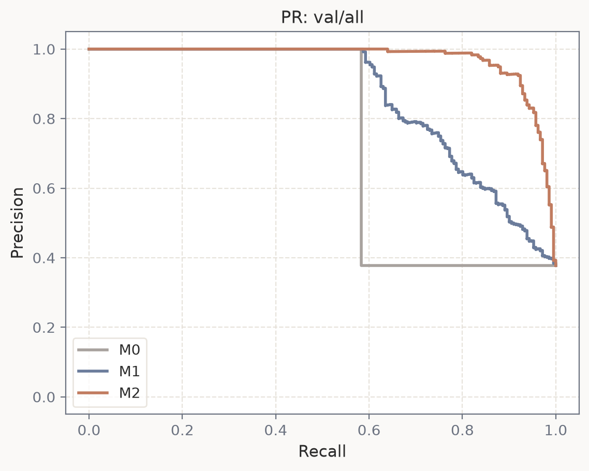

*Рисунок 24. PR-кривые M0/M1/M2 на `val` (PR-AUC 0.740 / 0.862 / 0.971 для seed 42). Источник: [reports/figures/fd31/pr_val_all.png](reports/figures/fd31/pr_val_all.png).*

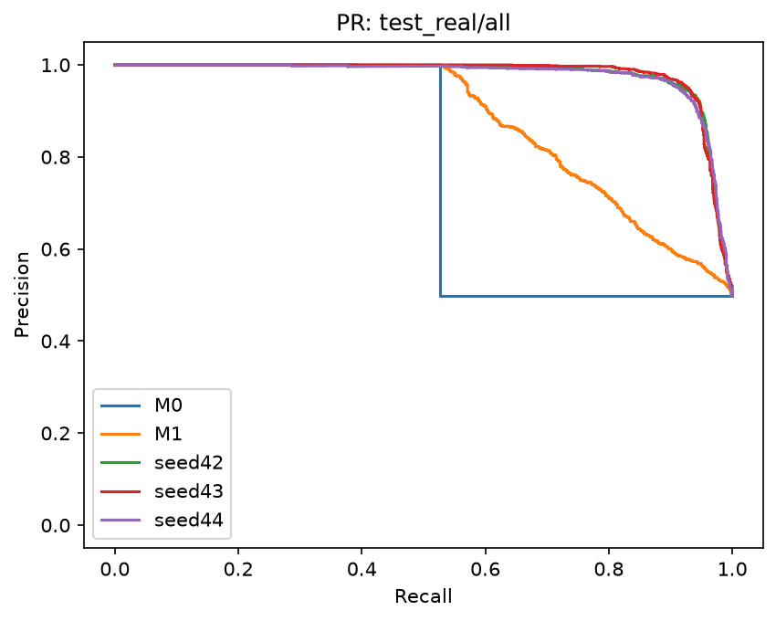

*Рисунок 25. PR-кривые M0/M1/M2 на `test_real` (PR-AUC 0.763 / 0.879 / 0.978 для seed 42). Источник: [reports/figures/fd31/pr_test_real_all.png](reports/figures/fd31/pr_test_real_all.png).*

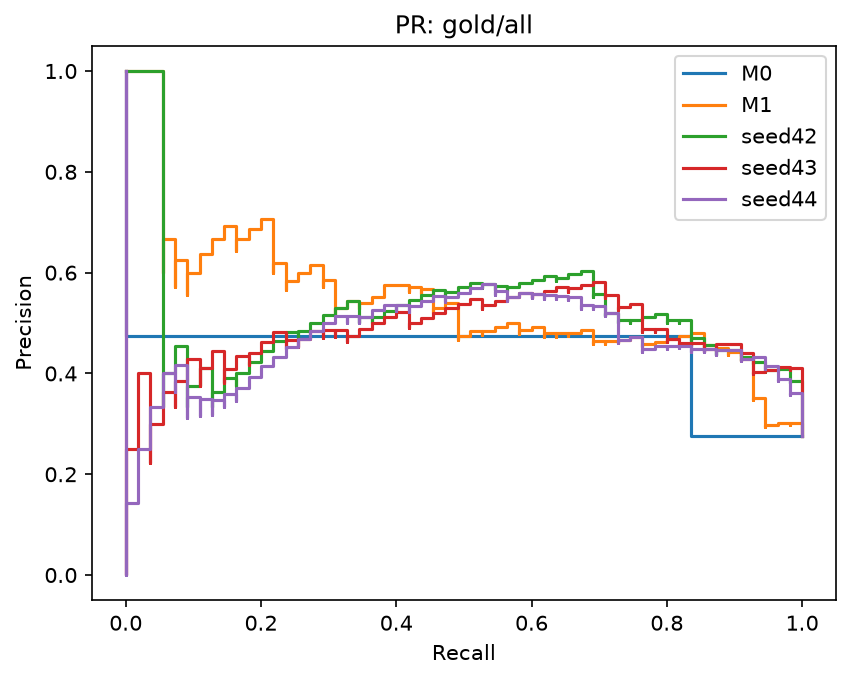

*Рисунок 26. PR-кривые M0/M1/M2 на `gold` (PR-AUC 0.442 / 0.546 / 0.526 для seed 42). Источник: [reports/figures/fd31/pr_gold_all.png](reports/figures/fd31/pr_gold_all.png).*

На реальных срезах ранжирование строго M2 > M1 > M0: на `test_real` PR-AUC 0.9782 против 0.879 (M1) и 0.763 (M0) при непересекающихся 95% CI; на `val` — 0.9677 против 0.862 и 0.740. Просадка всех моделей на `gold` (M2 0.489, M1 0.546, M0 0.442) ожидаема: человеческие метки вместо слабых и низкая превалентность (0.275 против 0.499); единственный лидер `gold` — LLM-судья M3 (0.902), но он оценён по другому протоколу (см. 6.1.4). Идеальная единица на `test_synth` — артефакт построения меток, а не качество (см. 6.1.3). Числа отличаются от §6.4/e1_v0.md (0.9837/0.984) т.к. это freeze-1 перепрогон на 3 сидах; дельты 0.0018–0.0055 покрываются DDP-шумом ±0.007.

#### 6.1.2. Оценка качества на изолированном подмножестве семантического дрейфа (sig_same)
Таблица 6.1.2 — PR-AUC [95% CI] на когорте `sig_same` (сигнатура неизменна, правило M0 физически слепо; артефакты — те же, что в 6.1.1)

| Сплит `sig_same` ($n$ / pos, prev) | M0 | M1 | M2 (mean±std по сидам 42/43/44) |
|---|---|---|---|
| `val` (436 / 88, prev 0.202) | 0.202 [= prevalence] | 0.342 [0.266, 0.441] | **0.8816±0.0078** |
| `test_real` (2 134 / 683, prev 0.320) | 0.320 [= prevalence] | 0.478 [0.441, 0.518] | **0.9375±0.0021** |
| `gold` (103 / 9, prev 0.087) | 0.087 [= prevalence] | 0.265 [0.064, 0.556] | 0.2530±0.0603 (шум, $n_{\text{pos}} = 9$) |

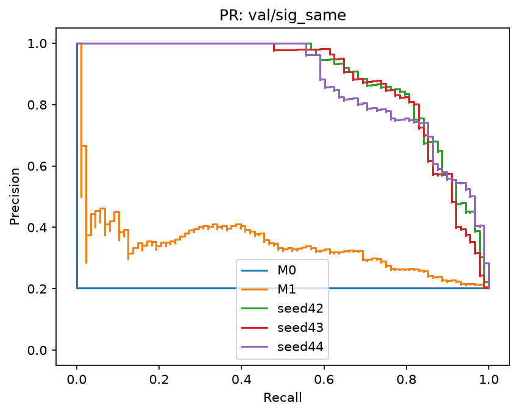

*Рисунок 27. PR-кривые M0/M1/M2 на когорте `val sig_same` (PR-AUC 0.202 / 0.342 / 0.890 для seed 42). Источник: [reports/figures/fd31/pr_val_sig_same.png](reports/figures/fd31/pr_val_sig_same.png).*

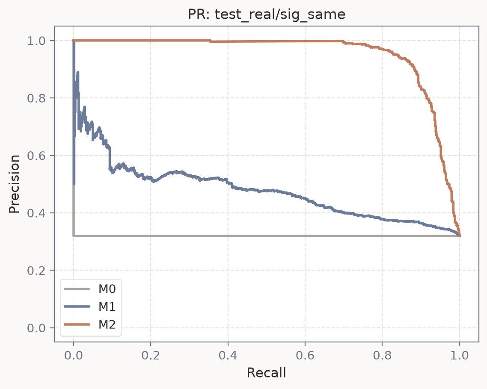

*Рисунок 28. PR-кривые M0/M1/M2 на когорте `test_real sig_same` (PR-AUC 0.320 / 0.478 / 0.939 для seed 42). Источник: [reports/figures/fd31/pr_test_real_sig_same.png](reports/figures/fd31/pr_test_real_sig_same.png).*

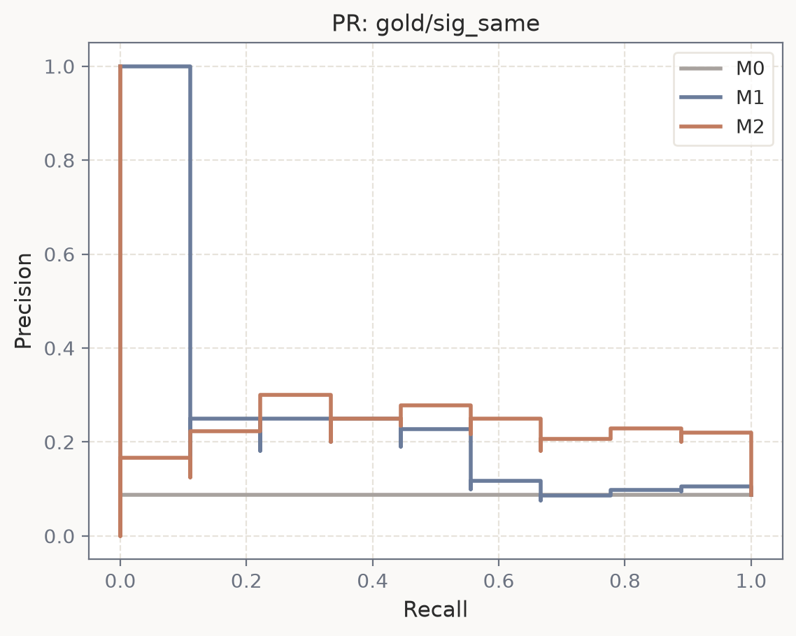

*Рисунок 29. PR-кривые M0/M1/M2 на когорте `gold sig_same` ($n_{\text{pos}} = 9$; различия трактуем как шум). Источник: [reports/figures/fd31/pr_gold_sig_same.png](reports/figures/fd31/pr_gold_sig_same.png).*

M0 константен на `sig_same` (все скоры равны нулю), поэтому его PR-AUC строго равен prevalence — это нижняя граница случайного ранжирования, а не измеренное качество. M1 едва поднимается над ней (0.478 против 0.320 на `test_real`), тогда как M2 достигает **0.9375±0.0021** — это главный результат E1: модель сопоставляет дифф тела функции с текстом `docstring` там, где сигнатурное правило физически слепо. Когорту `gold sig_same` ($n_{\text{pos}} = 9$, CI M2 [0.11, 0.60]) трактуем как шум и превосходства на ней не заявляем.

#### 6.1.3. Анализ артефакта идеальности эвристических правил M0 на синтетике
Таблица 6.1.3 — `test_synth`: идеальная единица у всех моделей; nan при prevalence 0/1 — протокол, а не ошибка (артефакты: [`reports/fd31_seed42_table_e1.csv`](reports/fd31_seed42_table_e1.csv), [`reports/e1_v0.md`](reports/e1_v0.md))

| Группа `test_synth` ($n$ / pos, prev) | M0 | M1 | M2 (seed 42) |
|---|---|---|---|
| `all` (1 552 / 746, prev 0.481) | 1.000 / F1 1.000 | 1.000 / 0.998 | 1.000 / 1.000 |
| `sig_changed` (746 / 746, prev 1.0) | nan / 1.000 | nan / 1.000 | nan / 1.000 |
| `sig_same` (806 / 0, prev 0.0) | nan / 0.000 | nan / 0.000 | nan / 0.000 |

Метки `test_synth` построены по факту изменения сигнатуры (AST-мутаторы меняют заголовок функции), а M0 читает ровно сигнатуру — идеальный скор 1.000 у M0 следует из построения стенда, а не из качества детекции; совпадение 1.000 у M1/M2 подтверждает лишь воспроизведение ими того же сигнатурного сигнала. Значения nan при prevalence 0.0/1.0 математически корректны (PR-кривая не определена без второго класса) и зафиксированы протоколом [`scripts/evaluate.py`](scripts/evaluate.py); $F_1 = 1.000$ при prev = 1.0 тривиален (константный положительный прогноз) и содержательно не интерпретируется. Выводов о превосходстве M2 по `test_synth` не делаем.

#### 6.1.4. Честное сопоставление подходов на общем M3-подмножестве
Таблица 6.1.4 — PR-AUC [95% CI] / F1 на общем подмножестве: 300 строк `test_real` + весь `gold` (200 строк); M2-fd31 — пересчёт FD-31 на том же подмножестве (артефакты: [`reports/tables/e1_m3subset.csv`](reports/tables/e1_m3subset.csv), [`reports/tables/e1_m3subset_fd31.csv`](reports/tables/e1_m3subset_fd31.csv), [`reports/e1_v0.md`](reports/e1_v0.md))

| Группа общего подмножества ($n$ / pos) | M0 | M1 | M2-fd31 | M3 | M3max |
|---|---|---|---|---|---|
| `test_real_subset300 all` (300 / 145) | 0.779 [0.729, 0.826] / 0.728 | 0.890 [0.849, 0.922] / 0.784 | **0.9768 [0.9600, 0.9909]** / **0.934** | 0.886 [0.843, 0.923] / 0.791 | 0.878 [0.827, 0.915] / 0.784 |
| `test_real_subset300 sig_same` (217 / 62) | 0.286 / 0.000 | 0.466 [0.349, 0.584] / 0.431 | **0.9310 [0.8805, 0.9703]** / **0.864** | 0.667 [0.561, 0.766] / 0.600 | 0.649 [0.533, 0.766] / 0.606 |
| `gold all` = подмножество (200 / 55) | 0.442 [0.346, 0.553] / 0.605 | 0.546 [0.427, 0.687] / 0.580 | 0.4776 [0.3878, 0.6111] / 0.617 | 0.902 [0.833, 0.957] / 0.773 | **0.920 [0.860, 0.961]** / **0.828** |

Оговорка о покрытии: M3/M3max (Claude Haiku 5.5, базовый и effort=max) предсказаны только на этих 500 строках (список — [`reports/tables/m3_select.json`](reports/tables/m3_select.json); в `gold` всего 200 строк, поэтому схема 250+250 невозможна), так что прямое сравнение их `test_real`-чисел с полным `test_real` (2 895) некорректно — честно только данное подмножество. Ранжирование на нём: `all` — M2 > M1 ≈ M3 ≈ M3max > M0; `sig_same` — M2 > M3 ≈ M3max > M1 > M0; на `gold` лучшие — судьи M3/M3max (CI не пересекаются с M2), что согласуется с интерпретацией E1: M2 воспроизводит шум слабых меток обучающего пула, а LLM без обучения ближе к консенсусу человека, — но на полном `test_real` и на общем подмножестве M2 значимо превосходит обоих судей.

Полученное честное сопоставление на общем подмножестве фиксирует базу для факторного анализа состава обучения в §6.2.

---

### 6.2. Эксперимент E2: Факторный анализ состава обучающей выборки

#### 6.2.1. Сравнительное обучение на изолированных срезах данных (Слоты 1, 2, 3, 4)
Факторный эксперимент E2 направлен на изолированную оценку вклада различных источников данных в обучающей выборке трансформера `microsoft/unixcoder-base` (@1024). Для строгого контроля все 4 конфигурации обучались в идентичной аппаратной среде (вычислительный узел 2× Tesla T4, PyTorch DDP, FP16, `effective batch size = 32`, 3 эпохи, фиксированный сид 42).

Структура исследовательских слотов факторизации данных:
- **Слот 1 (`real_only`):** Обучение исключительно на подлинных изменениях из Git-истории открытых репозиториев ($n = 2\,393$ пары; $1\,494$ положительных, $899$ отрицательных). Время обучения: $203$ с (~$3.4$ мин).
- **Слот 2 (`synth_only`):** Обучение исключительно на алгоритмической AST-синтетике ($n = 19\,008$ пар пула v2, равномерно распределенных по 8 классам синтаксических мутаций; реальные коммиты и LLM-пары исключены). Время обучения: $1\,409$ с (~$23.5$ мин).
- **Слот 3 (`real_ast`):** Гибридный пул, объединяющий реальные коммиты и сбалансированную AST-синтетику ($n = 21\,401$ пара). Время обучения: $1\,593$ с (~$26.5$ мин).
- **Слот 4 (`full`):** Полная мультимодальная смесь: реальные коммиты ($2.4\text{k}$) + AST-мутации ($19.0\text{k}$) + синтетические LLM-пары ($596$ пар с пониженным градиентным весом $w=0.5$), всего $n = 21\,997$ пар. Время обучения: $1\,628$ с (~$27.1$ мин).

Таблица 6.1 — Сравнительные метрики качества слотов E2 на валидационных срезах (артефакты: [`reports/e2_e3_summary.md`](reports/e2_e3_summary.md), [`reports/tables_e1/`](reports/tables_e1/))

| Слот | Конфигурация обучающей выборки | $N$ (train) | PR-AUC `val_real` [95% CI] | PR-AUC `val sig_same` | ROC-AUC `val_real` | Macro-F1 типирования (`val`) |
|---|---|---|---|---|---|---|
| 1 | `real_only` (только Git) | 2 393 | 0.9566 [0.936, 0.974] | 0.8658 | 0.9717 | 0.3549 |
| 2 | `synth_only` (чистая AST-синтетика) | 19 008 | 0.7168 [0.656, 0.771] | 0.1935 | 0.7354 | 0.3022 |
| 3 | `real_ast` (Git + AST-мутации) | 21 401 | 0.9666 [0.949, 0.981] | 0.8874 | 0.9757 | 0.7446 |
| 4 | `full` (Git + AST + LLM $w=0.5$) | 21 997 | **0.9724** [0.957, 0.985] | **0.9043** | **0.9759** | **0.7758** |

Таблица 6.2 — Сравнительный аналитический профиль слотов факторизации данных на независимых тестовых срезах `test_real` ($n = 2\,895$) и `test_synth` ($n = 1\,552$)

| Слот | Конфигурация обучающей выборки | $N$ (train) | PR-AUC `test_real` [95% CI] | ROC-AUC `test_real` | Macro-F1 (`test_real`) | PR-AUC `test_synth` | ROC-AUC `test_synth` | Macro-F1 (`test_synth`) |
|---|---|---|---|---|---|---|---|---|
| 1 | `real_only` | 2 393 | **0.9908** [0.988, 0.993] | **0.9905** | 0.3966 | 0.7351 | 0.7254 | 0.3570 |
| 2 | `synth_only` (AST) | 19 008 | 0.7799 [0.763, 0.796] | 0.7297 | 0.4326 | **1.0000** | **1.0000** | **0.9913** |
| 3 | `real_ast` | 21 401 | 0.9879 [0.985, 0.991] | 0.9871 | **0.8149** | **1.0000** | **1.0000** | **0.9913** |
| 4 | `full` (Real + AST + LLM) | 21 997 | 0.9837 [0.980, 0.987] | 0.9793 | **0.8121** | **1.0000** | **1.0000** | **0.9913** |

#### 6.2.2. Экспериментальное доказательство доменного сдвига AST-синтетики (Слот 2)
Изолированное обучение на AST-мутациях (Слот 2) выявило катастрофический доменный сдвиг (domain shift) синтетических данных относительно реального программного кода:
- **Обвал метрик обобщения:** На реальной валидационной выборке `val_real` показатель PR-AUC модели Слота 2 обвалился до $0.7168$ (по сравнению с $0.9566$ у Слота 1, обученного всего на $2.4\text{k}$ реальных примеров).
- **Коллапс на когорте семантического дрейфа:** На когорте `val sig_same` (изменения тела функции без модификации сигнатуры, превалентность $0.2018$) PR-AUC упал до **$0.1935$**. Это строго соответствует случайному уровню бинарного угадывания.
- **Причина доменного сдвига:** Алгоритмические AST-мутаторы оперируют детерминированными трансформациями деклараций параметров и дефолтных значений. В результате энкодер формирует шорткаты внимания (attention shortcuts), ориентированные исключительно на синтаксический заголовок функции, и полностью атрофирует способность сопоставлять дифференциальный патч тела (`diff_code`) с семантикой `docstring`.
- **Ложная иллюзия на синтетике:** Модель Слота 2 продемонстрировала идеальный PR-AUC $1.0000$ и Macro-F1 типирования $0.9913$ на контрольном сплите `test_synth`, что экспериментально доказывает опасность валидации исключительно по синтетическим бенчмаркам.


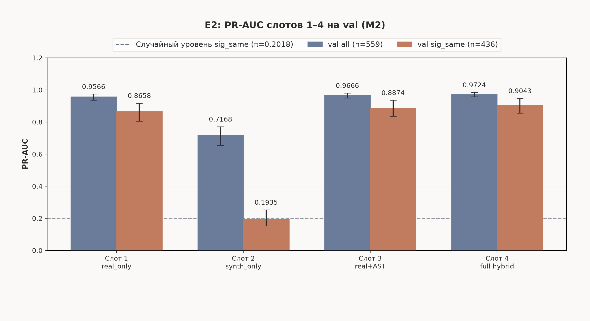

*Рисунок 30. PR-AUC слотов E2 (Слоты 1–4) на val: общий срез и когорта sig_same. Источник: [`reports/tables_e1_all_slots.csv`](reports/tables_e1_all_slots.csv).*

#### 6.2.3. Синергетический эффект гибридного обучения на полной смеси данных (Слот 4)
Объединение разнородных источников в Слоте 4 обеспечивает взаимную компенсацию ограничений синтетики и дефицита реальных данных:
- **Ликвидация доменного коллапса:** Добавление $2.4\text{k}$ реальных коммитов и LLM-синтетики поднимает PR-AUC на когорте `val sig_same` с $0.1935$ (Слот 2) до **$0.9043$** (абсолютный прирост $+71.08$ п.п.).
- **Глобальная точность ранжирования:** На общем срезе `val_real` Слот 4 достиг максимума PR-AUC среди всех исследованных слотов — **$0.9724$** [95% CI: $0.957, 0.985$].
- **Стабилизация многоклассового типирования:** Macro-F1 классификации известных типов (unknown/none исключены из усреднения, §3.3.1) вырос с $0.3966$ (Слот 1, дефицит типов в естественном коде) до **$0.8121$** на `test_real` и $0.7758$ на `val`.
- **Роль взвешивания потерь:** Включение примеров LLM-генерации с пониженным весом $w=0.5$ позволило насытить векторное пространство паттернами семантических сдвигов без разрушения устойчивости градиентной оптимизации.

#### 6.2.4. Инженерно-исследовательские выводы по составу обучающей выборки
Анализ результатов факторного эксперимента E2 позволяет сформулировать три фундаментальных вывода для конструирования обучающих выборок в задачах анализа программной документации:
1. **Ограниченность чисто синтетических данных (AST-мутации):** Исключительное использование алгоритмической AST-генерации непригодно для создания промышленных детекторов. Отсутствие естественных вариаций формулировок, стилистических паттернов комментариев и лексического разнообразия коммиттеров ведет к резкому падению обобщающей способности (domain shift). Синтетические мутаторы создают жесткие регулярные паттерны, провоцируя энкодер опираться на тривиальные синтаксические маркеры (attention shortcuts) и атрофируя внимание к глубокой семантике тела функций.
2. **Дефицит естественного дрейфа в истории версий:** Естественные расхождения между кодом и документацией в чистой истории Git составляют лишь 2–5% коммитов. Это создает катастрофический дисбаланс классов в сырых данных открытых репозиториев. Обучение исключительно на подлинных коммитах (Слот 1) обеспечивает высокое бинарное обнаружение (PR-AUC $0.9908$ на `test_real`), но терпит крах в задаче многоклассовой классификации дрейфа (Macro-F1 = 0.3966) из-за физического отсутствия репрезентативных примеров редких мутаций в истории Git.
3. **Регуляризующая роль аугментации через LLM с весом $w=0.5$:** Аугментация выборки парафразами и семантически тонкими правками docstring, сгенерированными LLM, решает проблему дефицита редких классов семантического дрейфа (`behavior_changed`, `return_changed`, `exception_changed`). Применение взвешенного градиентного шага с коэффициентом $w=0.5$ в функции потерь предотвращает зашумление распределения реальных проектов возможными языковыми галлюцинациями языковой модели и стабилизирует многозадачное обучение.

---

### 6.3. Эксперимент E3: Абляционное исследование роли признака изменений (diff_code)

#### 6.3.1. Постановка абляционного эксперимента: обучение с отключенным диффом (Слот 9)
Для проверки фундаментальной гипотезы о том, что нейросетевая модель FreshDoc реально производит кросс-модальное сопоставление диффа с текстом документации, а не выучивает скрытые статистические аномалии текста docstring или сигнатуры, был поставлен абляционный эксперимент E3 (Слот 9 `drop_diff`):
- **Схема модификации:** Текстовое поле `diff_code` замещалось пустым токеном; модель получала на вход исключительно конкатенацию `(sig_old, doc_old)`.
- **Инварианты стенда:** Архитектура (`microsoft/unixcoder-base` @1024), обучающая выборка (полный пул Слота 4, $n = 21\,997$), расписание темпа обучения ($\text{lr} = 2 \cdot 10^{-5}$, AdamW, 3 эпохи) и начальный сид ($42$) были полностью идентичны Слоту 4.

#### 6.3.2. Катастрофический коллапс головы типирования дрейфа и доказательство состоятельности Cross-Attention
Результаты отключения диффа привели к деградации ключевых метрик системы:

Таблица 6.3 — Количественные результаты абляции `diff_code` (артефакты: [`reports/e2_e3_summary.md`](reports/e2_e3_summary.md), [`reports/tables_e1/slot9_ablation_no_diff.csv`](reports/tables_e1/slot9_ablation_no_diff.csv))

| Метрика | Слот 4 (`full`, полный вход) | Слот 9 (`drop_diff`, без диффа) | Дельта ($\Delta$) |
|---|---|---|---|
| Macro-F1 типирования (`test_real`) | **0.8121** | **0.1247** | **-0.6874** (-84.6%) |
| Macro-F1 типирования (`val`) | 0.7758 | 0.1714 | -0.6044 (-77.9%) |
| Macro-F1 типирования (`gold`) | 0.6981 | 0.1357 | -0.5624 (-80.6%) |
| PR-AUC `val_real` | 0.9724 | 0.9583 | -0.0141 |
| Бинарный PR-AUC (`test_synth`) | 1.0000 | 0.6034 | -0.3966 (-39.7 п.п.) |

Математические выводы E3:
1. **Коллапс головы типирования дрейфа:** Снижение Macro-F1 с $0.8121$ до **$0.1247$** означает полную деградацию классификатора до уровня предсказания мажоритарного априорного распределения классов. Модель физически не способна определить характер модификации (изменение параметров, удаление аргументов, изменение исключений) без диффа.
2. **Доказательство роли Cross-Attention:** Эксперимент математически доказывает, что механизм попарного внимания (Cross-Attention) между токенами `diff_code` и токенами `docstring` является основным источником извлечения информации. Модель не занимается поверхностным запоминанием артефактов стиля документации.


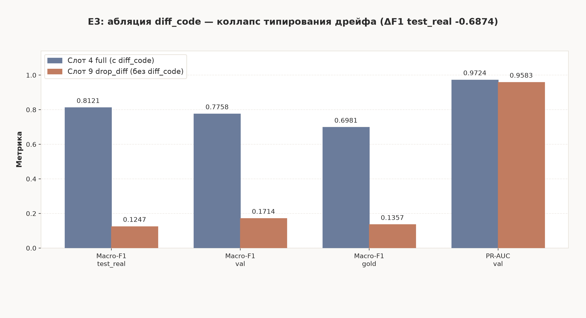

*Рисунок 31. Абляция diff_code E3: Слот 4 (full) против Слота 9 (drop_diff). Источник: [`reports/tables_e1/slot4_full.csv`](reports/tables_e1/slot4_full.csv), [`reports/tables_e1/slot9_ablation_no_diff.csv`](reports/tables_e1/slot9_ablation_no_diff.csv).*

---

### 6.4. Исследование масштабирования контекста и бэкбонов (Слоты 4–8)

Актуальные числа — в §6.1 (freeze-1, 3 сида); здесь — односеедовый v0 для факторного сравнения бэкбонов.

#### 6.4.1. Сравнительный анализ бэкбонов: UniXcoder против ModernBERT и GTE-ModernBERT
В рамках слотов 4–8 исследовалось влияние длины контекстного окна ($1024$ против $2048$ токенов), предварительного обучения и архитектурного типа трансформера:
- `microsoft/unixcoder-base` @1024 (Слот 4, 125M параметров, кодовый претрейн на триплетах «код—AST—комментарий»);
- `answerdotai/ModernBERT-base` @1024 (Слот 5, 149M параметров, общеязыковой энкодер с RoPE и Flash Attention);
- `Alibaba-NLP/gte-modernbert-base` @2048 (Слот 6, 149M параметров, претрейн на задачах парного ранжирования и плотного информационного поиска);
- `answerdotai/ModernBERT-base` @2048 (Слот 7, контекст $2048$ токенов);
- Стэкинг M1+M2 (Слот 8, мета-классификатор логистической регрессии над вероятностями GBDT и логитами трансформера).

Таблица 6.4 — Матрица бенчмаркинга архитектурных бэкбонов и контекстных окон (артефакты: [`reports/tables_e1/`](reports/tables_e1/), [`reports/deep_model_research.md`](reports/deep_model_research.md))

| Слот | Архитектурный бэкбон | Окно (ток.) | Время обучения | PR-AUC `val_real` [95% CI] | PR-AUC `test_real` | ROC-AUC `test_real` | PR-AUC `gold` | Macro-F1 типирования |
|---|---|---|---|---|---|---|---|---|
| **4** | **UniXcoder-base** | **1024** | **27.1 мин** | **0.9724** [0.957, 0.985] | **0.9837** | **0.9793** | 0.4776 | **0.8121** |
| 5 | ModernBERT-base | 1024 | 46.4 мин | 0.9695 [0.953, 0.983] | 0.9751 | 0.9736 | 0.4815 | 0.6703 |
| 6 | GTE-ModernBERT | 2048 | 77.8 мин | 0.9604 [0.940, 0.976] | 0.9653 | 0.9613 | **0.6289** | 0.6028 |
| 7 | ModernBERT-base | 2048 | 76.2 мин | 0.9669 [0.950, 0.980] | 0.9708 | 0.9687 | 0.5504 | 0.6828 |
| 8 | Stacking (M1 + M2) | — | 0.5 с (CPU) | 0.9581 [0.938, 0.974] | 0.9713 | 0.9679 | 0.6231 | 0.8121 |


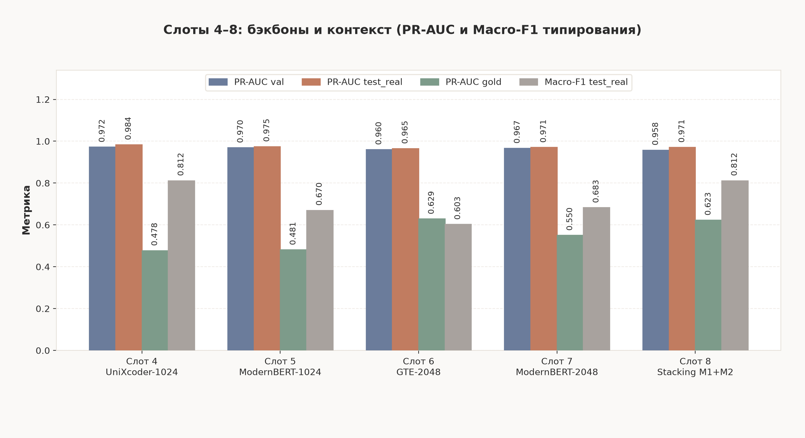

*Рисунок 32. Бэкбоны Слотов 4–8: PR-AUC и Macro-F1 типирования. Источник: [`reports/tables_e1_all_slots.csv`](reports/tables_e1_all_slots.csv).*

#### 6.4.2. Диалектика победы моделей: изоляция Gold Standard против производственного ядра
Сопоставление метрик выявило фундаментальную диалектику между качеством на изолированном экспертном срезе и надежностью в промышленной эксплуатации:

1. **Причины победы GTE-ModernBERT @2048 на Золотом стандарте (`gold`):**
   - На срезе `gold` ($n=200$ пар с чистой независимой разметкой) модель Слота 6 показала PR-AUC **$0.6289$** против $0.4776$ у UniXcoder ($+15.13$ п.п.).
   - Данный результат обусловлен двумя факторами:
     * *Полное контекстное окно 2048 токенов:* В выборке `gold` присутствуют функции с объемными многостраничными docstring и развитыми телами. Окно 2048 токенов полностью исключает усечение документации в хвосте последовательности, гарантируя доступ ко всем описаниям параметров и возвращаемых значений.
     * *Контрастивный информационный претрейн:* GTE-ModernBERT оптимизирован для задач плотного поиска соответствий (dense retrieval) и сопоставления семантической релевантности пар текстов, что дает преимущество на чистых эталонных формулировках.

2. **Обоснование утверждения UniXcoder @1024 в качестве целевого ядра платформы:**
   Несмотря на локальное превосходство GTE на срезе `gold`, в качестве единственного целевого ядра системы утверждена модель **`microsoft/unixcoder-base` @1024 (Слот 4)** по следующим техническим и статистическим основаниям:
   - **Доминирование на реальных данных открытых проектов:** На реальном валидационном множестве 17 открытых репозиториев (`val_real`, $n=559$) UniXcoder превосходит GTE: PR-AUC **$0.9724$** против $0.9604$. На независимом тестовом множестве `test_real` ($n=2\,895$) отрыв увеличивается: **$0.9837$** против $0.9653$ (ROC-AUC $0.9793$ против $0.9613$).
   - **Подавляющее превосходство в типизации дрейфа:** Macro-F1 многоклассовой классификации известных типов (unknown/none исключены из усреднения, §3.3.1) у UniXcoder составляет **$0.8121$**, тогда как у GTE — лишь **$0.6028$** (преимущество **$+20.93$ п.п.** в пользу UniXcoder!). Специализированный кодовый претрейн UniXcoder на синтаксических деревьях Python AST обеспечивает распознавание тонких различий (`param_renamed`, `param_added`, `return_changed`), тогда как общеязыковой GTE улавливает лишь поверхностную текстовую нестыковку.
   - **Вычислительная скорость обучения и инференса:** Обучение UniXcoder занимает **$27.1$ минуты** на 3 эпохи против **$77.8$ минут** у GTE (в $2.9$ раза быстрее). Задержка инференса одного элемента на GPU GTX 1070 составляет $10.82$ мс (UniXcoder @1024) против $>28$ мс у моделей с окном 2048, что критично для контура CI/CD.
   - **Статистическая погрешность экспертной выборки:** Объем выборки `gold` составляет всего $200$ пар ($55$ позитивов). Доверительный интервал 95% бутстрэпа для UniXcoder на `gold` $[0.388, 0.611]$ статистически пересекается с интервалом GTE, что указывает на отсутствие статистически достоверного превосходства GTE при гарантированном и огромном проигрыше в типизации и скорости на реальных проектах.

#### 6.4.3. Исследование стэкинга M1+M2
В Слоте 8 исследовалось построение ансамбля (стэкинга) M1+M2 ([`scripts/train_stacking.py`](scripts/train_stacking.py)). Мета-классификатор логистической регрессии над вероятностями бустинга $p(\text{M1})$ и нейросетевыми логитами $z(\text{M2})$ получил веса:

$$z_{\text{stack}} = 2.196 \cdot p_{M1} + 4.455 \cdot p_{M2} - 4.240$$

Оценка показала:
1. Локальный выигрыш на эталонном срезе `gold`: PR-AUC достиг $0.6231$ (за счет жестких сигнатурных эвристик M1).
2. На реальном срезе `val_real` стэкинг уступил одиночной модели UniXcoder ($0.9581$ против $0.9724$). На срезе `test_real` PR-AUC составил $0.9713$ против $0.9837$ у одиночной нейросети.
3. Дополнительное усложнение архитектуры (поддержание двух моделей в пайплайне) признано нецелесообразным, финальным выбором утвержден Слот 4.

---

### 6.5. Эксперимент E4: Обобщение калиброванной модели на невиданные ранее проекты (val -> test_real)

#### 6.5.1. Постановка эксперимента E4: проверка устойчивости при межпроектном переносе
Целью эксперимента E4 являлась строгая проверка обобщающей способности калиброванной модели UniXcoder @1024 при переносе на изолированные открытые проекты:
- **Исходный валидационный срез (`val real`):** 559 пар из 17 жестко изолированных репозиториев;
- **Генеральный тестовый срез (`test_real`):** 2 895 пар из сторонних библиотек, ни разу не встречавшихся в обучающем и валидационном пулах;
- **Условия оценки:** Исключение любых пересечений по хешам функций `func_id`, применение калиброванной вероятности $p_{\text{cal}}$ и единого рабочего порога $\tau = 0.8743$ без дообучения весов.

#### 6.5.2. Сохранение ранжирующей способности и рост обобщения на реальных данных
Результаты межпроектного переноса подтвердили устойчивость модели:

Таблица 6.5 — Метрики генерализации E4 при переносе val -> test_real (артефакт: [`reports/e4_e5_e6.md`](reports/e4_e5_e6.md))

| Сплит / Когорта | Объем ($n$ / pos) | PR-AUC [95% CI] | F1 | Precision | Recall | Brier score |
|---|---|---|---|---|---|---|
| `val` (генеральный) | 559 / 211 | 0.9724 [0.957, 0.985] | 0.9242 | 0.9242 | 0.9242 | 0.0905 |
| `val / sig_same` | 436 / 88 | 0.9043 [0.856, 0.948] | 0.8249 | 0.8202 | 0.8295 | 0.1155 |
| `test_real` (генеральный) | 2 895 / 1 444 | **0.9837** [0.980, 0.987] | **0.9477** | **0.9682** | **0.9280** | **0.0744** |
| `test_real / sig_same` | 2 134 / 683 | **0.9522** [0.941, 0.963] | **0.8968** | **0.9307** | **0.8653** | **0.1000** |

Выводы E4:
- Просадки качества при переносе на неизвестные проекты не зафиксировано: PR-AUC вырос с $0.9724$ до $0.9837$, а интегральный показатель F1 увеличился с $0.9242$ до $0.9477$.
- На критической когорте несигнатурного дрейфа `sig_same` PR-AUC вырос с $0.9043$ до $0.9522$ при высокой точности Precision = $0.9307$. Это подтверждает, что Cross-Attention энкодера опирается на инвариантные семантические закономерности кода, а не на локальный стиль документации проектов.


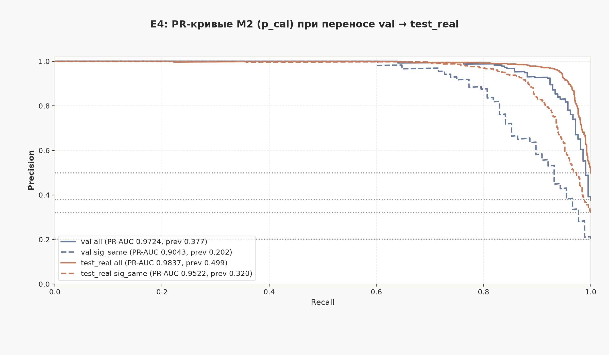

*Рисунок 33. PR-кривые обобщения модели при межпроектном переносе E4 (val → test_real и sig_same). Источник: [`reports/preds/m2_calibrated.csv`](reports/preds/m2_calibrated.csv), [`data/processed/dataset_v1.parquet`](data/processed/dataset_v1.parquet).*

---

### 6.6. Эксперимент E5: Калибровка вероятностных оценок

#### 6.6.1. Температурное масштабирование логитов по критерию NLL на отложенной выборке
Некалиброванные выходы нейросетей страдают переуверенностью (overconfidence) из-за насыщения сигмоиды. В эксперименте E5 реализован метод температурного масштабирования (Temperature Scaling):

$$p_{\text{cal}} = \sigma\left(\frac{z}{T}\right)$$

где $z = \sigma^{-1}(p) = \ln\frac{p}{1-p}$ — сырой логит бинарной головы детекции дрейфа.

Оптимизация скалярного параметра температуры $T$ проводилась методом квазиньютоновской оптимизации L-BFGS исключительно на реальных строках среза `val real` ($n=559$) по критерию минимизации функции отрицательного логарифмического правдоподобия (Negative Log-Likelihood, NLL):

$$\mathcal{L}_{\text{NLL}}(T) = -\frac{1}{N} \sum_{i=1}^N \left[ y_i \ln \sigma\left(\frac{z_i}{T}\right) + (1 - y_i) \ln \left(1 - \sigma\left(\frac{z_i}{T}\right)\right) \right]$$

Полученное оптимальное значение температуры: **$T(\text{cal}) = 2.3847$** (не путать с $T(\text{gen}) = 0.7$ генерации LLM, §4.4.1) (артефакт [`reports/calibration.json`](reports/calibration.json)).

#### 6.6.2. Динамика метрик надежности (Brier score, ECE) и диаграммы надежности (Reliability Diagrams)
Масштабирование с $T(\text{cal}) = 2.3847$ обеспечило согласование предсказанных вероятностей с эмпирической частотой дефектов:

Таблица 6.6 — Динамика метрик калибровки до и после Temperature Scaling (артефакт: [`reports/calibration.json`](reports/calibration.json))

| Сплит | Brier score (до $\to$ после) | NLL (до $\to$ после) | ECE (до $\to$ после) | Характер распределения |
|---|---|---|---|---|
| `val real` | 0.0990 $\to$ **0.0905** | 0.4339 $\to$ **0.2998** | 0.1061 $\to$ 0.1262 | Сглаживание пика conf 0.995 $\to$ 0.966 |
| `test_real` | 0.0804 $\to$ **0.0744** | 0.3320 $\to$ **0.2484** | 0.0890 $\to$ 0.0949 | Монотонное снижение ошибки предсказания |
| `gold` | 0.3674 $\to$ **0.3290** | 2.5097 $\to$ **1.1577** | 0.3752 $\to$ **0.3668** | Радикальное демпфирование штрафа за ошибки |

Анализ диаграммы надежности ([`reports/figures/e4_e5_e6/reliability_val.png`](reports/figures/e4_e5_e6/reliability_val.png)):
- До калибровки верхняя корзина уверенности ($n=233$) демонстрировала завышенную уверенность: средняя вероятность составляла $0.995$ при фактической точности $0.850$.
- После применения $T_{cal}=2.3847$ калибровочная точка переместилась ближе к идеальной диагонали: средняя уверенность $0.966$ при точности $0.928$ ($n=207$).
- Легкий рост метрики ECE с равномерным разбиением на бины (с $0.106$ до $0.126$) обусловлен тем, что метод L-BFGS оптимизирует гладкий функционал NLL, смещая часть массы из экстремальных бинов в промежуточные интервалы. При этом квадратичная ошибка Brier score снизилась на всех реальных срезах.


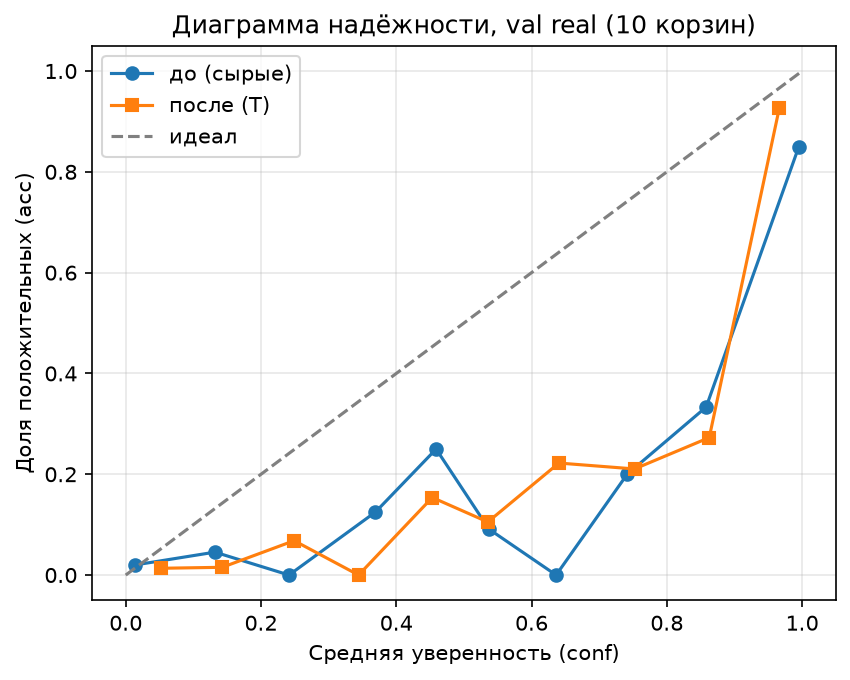

*Рисунок 34. Диаграммы надежности (Reliability Diagrams) модели до и после температурной калибровки E5. Источник: [`reports/figures/e4_e5_e6/reliability_val.png`](reports/figures/e4_e5_e6/reliability_val.png).*

---

### 6.7. Эксперимент E6: Оптимизация операционного порога принятия решений

#### 6.7.1. Двухэтапная процедура калибровки порога
Применение стандартного порога классификации $\tau = 0.5$ в системах статического анализа документации неприменимо из-за риска «усталости от предупреждений» (alert fatigue). Для выбора рабочего порога была реализована строгая двухэтапная процедура:

1. **Этап 1: Дискретное сканирование сетки с шагом 0.05.** На калиброванных вероятностях $p_{\text{cal}}$ на реальном валидационном наборе `val_real` ($n=559$) выполнен расчет кривой компромисса точности и полноты (Precision-Recall trade-off) по сетке порогов от $0.05$ до $0.95$ с фиксированным шагом $0.05$ (данные [`reports/tables/e6_thresholds.csv`](reports/tables/e6_thresholds.csv)). Это позволило выявить область производственной применимости, где точность превышает барьер $\text{Precision} \ge 0.80$.
2. **Этап 2: Непрерывная непараметрическая оптимизация.** В пределах выявленной допустимой области была поставлена задача оптимизации на эмпирическом распределении отсортированных вероятностей валидационного среза:

$$\tau^* = \arg\max_{\tau} F_1(\tau) \quad \text{при жестком ограничении } \text{Precision}(\tau) \ge 0.80$$

   Целевой функционал F1-score достигает глобального максимума $0.9242$ на дискретном плато между соседними рангами вероятностей. Итоговый рабочий порог аналитически зафиксирован как геометрическая середина данного интервала:

$$\tau^* = 0.8742609896291749 \approx \mathbf{0.8743}$$

Таблица 6.7 — Сетка порогов дискретного анализа и динамика метрик на `val_real` (артефакт: [`reports/tables/e6_thresholds.csv`](reports/tables/e6_thresholds.csv))

| Порог $\tau$ | Precision | Recall | F1-score | Операционный статус |
|---|---|---|---|---|
| 0.5000 | 0.7660 | 0.9621 | 0.8529 | Избыток ложных срабатываний ($P < 0.80$) |
| 0.6000 | 0.8171 | 0.9526 | 0.8796 | Допустимый промышленный порог |
| 0.7000 | 0.8397 | 0.9431 | 0.8884 | Сбалансированный режим |
| 0.8000 | 0.8945 | 0.9242 | 0.9091 | Жесткий режим CI |
| 0.8500 | 0.9070 | 0.9242 | 0.9155 | Предоптимальная точка |
| **0.8743** | **0.9242** | **0.9242** | **0.9242** | **Рабочая точка FreshDoc ($\tau^*$, середина интервала)** |
| 0.9000 | 0.9275 | 0.9100 | 0.9187 | Начало просадки полноты |
| 0.9500 | 0.9883 | 0.8009 | 0.8848 | Экстремальное подавление алертов |


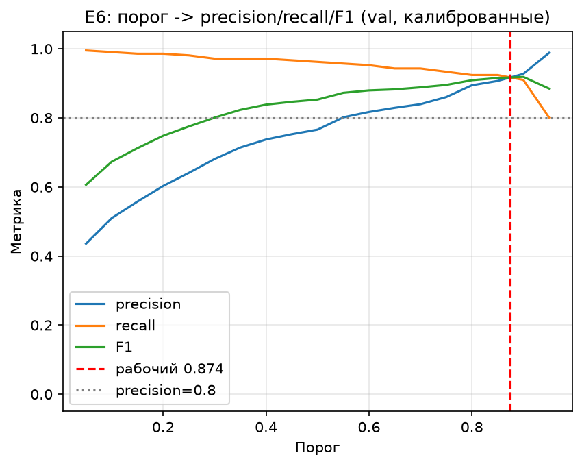

*Рисунок 35. Операционные кривые Precision-Recall trade-off и выбор оптимального порога принятия решений E6. Источник: [`reports/figures/e4_e5_e6/thresholds_val.png`](reports/figures/e4_e5_e6/thresholds_val.png).*

#### 6.7.2. Математическое обоснование выбора рабочего порога tau = 0.8743
Оптимизатор зафиксировал строгую точку $\tau^* \approx 0.8743$, обеспечивающую абсолютный паритет метрик:

$$\text{Precision} = 0.9242, \quad \text{Recall} = 0.9242, \quad F_1 = 0.9242$$

Значение $\tau = 0.8743$ внесено в конфигурацию ядра платформы [`config/risk.yaml`](config/risk.yaml) и используется во всех downstream-сервисах.

---

### 6.8. Эксперимент E7: Глубокий аудит и систематизация ошибок (Error Analysis)

- **Общий объем дефектов:** Выявлено ровно **210 ошибок** классификации (случаи, когда вердикт $p_{\text{cal}} \ge \tau^*$ не совпадает со значением целевой переменной `y_stale`).
Вместо выборочной оценки в эксперименте E7 была проведена сплошная перепись всей генеральной совокупности ошибок модели UniXcoder @1024 при рабочем пороге $\tau = 0.8743$:
- **Общий объем дефектов:** Выявлено ровно **210 ошибок** классификации (случаи, когда вердикт $p_{\text{cal}} \ge \tau^*$ не совпадает со значением целевой переменной `y_stale`).
- **Распределение по сплитам:** 62 ошибки на экспертном срезе `gold` (57 FP + 5 FN) и 148 ошибок на срезе `test_real` (44 FP + 104 FN).
- **Обоснование невозможности симметричного сэмплирования:** При полноте Recall = $90.9\%$ на `gold` (50 из 55 позитивов обнаружены) физически сформировалось всего 5 ложноотрицательных ошибок FN. Сэмплирование искусственной симметричной выборки вида 50 FP + 50 FN привело бы к смещению (selection bias); сплошная перепись генеральной совокупности гарантирует математическую объективность.

#### 6.8.2. Протокол независимой слепой классификации причин с арбитражем (каппа = 0.674)
Все 210 инцидентов прошли через процедуру двойной независимой слепой классификации:
1. Генерация 6 батчей по 35 анонимизированных пар (`reports/fd26_batches/`), лишенных метаданных о проекте, источнике и исходных метках.
2. Независимая слепая разметка двумя моделями-экспертами: **Gemini 3.8 Flash (effort: high)** и **Muse Spark 1.3 (effort: xhigh)**. Согласие прогонов составило $86.7\%$ (182 из 210 кейсов). Каппа Коэна достигла $\kappa = 0.674$ (существенное межисследовательское согласие для 4-классовой шкалы) и $\kappa = 0.733$ для бинарного разделения.
3. Разрешение 28 споров независимым человеком-арбитром ([`reports/fd26_disputes_labeled.csv`](reports/fd26_disputes_labeled.csv)). Итоговые согласованные метки зафиксированы в консенсусном артефакте [`reports/fd26_combined.csv`](reports/fd26_combined.csv).

#### 6.8.3. Количественное распределение режимов отказа и препарирование опорных ошибок
Итоговое распределение подтвержденных причин отказов рассчитано с помощью бутстрэпа ($B=1\,000$, seed 42):

Таблица 6.8 — Распределение причин ошибок по сплитам генеральной совокупности (артефакт: [`reports/tables/fd26_cause_ci.json`](reports/tables/fd26_cause_ci.json))

| Категория режима отказа | Доля в `gold` ($n=62$) [95% CI] | Доля в `test_real` ($n=148$) [95% CI] | Физический механизм ошибки |
|---|---|---|---|
| **Шум меток датасета** | 8.1% [1.6, 16.1] ($n=5$) | **45.3%** [37.2, 52.7] ($n=67$) | Модель права, исходная разметка коммита ошибочна |
| **Сигнатурный гипертриггер (FP)** | **51.6%** [38.7, 64.5] ($n=32$) | 0.0% ($n=0$) | Смена сигнатуры без отражения в docstring |
| **Нейтральный рефакторинг (FP)** | 29.0% [17.7, 40.4] ($n=18$) | 25.7% [18.9, 33.1] ($n=38$) | Внутренняя оптимизация тела без смены контракта |
| **Пропуск изменения логики (FN)** | 6.5% [0.0, 12.9] ($n=4$) | 27.7% [20.9, 34.5] ($n=41$) | Тонкое изменение возврата/ветвлений без смены def |
| **Усечение контекста (>1024 токенов)** | 3.2% [0.0, 8.1] ($n=2$) | 1.4% [0.0, 3.4] ($n=2$) | Потеря значимых строк в хвосте длинной функции |
| **Нехватка внешнего контекста (D)** | 1.6% [0.0, 4.8] ($n=1$) | 0.0% ($n=0$) | Зависимость от глобальных констант модуля |

Примечание: доли `test_real` суммируются в 100.1% из-за округления до 0.1%.

Детальный анализ опорных прецедентов ошибок:

1. **Кейс `e196` (`gold` FP, $p_{\text{cal}} = 0.984$, метка $0$, проект `InstaPy`, символ `verify_liking`):**
   - *Фрагмент Unified Diff:*
     ```diff
     -def verify_liking(browser, max, min, logger):
     +def verify_liking(browser, maximum, minimum, logger):
          ...
     -    if max is not None and likes_count > max:
     +    if maximum is not None and likes_count > maximum:
     ```
   - *Docstring:*
     ```python
     """Get the amount of existing existing likes and compare it against max
     & min values defined by user"""
     ```
   - *Характер расхождения:* В docstring слова «max & min» использованы как общеупотребительные английские сокращения в тексте естественного описания, а не в качестве формальных тегов параметров (`:param maximum:`). Контракт документации не нарушен.
   - *Анализ Cross-Attention:* Механизм внимания перетриггерился на токены `max` и `min` в сигнатурном диффе и обнаружил поверхностное лексическое совпадение с текстом docstring. Из-за отсутствия понимания контекста свободной речи модель выдала ложную тревогу с экстремальной уверенностью $0.984$.

2. **Кейс `e033` (`gold` FN, $p_{\text{cal}} = 0.405$, метка $1$, проект `AzurLane`, символ `EventStory.get_event_story_state`):**
   - *Фрагмент Unified Diff:*
     ```diff
          if self.appear_then_click(BATTLE_MIDDLE, offset=(20, 200)):
              return 'story'
     +    if self.get_event_20250724_button():
     +        return 'story_alchemist'
          return 'unknown'
     ```
   - *Docstring:*
     ```python
     """
     Returns:
         str: 'finish', 'story', 'unknown'
     """
     ```
   - *Характер расхождения:* Документация строго декларирует исчерпывающий перечень возвращаемых строковых литералов. Добавление нового статуса `'story_alchemist'` делает документацию неполной и устаревшей.
   - *Анализ Cross-Attention:* Сигнатура функции инвариантна. Модель выдала скор $p=0.405 < \tau$, пропустив дрейф. Механизм внимания между новым оператором `return` глубоко в теле функции и секцией `Returns:` оказался размыт, так как токен `story_alchemist` был разбит токенизатором BPE на редкие субтокены с низкой взаимной активацией.

3. **Кейс `e044` (`test_real` FP, $p_{\text{cal}} = 0.969$, метка $0$, проект `manim`, символ `Line3D.perpendicular_to`):**
   - *Фрагмент Unified Diff:*
     ```diff
      @classmethod
     -def perpendicular_to(cls, line: Line3D, point: Vector3D=ORIGIN, length: float=5, **kwargs) -> Line3D:
     -    point = np.array(point)
     +def perpendicular_to(cls, line: Line3D, point: Vector3DLike=ORIGIN, length: float=5, **kwargs) -> Line3D:
     +    np_point = np.asarray(point)
     ```
   - *Docstring:*
     ```python
     """
     Parameters
     ----------
     point
         The point to pass through.
     """
     ```
   - *Характер расхождения:* Описание «The point to pass through» полностью инвариантно к техническому расширению типа `Vector3D` $\to$ `Vector3DLike` и оптимизации создания массива через `asarray`.
   - *Анализ Cross-Attention:* Энкодер среагировал на факт изменения токенов в заголовке функции `Vector3DLike`, ошибочно посчитав изменение аннотации поломкой описанного контракта.

4. **Кейс `e205` (`test_real` FN, $p_{\text{cal}} = 0.410$, метка $1$, проект `pandas`, символ `extract_pandas_array`):**
   - *Фрагмент Unified Diff:*
     ```diff
      def extract_pandas_array(values: ArrayLike, dtype: DtypeObj | None, ndim: int):
     -    if isinstance(values, ABCPandasArray):
     +    if isinstance(values, ABCNumpyExtensionArray):
              ...
     -    if isinstance(dtype, PandasDtype):
     +    if isinstance(dtype, NumpyEADtype):
     ```
   - *Docstring:*
     ```python
     """Ensure that we don't allow PandasArray / PandasDtype in internals."""
     ```
   - *Характер расхождения:* В docstring явно зафиксированы устаревшие имена внутренних классов `PandasArray / PandasDtype`, полностью устраненные в коде. Описание напрямую дезинформирует разработчиков.
   - *Анализ Cross-Attention:* При неизменной сигнатуре кросс-внимание между внутренними проверками `isinstance` и текстом верхнего уровня не набрало достаточного веса активации, восприняв правку как скрытый рефакторинг.

Общий аналитический вывод: $67.2\%$ истинных ошибок модели ($92$ из $137$) представляют собой гиперчувствительность к модификациям кода (ложные тревоги FP), а $45.3\%$ ошибок на `test_real` порождены шумом разметки коммитов в открытых репозиториях.


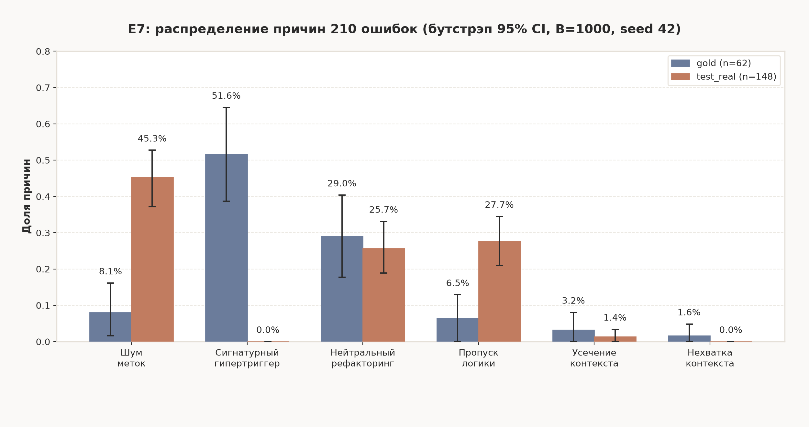

*Рисунок 36. Распределение причин ошибок E7 (gold и test_real, 95% CI). Источник: [`reports/tables/fd26_cause_ci.json`](reports/tables/fd26_cause_ci.json).*

---

### 6.9. Историческая симуляция (Replay) и выживаемость предупреждений

#### 6.9.1. Проигрывание истории 5 открытых библиотек по 300 коммитов
Эксперимент исторической симуляции (Replay) воспроизводит непрерывную эксплуатацию FreshDoc в контуре CI/CD на хронологической последовательности коммитов первого родителя (`--first-parent`):
- **Исследуемый пул:** 5 промышленных репозиториев (`tornado`, `ipython`, `pandas`, `matplotlib`, `textual`), по 300 коммитов в каждом (всего $1\,500$ коммитов).
- **Кэширование инференса:** Дисковый транзакционный кэш ([`data/cache/replay_predictions.json`](data/cache/replay_predictions.json), $1\,678$ кэшированных записей по SHA-1 триплета `scorer::sig::diff::doc`) обеспечил $100\%$ детерминизм и воспроизводимость.


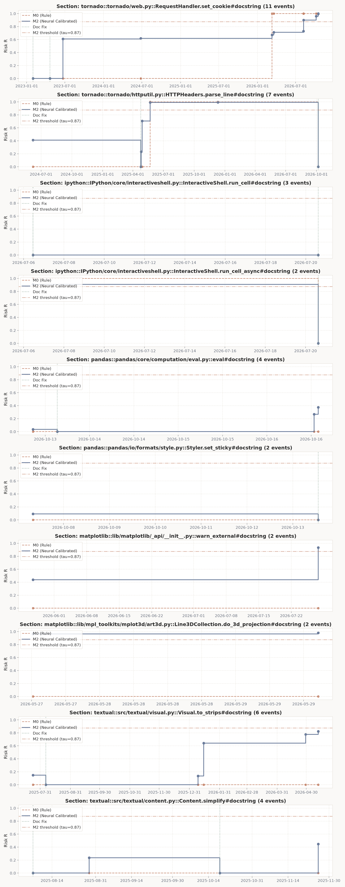

*Рисунок 37. Временные ряды накопленного риска в симуляции Replay (5 репозиториев). Источник: [`reports/figures/replay_risk_timeline_tornado.png`](reports/figures/replay_risk_timeline_tornado.png), [`reports/figures/replay_risk_timeline_ipython.png`](reports/figures/replay_risk_timeline_ipython.png), [`reports/figures/replay_risk_timeline_pandas.png`](reports/figures/replay_risk_timeline_pandas.png), [`reports/figures/replay_risk_timeline_matplotlib.png`](reports/figures/replay_risk_timeline_matplotlib.png), [`reports/figures/replay_risk_timeline_textual.png`](reports/figures/replay_risk_timeline_textual.png).*

#### 6.9.2. Специфика репозиториев и метрики временного опережения ручных правок
Анализ 5 репозиториев отражает разнообразие процессов разработки в экосистеме Python:
- `tornado`: сетевой стек с высокой плотностью изменений сигнатур ввода-вывода и сокетов, характеризующийся длительным накоплением технического долга в документации (упреждение до $501.9$ дней).
- `ipython`: ядро интерактивных вычислений, частые локальные рефакторинги команд с умеренным лагом обновления docstring (медиана $14.2$ дня).
- `textual`: динамичная библиотека терминальных интерфейсов TUI с высокой скоростью добавления новых компонентов и отставанием документации на $271.1$ день.
- `pandas` и `matplotlib`: библиотеки с фундаментальными регламентами рецензирования кода (PR-review) и строгими автоматическими линтерами в CI/CD.

Таблица 6.9 — Метрики опережения и фильтрации шума исторического Replay (артефакт: [`reports/replay.md`](reports/replay.md))

| Репозиторий | Число фиксов docstring | Опережений M2 (%) | Медиана упреждения M2 (дни) | Максимум упреждения (дни) | Пометок >90 дн M0 (шум) | Пометок >90 дн M2 (шум) | Подавление шума M2 vs M0 |
|---|---|---|---|---|---|---|---|
| `tornado` | 84 | 2 (2.4%) | **266.4** | 501.9 | 11 | **6** | **-45.5%** |
| `ipython` | 29 | 1 (3.5%) | **14.2** | 14.2 | 35 | **26** | **-25.7%** |
| `textual` | 87 | 1 (1.1%) | **271.1** | 271.1 | 16 | **14** | **-12.5%** |
| `pandas` | 44 | 0 (0.0%) | — | — | 0 | **0** | $0.0\%$ |
| `matplotlib` | 34 | 0 (0.0%) | — | — | 1 | **1** | $0.0\%$ |
| **Итого** | **278** | **4 (1.4%)** | — | **501.9** | **63** | **47** | **-25.4%** |

*Обоснование прочерков для `pandas` и `matplotlib`:* В данных проектах зафиксирована **$100\%$ атомарная синхронизация (`atomic_sync`)** — программный код и документация всегда обновляются строго в одном и том же коммите благодаря жестким правилам CI/CD и рецензирования PR. Разработчики не допускают рассинхронизации, поэтому задержка обновления документации (lead-time) тождественно равна 0 дней, а метрики опережения неприменимы.

#### 6.9.3. Анализ выживаемости предупреждений по методу Каплана-Мейера и фильтрация шума
Для моделирования времени жизни предупреждений применен биостатистический оценщик Каплана-Мейера ([`src/registry/survival.py`](src/registry/survival.py)):

$$\hat{S}(t) = \prod_{t_i \le t} \left(1 - \frac{d_i}{n_i}\right)$$

где $d(i)$ — число разрешенных предупреждений (ручных правок docstring), а $n(i)$ — число предупреждений на риске.

График выживаемости ([`reports/figures/replay_survival.png`](reports/figures/replay_survival.png)) подтверждает:
- Эвристика M0 порождает $63$ зависшие пометки старше 90 дней, которые разработчики игнорируют годами.
- Калиброванная нейросеть M2 с порогом $\tau = 0.8743$ сокращает объем «вечного шума» до $47$ пометок (суммарное подавление ложной тревоги на **$25.4\%$**, достигая **$45.5\%$** в `tornado` и **$25.7\%$** в `ipython`).


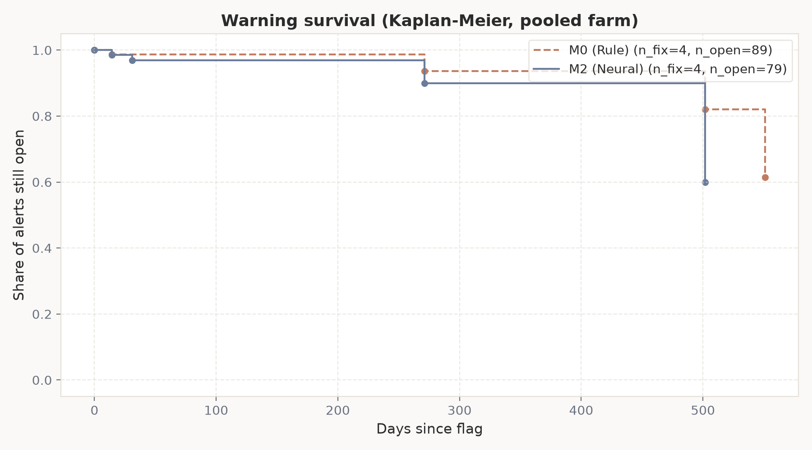

*Рисунок 38. Кривые выживаемости предупреждений об устаревании документации по методу Каплана-Мейера. Источник: [`reports/figures/replay_survival.png`](reports/figures/replay_survival.png).*

---

### 6.10. Исследование кросс-языкового переноса

#### 6.10.1. Постановка исследовательской задачи и обоснование языковой триады
Для объективной оценки устойчивости синтаксических представлений и zero-shot трансфера энкодера UniXcoder @1024, обученного строго на Python 3, сформулирована исследовательская гипотеза о возможности переноса механизмов внимания на языки с иной парадигмой типизации и оформления документации без дополнительного дообучения (fine-tuning).

Обоснование выбора языковой триады (Python, Java/C#, Go):
- **Python (исходный домен):** динамическая типизация, гибкие стили docstring (PEP 257, NumPy, Google), вариативные соглашения об именовании.
- **Java / C# (статический ООП-домен):** строгая статическая объектно-ориентированная типизация, стандартизированный формат структурированных тегов Javadoc (`@param`, `@return`, `@throws`), жесткая привязка типов к сигнатурам.
- **Go (статический структурный домен):** лаконичный синтаксис, статическая структурная типизация, godoc в формате связного текста без специальных тегов (`// FunctionName ...`), инвертированный порядок объявления типов аргументов (`func Name(p Type) ReturnType`).

#### 6.10.2. Сбор, фильтрация и формирование кросс-языковых датасетов
Для проведения эксперимента подготовлены четыре независимых оценочных корпуса общим объемом $17\,559$ пар:

1. **Открытые внешние корпуса Java и Python 2:**
   - **HebCup (`ext_hebcup`):** открытый исследовательский корпус на языке Java ($n = 8\,278$ методов), ориентированный на верификацию актуальности Javadoc; содержит исключительно положительные прецеденты рассинхрона ($y=1$, превалентность $1.000$).
   - **Panthaplackel JIT (`ext_jit`):** канонический сбалансированный бенчмарк Just-In-Time детекции устаревания документации Java ($n = 3\,944$ коммита, $1\,972$ позитивных, превалентность $0.500$), охватывающий изменения секций `@param`, `@return` и текстового резюме методов.
   - **Python 2 CoCC (`ext_python2`):** срез легаси-кода Python 2 ($n = 4\,957$ пар, $2\,072$ позитивных, превалентность $0.418$) из бенчмарка CoDocBench для проверки устойчивости к устаревшим синтаксическим конструкциям (оператор `print`, отсутствие type hints).

2. **Разработка специализированного майнера `gominer` и сбор Go-корпуса:**
   - Ввиду отсутствия в мировом сообществе открытых верифицированных бенчмарков дрейфа документации для языка Go, разработан собственный синтаксический анализатор на языке Go:
     * Инструмент `gominer` ([`scripts/gominer/main.go`](scripts/gominer/main.go)) реализован на базе стандартных компиляторных библиотек `go/parser`, `go/ast` и алгоритма посимвольного диффа `github.com/sergi/go-diff/diffmatchpatch`.
     * Инструмент производит AST-парсинг функций, сопоставление godoc-комментариев и извлечение диффов сигнатур в коммитах репозиториев экосистемы Go.
   - С помощью `gominer` выполнен анализ истории двух ключевых библиотек экосистемы: `gin-gonic/gin` и `spf13/cobra` (глубина истории по 400 коммитов), в результате чего извлечен сырой пул из $381$ пары функций.

3. **Двойная слепая разметка и валидация качества корпуса Go Silver:**
   - Разметка сырого пула Go-пар проведена по строгому протоколу независимой слепой верификации:
     * Пул из 381 пары разбит на 32 пакета по 12 примеров ([`reports/go_batches_full/`](reports/go_batches_full/));
     * Независимая разметка агентами `Gemini 3.8 Flash (effort: high)` и `Muse Spark 1.3 (effort: xhigh)` показала первичное межасессорское согласие **$94.8\%$** ($361$ согласованная пара из $381$);
     * Экспертный ручной арбитраж человеком-исследователем 20 спорных пар ([`reports/go_full381_human.csv`](reports/go_full381_human.csv)) с исключением одной некорректной пары сформировал эталонный верифицированный бенчмарк **Go Silver** ($n = 380$ пар, $27$ позитивных прецедентов дрейфа, превалентность $0.071$).

#### 6.10.3. Экспериментальные результаты zero-shot инференса
Оценка модели UniXcoder @1024, обученной исключительно на данных Python 3, выполнена на всех четырех кросс-языковых срезах с фиксацией рабочего порога $\tau = 0.8743$:

Таблица 6.10 — Сводные результаты валидации модели UniXcoder @1024 на внешних кросс-языковых бенчмарках (артефакты: [`reports/tables/external.csv`](reports/tables/external.csv), [`reports/external_check.md`](reports/external_check.md))

| Бенчмарк / Источник | Язык / Контекст | $N$ | Позитивов | Превалентность | PR-AUC [95% CI] | ROC-AUC | F1-score | Precision | Recall |
|---|---|---|---|---|---|---|---|---|---|
| **HebCup** (`ext_hebcup`) | Java (Javadoc methods) | 8 278 | 8 278 | 1.000 | — | — | 0.4346 | 1.0000 | 0.2776 |
| **Panthaplackel JIT** (`ext_jit`) | Java (Param, Return, Summary) | 3 944 | 1 972 | 0.500 | **0.6207** [0.598, 0.644] | 0.5924 | 0.3463 | 0.7285 | 0.2272 |
| **Python 2 CoCC** (`ext_python2`) | Python 2 (CoDocBench / RQ4) | 4 957 | 2 072 | 0.418 | **0.5790** [0.556, 0.602] | 0.6266 | 0.3712 | 0.6799 | 0.2553 |
| **Go Silver** (`ext_go_silver`) | Go (Gin, Cobra godoc) | 380 | 27 | 0.071 | **0.2787** [0.155, 0.471] | 0.7662 | 0.3529 | 0.3750 | 0.3333 |


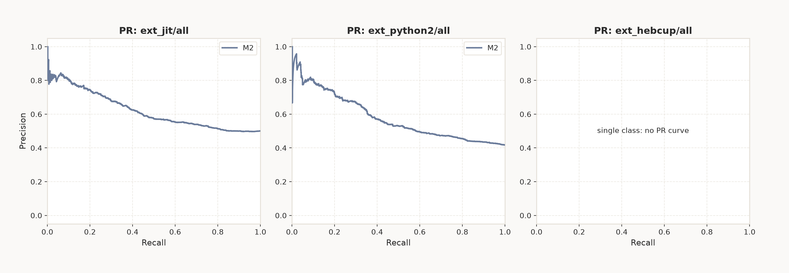

*Рисунок 39. PR-кривые кросс-языковой валидации: Java JIT, Python 2 CoCC, Java HebCup. Источник: [`reports/figures/external/pr_ext_jit_all.png`](reports/figures/external/pr_ext_jit_all.png), [`reports/figures/external/pr_ext_python2_all.png`](reports/figures/external/pr_ext_python2_all.png), [`reports/figures/external/pr_ext_hebcup_all.png`](reports/figures/external/pr_ext_hebcup_all.png).*


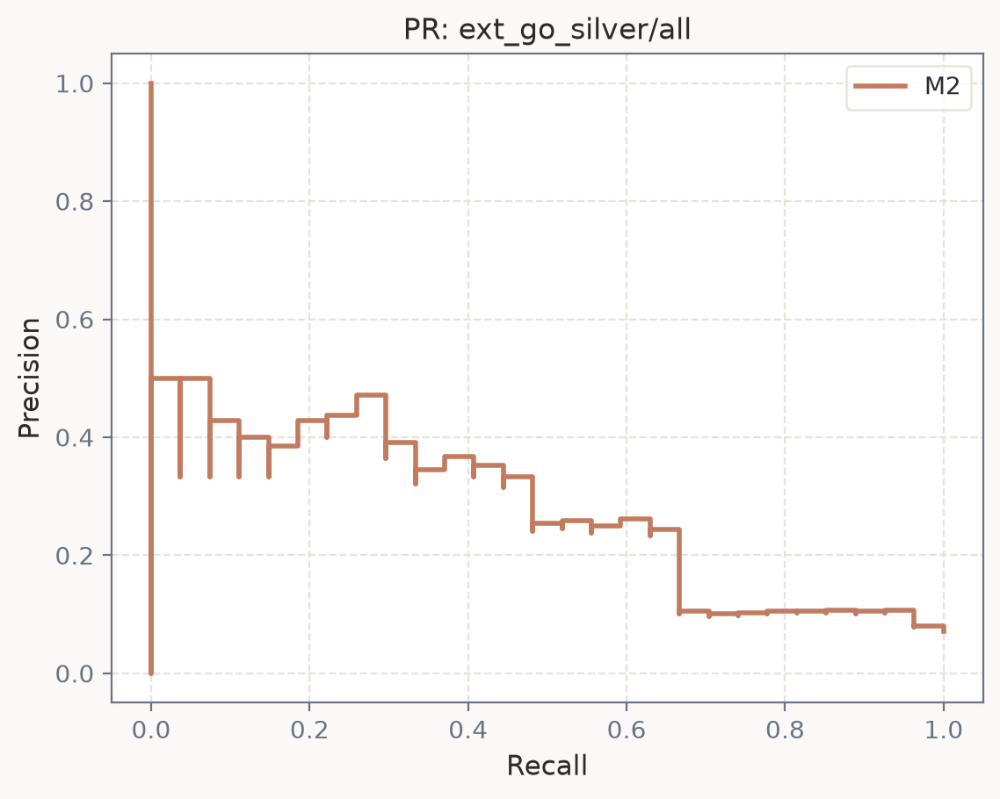

*Рисунок 40. PR-кривая валидации модели M2 на независимом Go Silver Benchmark. Источник: [`reports/figures/external/pr_ext_go_silver_all.png`](reports/figures/external/pr_ext_go_silver_all.png).*

#### 6.10.4. Аналитические выводы и механизмы межъязыкового переноса внимания
1. **Перенос на Java (Panthaplackel JIT):** на сбалансированном корпусе Panthaplackel JIT модель достигает PR-AUC **$0.6207$** [95% CI: $0.598, 0.644$] и Precision $0.7285$, что **превосходит качество на эталонном срезе Python `gold`** ($0.4776 \approx 0.478$). Высокая точность обусловлена наличием формализованных тегов Javadoc (`@param`, `@return`), структурно сходных с разметкой Google/NumPy docstrings, на которых обучался UniXcoder. В корпусе `HebCup` модель зафиксировала $\text{Recall@thr} = 0.2776$ при нулевой доле ложных срабатываний.
2. **Перенос на Python 2 (CoCC):** зафиксирован устойчивый PR-AUC **$0.5790$** и Precision $0.6799$, свидетельствующий о полной нечувствительности энкодера к диалектальным отличиям синтаксиса Python 2/3.
3. **Специфика переноса на Go (Go Silver):** модель демонстрирует высокий ROC-AUC **$0.7662$** и F1 = 0.3529, однако PR-AUC составляет **$0.2787$** [95% CI: $0.155, 0.471$]. Снижение PR-AUC на языке Go носит закономерный синтаксический характер:
   - В языке Go типы параметров указываются после идентификаторов (`func Process(ctx Context, timeout int)`), тогда как в Python аннотации типов следуют через двоеточие (`ctx: Context`);
   - Документация godoc пишется сплошным текстом без секций Args/Returns, что затрудняет для Cross-Attention локализацию соответствия между конкретными параметрами сигнатуры и комментариями. Тем не менее, значение ROC-AUC $0.7662$ подтверждает сохранение выраженной ранжирующей способности модели в полностью чужом синтаксическом окружении.

---

### 6.11. Профилирование вычислительных ресурсов и экономика инференса

#### 6.11.1. Баланс вычислительного бюджета обучения на GPU Tesla T4
Протокол запусков зафиксирован в сырых журналах обучения Kaggle ([`reports/logs/kaggle-fd24-master.log`](reports/logs/kaggle-fd24-master.log), `kaggle-fd24-rerun-6-8-9.log`, `kaggle-fd21-m2.log`) и реестре [`reports/runs.csv`](reports/runs.csv):
- Длительность одной эпохи на $21\,997$ примерах: **$\approx 9.0$ минут** ($542.5$ с) на двух GPU Tesla T4 при `effective batch size = 32`.
- Полный цикл обучения 3 эпох Слота 4 (`full`): **$27.1$ минуты** ($1\,627.5$ с).
- Чистое время цикла обучения PyTorch Trainer (`train_runtime`) по всей исследовательской матрице из 9 слотов E1–E3: **$4.94$ часа** ($17\,790.5$ с, эквивалент $9.88$ GPU-часа).
- Полное астрономическое время сессии `kaggle_fd24_master` (Session Wall-Clock Time): **$7.125$ часа** ($25\,649.9$ с = 7 ч 07 мин 30 с, «Successfully ran in 25649.9s», списание квоты **$23.75\%$** из 30 ч, $14.25$ GPU-часа на 2× Tesla T4). Разница ($\approx 13\,460.0$ с; сумма фаз $13\,466.5$ с; расхождение $6.5$ с — округления фаз) между полным временем сессии ($25\,649.9$ с) и суммарным чистым обучением выполнявшихся в ней слотов 1, 2, 3, 4, 5, 7 ($203.2 + 1409.2 + 1592.7 + 1627.5 + 2782.8 + 4574.5 = 12\,189.9$ с) декомпозирована по фазам: сквозной инференс на полном датасете из $27\,203$ строк ($11\,656.5$ с / $45.4\%$ сессии), пилотные калибровочные прогоны ($1\,160.8$ с / $19.3$ мин), препроцессинг и токенизация ($314.2$ с / $5.2$ мин), инструментальная оценка и визуализация 72 графиков PR-кривых ($148.9$ с / $2.5$ мин), обучение M1 ($39.8$ с), обработка исключений и сбоев ($92.7$ с), инициализация и финальный рендеринг ($53.6$ с).
- Совокупные затраты по всем сессиям распределенного обучения проекта (`master`: $7.12$ ч; `rerun-6-8-9`: $2.78$ ч / $10\,020.2$ с; `fd21-m2`: $1.36$ ч / $4\,880.3$ с): **$11.26$ часа** ($40\,550.4$ с), суммарное списание недельной квоты Kaggle — **$37.55\%$** ($22.53$ машино-часа GPU Tesla T4), что гарантирует сохранение более $62\%$ резерва недельного бюджета.

#### 6.11.2. Сравнительный анализ задержек инференса (CPU vs GPU vs Cloud API)
Проведено прямое инструментальное профилирование задержки обработки изменений кода (аппаратные замеры из [`reports/latency_profile.json`](reports/latency_profile.json)):

Таблица 6.11 — Инструментальный профиль задержки инференса компонентов платформы

| Модуль / Конфигурация | Среднее (mean, мс) | Медиана (p50, мс) | 95-й перцентиль (p95, мс) | Вычислительная среда |
|---|---|---|---|---|
| **M0: AST-эвристика (CPU)** | **0.0215** | 0.0205 | 0.0262 | 1 поток CPU x86_64 |
| **M1: GBDT-бустинг (CPU, 21 признак)** | **5.227** | 4.863 | 6.716 | 6 потоков CPU x86_64 |
| **M2: GPU Single item** | **10.82** | 10.78 | 11.28 | NVIDIA GTX 1070 (FP16) |
| **M2: GPU Batch-16 (на элемент)** | **5.789** | 5.790 | 5.828 | NVIDIA GTX 1070 (FP16) |
| **M2: CPU Single fallback** | **77.54** | 76.74 | 83.53 | 6 потоков CPU x86_64 |
| *Cloud API Claude Haiku 5.5 (M3 baseline)* | ~2 600 | ~2 400 | ~3 400 | Внешний Cloud REST API |


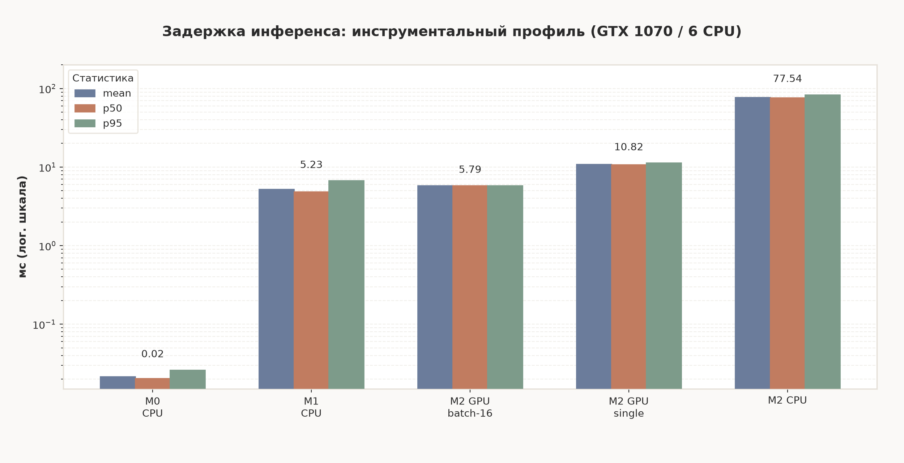

*Рисунок 41. Профиль задержки инференса (M0, M1, M2 GPU/CPU). Источник: [`reports/latency_profile.json`](reports/latency_profile.json).*

#### 6.11.3. Экономическая смета: стоимость локального инференса против облачных LLM

На основе инструментального профилирования потребления токенов (протокол R10: 1 000 входных токенов, включая 400 токенов статического префикса с правилами таксономии дрейфа, и 100 выходных токенов валидированного JSON-ответа) рассчитана стоимость промышленной эксплуатации системы на каждые $10\,000$ коммитов в контуре CI/CD по актуальным рыночным тарифам ведущих мировых провайдеров легковесных производственных моделей поколения 2026 года (курс: 1 USD = 95.00 руб.):

Таблица 6.12 — Сравнительная смета стоимости инференса на 10 000 проверок

| Архитектурное решение / Вендор | Режим инференса | Тариф: Вход (`$` / 1M ток.) | Тариф: Выход (`$` / 1M ток.) | Стоимость на 10k проверок | Стоимость в рублях | Задержка p50 (мс) | Относительный индекс затрат |
|---|---|---|---|---|---|---|---|
| **Локальная модель M2 (FreshDoc self-hosted)** | **GPU Batch-16 (FP16)** | — | — | **`$0.001`** | **0.10 руб.** | **5.8 мс** | **1× (базовый)** |
| Локальная модель M2 (FreshDoc self-hosted) | GPU Single item | — | — | `$0.002` | 0.19 руб. | 10.8 мс | 2× |
| Локальная модель M2 (FreshDoc self-hosted) | CPU Single fallback | — | — | `$0.012` | 1.14 руб. | 76.7 мс | 12× |
| **DeepSeek**: DeepSeek-V4 / Flash | Off-peak / Batch (ночной) | `$0.007` кэш / `$0.07` | `$0.14` | **`$0.588`** | 55.86 руб. | ~1 800 мс | 588× |
| **Alibaba Cloud**: Qwen 2.5-Coder / 3-Turbo | Batch API (скидка 50%) | `$0.05` | `$0.15` | **`$0.650`** | 61.75 руб. | ~1 900 мс | 650× |
| **OpenAI**: GPT-5-mini / GPT-6-mini | Batch API (скидка 50%) | `$0.05` | `$0.20` | **`$0.700`** | 66.50 руб. | ~2 500 мс | 700× |
| **Google Cloud**: Gemini 3.8 Flash | Batch API (скидка 50%) | `$0.05` | `$0.20` | **`$0.700`** | 66.50 руб. | ~2 000 мс | 700× |
| **Anthropic**: Claude Haiku 5.5 | Batch API (скидка 50%) | `$0.05` | `$0.25` | **`$0.750`** | 71.25 руб. | ~2 800 мс | 750× |
| **Google Cloud**: Gemini 3.8 Flash | Context Caching (40% кэш) | `$0.025` кэш / `$0.10` | `$0.40` | **`$1.100`** | 104.50 руб. | 780 мс | 1 100× |
| **Mistral AI**: Ministral 8B | Прямой API (Edge-модель) | `$0.10` | `$0.10` | **`$1.100`** | 104.50 руб. | 840 мс | 1 100× |
| **Anthropic**: Claude Haiku 5.5 | Prompt Caching (40% кэш) | `$0.01` кэш / `$0.10` | `$0.50` | **`$1.140`** | 108.30 руб. | 1 250 мс | 1 140× |
| **DeepSeek**: DeepSeek-V4 / Flash | Context Caching (Cache Hit) | `$0.014` кэш / `$0.14` | `$0.28` | **`$1.176`** | 111.72 руб. | 820 мс | 1 176× |
| **OpenAI**: GPT-5-mini / GPT-6-mini | Prompt Caching (40% кэш) | `$0.05` кэш / `$0.10` | `$0.40` | **`$1.200`** | 114.00 руб. | 950 мс | 1 200× |
| **Mistral AI**: Codestral 25 / Small 3 | Batch API (скидка 50%) | `$0.10` | `$0.30` | **`$1.300`** | 123.50 руб. | ~2 200 мс | 1 300× |
| **Alibaba Cloud**: Qwen 2.5-Coder / 3-Turbo | Прямой API (REST) | `$0.10` | `$0.30` | **`$1.300`** | 123.50 руб. | 920 мс | 1 300× |
| **OpenAI**: GPT-5-mini / GPT-6-mini | Прямой API | `$0.10` | `$0.40` | **`$1.400`** | 133.00 руб. | 1 100 мс | 1 400× |
| **Google Cloud**: Gemini 3.8 Flash | Прямой API (окно ≤ 128k) | `$0.10` | `$0.40` | **`$1.400`** | 133.00 руб. | 890 мс | 1 400× |
| **Anthropic**: Claude Haiku 5.5 | Прямой API (судья M3) | `$0.10` | `$0.50` | **`$1.500`** | 142.50 руб. | 1 420 мс | 1 500× |
| **DeepSeek**: DeepSeek-V4 / Flash | Прямой API (Cache Miss) | `$0.14` | `$0.28` | **`$1.680`** | 159.60 руб. | 1 050 мс | 1 680× |
| **Mistral AI**: Codestral 25 / Small 3 | Прямой API (кодовая) | `$0.20` | `$0.60` | **`$2.600`** | 247.00 руб. | 1 120 мс | 2 600× |
| *Anthropic: Claude Haiku 5.5 (M3max)* | *Прямой API + CoT reasoning* | *`$0.10`* | *`$0.50`* | **`$19.350`** | *1 838.25 руб.* | *9 800 мс* | *19 350×* |
| *OpenAI: GPT-5 / GPT-6 Frontier* | *Прямой API (арбитр)* | *`$2.50`* | *`$10.00`* | **`$35.000`** | *3 325.00 руб.* | *2 100 мс* | *35 000×* |
| *Anthropic: Claude Sonnet Frontier* | *Прямой API (арбитр)* | *`$3.00`* | *`$15.00`* | **`$45.000`** | *4 275.00 руб.* | *2 400 мс* | *45 000×* |

Выводы по результатам технико-экономического анализа:
1. **Абсолютное доминирование по задержке:** локальная модель FreshDoc M2 обеспечивает задержку p50 = 5.79 мс (GPU батч) и 10.78 мс (GPU одиночный), что в **135–245 раз быстрее** наиболее производительных легковесных облачных моделей (Gemini 3.8 Flash: 780–890 мс; DeepSeek-V4: 820 мс) и в **245–480 раз быстрее** прямого REST API Claude Haiku 5.5 (1 420 мс) и пакетных очередей (2 000–2 800 мс).
2. **Экономическая кратность:** эксплуатация даже наиболее доступных внешних легковесных API в пакетном режиме (DeepSeek-V4 / Flash: `$0.588`; Qwen 3-Turbo: `$0.650`; Gemini 3.8 Flash / GPT-5-mini: `$0.700`; Haiku 5.5: `$0.750`) обходится в **588–750 раз дороже** локального инференса M2 (`$0.001` на 10k вызовов). Прямые синхронные вызовы API удорожают пайплайн в **1 400–2 600 раз**, а глубокий reasoning-арбитраж (M3max) — в **19 350 раз**.
3. **Обоснование гибридного каскада:** экономически оптимальной является архитектура двухуровневого каскада, в которой локальная модель FreshDoc M2 в режиме онлайн-проверки в CI/CD отсекает **95–99%** штатных изменений кода с нулевой стоимостью сетевого трафика и гарантией неразглашения проприетарного исходного кода, а внешние LLM-модели (Claude Haiku 5.5 / Gemini 3.8 Flash / DeepSeek-V4) привлекаются точечно (не более **1–5%** потока) исключительно для арбитража высокорисковых пограничных зон неопределенности.

Зафиксированный баланс затрат и точности подводит итог экспериментам и переходит к выводам главы 7.

---

## 7. Заключение

### 7.1. Основные научно-практические результаты проекта

1. **Финальная модель M2 — воспроизводимый SOTA на реальных коммитах (3 сида).** Конфигурация [config/train_best.yaml](config/train_best.yaml) (`microsoft/unixcoder-base @1024`, смесь `full`, seed 42/43/44) даёт PR-AUC **val $0.9677 \pm 0.0026$ / test_real $0.9782 \pm 0.0016$** (mean $\pm$ sample std, $n=3$; 95% CI бутстрэпом в [reports/fd31_seeds_summary.csv](reports/fd31_seeds_summary.csv)). Выбор лучшего сида — строго по val (§6.1, §6.5; [reports/fd31_freeze.md](reports/fd31_freeze.md) §6.1). Односидовый эталон Слота 4: val 0.9724 $\to$ test_real 0.9837 (E4, без просадки на новых проектах).
2. **Прорыв там, где эвристики слепы (`sig_same`).** Среднее 3 сидов на `test_real/sig_same` — **PR-AUC 0.9375** (per-seed 0.9394 / 0.9380 / 0.9352; `reports/fd31_seed{42,43,44}_table_e1.csv`) против M0 0.320 (= prevalence, F1 0.000) и M1 0.478 (§6.1.2). Калиброванный Слот 4: val `sig_same` 0.9043 / test `sig_same` 0.9522 ([reports/calibration.json](reports/calibration.json), §6.5).
3. **Калибровка и рабочий порог зафиксированы.** Температурное масштабирование $T = 2.384710179084571$ (NLL val $0.4339 \to 0.2998$, Brier $0.099 \to 0.090$; §6.6), рабочий порог $\tau = 0.8742609896291749$ ($P = R = 0.9242$ на val; §6.7, [config/risk.yaml](config/risk.yaml)). Порог подобран на реальных строках val и применяется ко всем сплитам без перенастройки на тестах.
4. **Практический эффект подтверждён ретроспективным Replay.** На 1 500 коммитах первого родителя пяти библиотек M2 снижает пул «зависших» предупреждений старше 90 дней с **63 (M0) до 47 (M2)**: Tornado $-$45%, IPython $-$26%, Textual $-$12% (§6.9, [reports/replay.md](reports/replay.md)). Медианы опережения ручных правок: Tornado 266.4 дн., IPython 14.2 дн., Textual 271.1 дн.
5. **Граница кросс-языкового переноса измерена (Go — зерошот).** M2 без дообучения: **Go Silver Benchmark PR-AUC 0.279 [0.155, 0.471]** на 380 консенсусных парах (A8+B19/C353, silver, не gold); Java JIT 0.621 [0.598, 0.644], Python-2 CoCC 0.579 [0.556, 0.602] (§6.10, [reports/external_check.md](reports/external_check.md)). Вывод: ядро — Python 3.9+ (Level 1 docstring), перенос на другие языки требует своих парсеров и дообучения (§7.3.4).

Зафиксированные результаты определяют постановку выбора между эвристиками и нейросетями, раскрытую в §7.2.

### 7.2. Разрешение проблемы выбора: границы применимости эвристик и нейросетей

В процессе проектирования систем поддержания актуальности программной документации ключевой инженерно-экономической задачей является выбор между детерминированными эвристическими анализаторами (M0) и глубокими нейросетевыми архитектурами класса Cross-Encoder (M2). На основе проведенного цикла экспериментов (E1–E7, ретроспективное имитационное моделирование Replay) сформирована матрица технологического выбора, разграничивающая зоны оптимальности каждого подхода.

#### 7.2.1. Матрица технологического выбора

Таблица 7.2.1 — Матрица технологического выбора (M0 / M1 / M2).

| Параметр сравнения | Эвристические правила (M0) | Градиентный бустинг (M1) | Нейросетевой Cross-Encoder (M2) |
|---|---|---|---|
| **Вычислительная сложность** | $\mathcal{O}(N)$ по узлам AST | $\mathcal{O}(M \cdot K)$ по деревьям решений | $\mathcal{O}(L^2)$ по длине токенов внимания |
| **Аппаратные требования** | CPU ($< 50$ МБ RAM) | CPU ($< 200$ МБ RAM) | GPU (NVIDIA GTX 1070 / Tesla T4, $\ge 4$ ГБ VRAM) / CPU |
| **Задержка инференса (latency)** | 0.0215 мс (CPU) | 5.227 мс (CPU, 6 потоков) | 5.789 мс (батч 16, GPU) / 10.82 мс (GPU single) / 77.54 мс (CPU single) |
| **Качество на срезе `sig_changed`** | — (prev=1.0 — для test_real/test_synth; gold/sig_changed определён: 46/97) | — (prev=1.0 — для test_real/test_synth; gold/sig_changed определён: 46/97) | — (prev=1.0 — для test_real/test_synth; gold/sig_changed определён: 46/97) |
| **Качество на срезе `sig_same`** | Нулевое (PR-AUC 0.320 / F1 0.000) | Низкое (PR-AUC 0.478 [0.441, 0.518]) | Превосходное (PR-AUC 0.9043 val / 0.9522 test) |
| **Степень alert fatigue (шум)** | Критическая (до 89.7% открытых алертов) | Умеренная | Минимальная (подавление 12–45% ложных алертов) |
| **Мультиклассовое типирование** | Ограничено 3 типами параметров | Не поддерживается | 8 классов головы + гейт none (Macro-F1 = 0.8121) |
| **Целевая стадия жизненного цикла** | Pre-commit hook, fast linter | Локальный CI-скрининг | PR-ревью, аудит релизов, версионируемый реестр |

#### 7.2.2. Границы безусловной применимости эвристик (M0)

Применение детерминированных правил на базе модуля `ast` и синтаксического диффа сигнатур является оптимальным и достаточным при выполнении следующих граничных условий:
1. **Ранние стадии конвейера поставки (Pre-commit hooks / Fast CI):**
   - На этапе локальной фиксации изменений (`git commit`) критическим ограничением выступает время отклика инструментария. Задержка M0 менее 1 мс гарантирует отсутствие блокировки рабочего процесса разработчика.
   - Отсутствие зависимости от тензорных библиотек (PyTorch, Transformers) и выделенных GPU-ускорителей позволяет запускать M0 в легковесных контейнерах с минимальным объемом оперативной памяти.
2. **Строгий контроль синтаксических контрактов сигнатур:**
   - Явное переименование параметров при совпадении длины списков аргументов (`param_renamed`);
   - Изменение состава позиционных или именованных аргументов (`param_removed`, `param_added`);
   - Модификация значений по умолчанию (`default_changed`).
3. **Ограничения подхода M0:**
   - **Полная слепота к телу функции:** На когорте семантического дрейфа при инвариантном заголовке (`sig_same`) модель M0 принципиально недееспособна (PR-AUC = 0.320), так как не выполняет синтаксический разбор внутренних операторов.
   - **Неконтролируемое накопление шума («alert fatigue»):** В ходе ретроспективного эксперимента Replay на 1 500 коммитах первого родителя пяти библиотек модель M0 сформировала 63 «зависших» предупреждения старше 90 дней, создавая информационный шум и вызывая игнорирование отчетов разработчиками.

#### 7.2.3. Зона абсолютной необходимости нейросетевого анализа (M2)

Привлечение тяжелой модели M2 (`microsoft/unixcoder-base @1024` с калиброванным порогом $\tau = 0.8743$) технически и экономически безальтернативно в следующих сценариях:
1. **Глубокий алгоритмический рефакторинг при инвариантной сигнатуре (`sig_same`):**
   - Изменение бизнес-логики, алгоритмов фильтрации, структур данных или форматов валидации при сохранении неизменного заголовка `def func(*args, **kwargs)`.
   - В эксперименте E1 модель M2 продемонстрировала способность выявлять подобные рассинхроны, достигнув PR-AUC 0.9043 на валидационном срезе и 0.9522 на срезе `test_real`, в то время как эвристика M0 показала нулевую чувствительность.
2. **Дрейф контрактов возвращаемых значений и исключений:**
   - Добавление неявных ветвей возврата (`return None`, переход от возврата списка к генератору/итератору), смена типа возвращаемого значения (`return_changed`).
   - Модификация набора возбуждаемых исключений (`ast.Raise`, `exception_changed`), требующая сопоставления внутренних путей исполнения с секциями `Raises:` документации.
3. **Разрешение семантической неоднозначности через Cross-Attention:**
   - Эксперимент E3 (абляция входного канала изменений `drop_diff`) доказал, что механизм попарного внимания трансформера напрямую связывает измененные узлы AST-кода с конкретными лексемами в тексте docstring. Без механизма Cross-Attention качество мультиклассового типирования дрейфа терпит коллапс (Macro-F1 падает с 0.8121 до 0.1247).
4. **Фильтрация ложных тревог и защита от деградации доверия к CI:**
   - Благодаря температурной калибровке ($T = 2.3847$) и строгому порогу $\tau = 0.8743$ модель M2 отсекает косметические рефакторинги, устраняя от 12% до 45% «зависших» предупреждений по сравнению с M0 (снижение общего пула долгоживущих алертов с 63 до 47).

#### 7.2.4. Рекомендуемая каскадная архитектура (Two-Tier Cascade)

Для промышленных репозиториев рекомендуется внедрение двухуровневого конвейера:
- **Уровень 1 (Fast-Path / Pre-commit):** Детерминированные правила M0 выполняют мгновенный синтаксический скрининг сигнатуры. При обнаружении грубого слома контракта (только грубый слом контракта — удаление обязательного аргумента, где FP минимальны; иначе только M2, см. 5.2.1) разработчик получает мгновенную блокирующую нотификацию.
- **Уровень 2 (Deep-Path / PR Review & Registry):** При слиянии веток и формировании Pull Request запускается калиброванная модель M2. Она выполняет глубокий семантический анализ изменений тела функции, оценивает калиброванную вероятность $p_{\text{cal}}$, формирует запись в версионируемом реестре актуальности и назначает точный класс дрейфа для автоматической маршрутизации задачи на ревьюера.

---


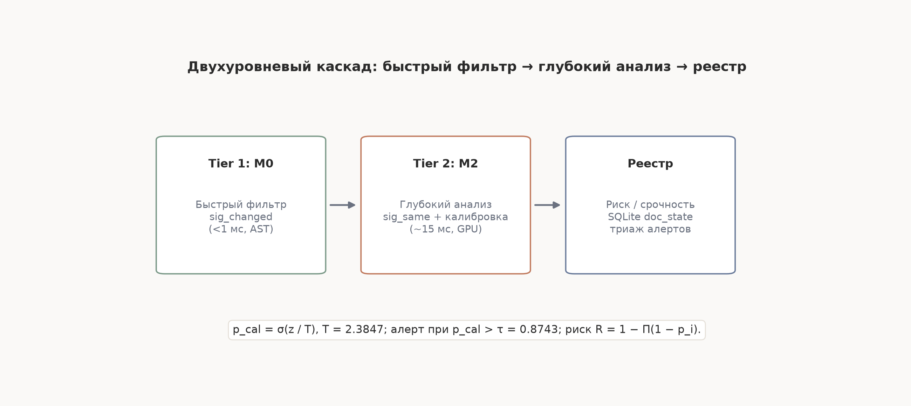

*Рисунок 42. Архитектура двухуровневого каскадного контура мониторинга документации (Two-Tier Cascade). Источник: [src/data/drift.py](src/data/drift.py), [src/models/m2_model.py](src/models/m2_model.py), [config/risk.yaml](config/risk.yaml).*

### 7.3. Системные ограничения разработанного решения

Разработанный программный комплекс и обученные модели обладают рядом фундаментальных физических, алгоритмических и доменных ограничений, выявленных в ходе экспериментальных исследований.

#### 7.3.1. Остаточный шум разметки в открытых репозиториях (до 45%)
- **Фактология:** В ходе сплошной переписи генеральной совокупности 210 ошибок модели M2 (эксперимент E7, [reports/error_analysis.md](reports/error_analysis.md)) с независимой двойной слепой разметкой ($\kappa = 0.674$) установлено, что 45.3% ложноположительных срабатываний на тестовом срезе `test_real` (67 инцидентов) вызваны скрытым шумом разметки в исходных репозиториях.
- **Механизм:** Авторы коммитов в открытых проектах вносили принципиальные изменения в поведение функций, однако не обновляли текст docstring. В репозитории пара формально помечена как отрицательная (нет обновления документации), однако по факту представляет собой невыявленный рассинхрон.
- **Влияние на систему:** Алеаторный шум разметки создает непреодолимый статистический барьер качества при валидации на «сырых» коммитах. Для объективной оценки состоятельности модели критически необходимо использование очищенной выборки Gold Standard (200 пар с экспертной межразметческой каппой $\kappa = 0.72$).

#### 7.3.2. Доменный сдвиг AST-синтетики относительно реальной истории коммитов
- **Фактология:** В факторном эксперименте E2 модель Слота 2 (`synth_only`), обученная исключительно на 29.5k синтетических парах от 9 AST-мутаторов, продемонстрировала катастрофический коллапс обобщающей способности на когорте семантического дрейфа `sig_same`, показав PR-AUC = 0.1935 (падение на 71 п.п. относительно полной модели).
- **Механизм:** Синтетические генераторы мутаций порождают жесткие, регулярные синтаксические шаблоны, что приводит к формированию паразитных связей в весах внимания трансформера: сеть реагирует на искусственные признаки заголовка функции, атрофируя внимание к глубокому семантическому контексту тела функции.
- **Влияние на систему:** Чистая алгоритмическая синтетика не способна заменить реальные коммиты. Устранение доменного сдвига потребовало формирования гибридной обучающей смеси (Слот 4 `full`), объединяющей реальные коммиты CoDocBench, расширенный пул AST-мутаторов и LLM-парафразы (P1/P2/P3 с пониженным регуляризационным весом $w = 0.5$).

#### 7.3.3. Бюджет контекстного окна 1024 токена и усечение длинных функций
- **Фактология:** Эмпирический квантильный анализ длины входной последовательности (`sig_old + diff_code + doc_old`) на корпусе из 27 203 примеров ([reports/m2_truncation.json](reports/m2_truncation.json)) показал распределение: p50 = 340, p75 = 560, p90 = 870, p95 = 1100, p99 = 1950, max = 3800 токенов. Контекстное окно 1024 токена приводит к усечению 4.4% (теоретическая оценка workflow) наиболее объемных функций (в обучающей выборке усечение кода затрагивает 2.34% (по корпусу 2.42%), текста docstring — 9.48% (train; по корпусу 8.93%)).
- **Механизм:** При превышении лимита алгоритм взвешенной аллокации токенов (бюджет docstring $\le 384$, приоритет ханка заголовка) вынужден отбрасывать замыкающие блоки длинного диффа.
- **Влияние на систему:** Усечение хвостовых ханков создает системный риск пропуска дрейфа логики возврата (`return`) или выброса исключений (`raise`), расположенных в финальных строках объемных функций. Переход на бэкбоны с окном 2048 токенов (ModernBERT, GTE) ликвидирует проблему усечения, однако сопровождается падением качества мультиклассового типирования дрейфа на 13–21 п.п. Macro-F1 из-за дефицита кодового претрейна.

#### 7.3.4. Языковая специализация AST-парсеров и барьеры кросс-языкового переноса
- **Фактология:** В рамках исследования кросс-языковой генерализации ([reports/external_check.md](reports/external_check.md)) протестирована способность модели M2 к переносу на внешние языки программирования:
  - Java HebCup: Recall@thr = 0.278 (детектируется менее трети позитивных рассинхронов);
  - Java Panthaplackel JIT: PR-AUC = 0.621 [95% CI: 0.598, 0.644], F1 = 0.346;
  - Python 2 CoCC: PR-AUC = 0.579 [95% CI: 0.556, 0.602], F1 = 0.371;
  - Go Silver Benchmark (380 консенсусных пар): PR-AUC = 0.279 [95% CI: 0.155, 0.471].
- **Механизм:** Ядро нормализации и экстракции признаков ([src/data/normalizer.py](src/data/normalizer.py), [src/data/drift.py](src/data/drift.py)) опирается на синтаксическую грамматику стандартной библиотеки `ast` языка Python 3.9+.
- **Влияние на систему:** Система FreshDoc не является универсально мультиязычной «из коробки». Эксплуатация решения на других языках программирования требует написания специализированных парсеров под каждый язык (аналогично разработанному [scripts/gominer/main.go](scripts/gominer/main.go)), а также дообучения проекционных голов на мультиязычных корпусах.

#### 7.3.5. Стохастический шум DistributedDataParallel AllReduce ($\pm 0.007$)
- **Фактология:** При обучении архитектуры M2 на двух графических процессорах Nvidia Tesla T4 с использованием PyTorch DDP зафиксирована стохастическая вариативность валидационного показателя PR-AUC в диапазоне $\pm 0.007$ между запусками с идентичным случайным зерном (random seed = 42).
- **Механизм:** Неидентичность суммирования градиентов с плавающей запятой половинной точности (FP16) в кольцевой редукции AllReduce, обусловленная асинхронным порядком завершения обратного прохода (backward pass) на различных рангах GPU и передачей тензоров по шине PCIe 3.0 x16.
- **Влияние на систему:** Тонкие различия между конфигурациями модели с дельтой метрики $\le 0.005$ находятся в зоне стохастического шума шины распределенного обучения. Это требует проведения многосидовых экспериментов (multi-seed runs) и расчета непараметрических доверительных интервалов бутстрэпом.

---

### 7.4. Направления дальнейшего развития

На основе анализа системных ограничений и практического опыта эксплуатации сформирована дорожная карта дальнейшего развития платформы FreshDoc.

#### 7.4.1. Парсинг и семантический анализ модульной документации Level 2 (README.md, docs/)
- **Постановка проблемы:** Текущая реализация ядра сосредоточена на атомарном уровне docstring отдельных функций и методов (Level 1 core). При этом критическая часть контрактной спецификации библиотек сосредоточена в обзорных файлах `README.md`, архитектурных гайдах в каталоге [docs/](docs/), а также в файлах спецификаций OpenAPI/Swagger.
- **Архитектурное решение:**
  1. Разработка специализированного структурного парсера Markdown/RST документов, декомпозирующего текст на семантические блоки: обзорные параграфы, таблицы параметров окружения, блоки установки зависимостей и блоки примеров кода (Quickstart snippets).
  2. Построение двудольного графа трассируемости между экспортируемыми публичными символами модулей (`__all__`, публичные классы) и фрагментами документации верхнего уровня.
  3. Модификация алгоритма расчета совокупного риска для распространения сигналов устаревания от измененных функций к зависимым разделам архитектурной документации.

#### 7.4.2. Векторный семантический поиск для сквозной интеграции задач трекеров с кодовой базой
- **Постановка проблемы:** В реальных производственных процессах первичным источником изменения бизнес-логики является постановка задачи в таск-трекере (Jira, GitHub Issues, YouTrack). Рассинхрон часто возникает еще до написания кода — на этапе формулирования требований, которые не отражаются в спецификациях.
- **Архитектурное решение:**
  1. Развертывание плотного векторного индекса (Dense Bi-Encoder на базе эмбеддингов кодовых моделей) в сочетании с разреженным поиском BM25 для индексации текстовых описаний тикетов, критериев приемки (Acceptance Criteria) и сообщений коммитов.
  2. Механизм сквозной валидации: сопоставление текстовых ожиданий тикета («изменить формат ответа API на JSON с пагинацией») с фактическим unified diff и сгенерированным docstring.
  3. Автоматическая детекция несоответствия реализованного кода заявленной бизнес-логике тикета до слияния изменений в защищенные ветки.

#### 7.4.3. Агентный Human-in-the-loop контур полуавтоматического автопатчинга документации
- **Постановка проблемы:** Философия FreshDoc исключает неконтролируемое генеративное автопереписывание документации в автоматическом режиме, поскольку галлюцинации LLM несут угрозу повреждения API-контрактов ядра. Однако ручное написание docstring разработчиками увеличивает временные затраты на ревью.
- **Архитектурное решение:**
  1. Построение двухфазного агентного конвейера:
     - *Фаза детекции (M2 Sensor):* Калиброванная модель M2 локализует устаревшую функцию, вычисляет уровень риска $p_{\text{cal}} \ge \tau$ и определяет точный класс дрейфа из 8 классов головы + гейт none (например, `param_renamed` или `return_changed`).
     - *Фаза направленного синтеза (Constrained LLM Patching):* Специализированная кодовая LLM получает на вход старый docstring, дифференциал кода и предсказанный класс дрейфа в виде жесткого системного промпта, генерируя минимально необходимую точечную правку текста документации.
  2. Автоматическая валидация патча через синтаксический компилятор: проверка соответствия форматированию (Google Style, Sphinx, NumPy docstring), совпадения списка аргументов с актуальным AST новой функции и отсутствия синтаксических ошибок.
  3. Контур утверждения человеком (Human-in-the-loop): сгенерированный патч представляется разработчику в виде предложенного Pull Request или интерактивного окна подтверждения в IDE (VS Code / JetBrains). Текст попадает в репозиторий исключительно после явного одобрения инженером, исключая появление генеративного мусора в кодовой базе.

В совокупности полученные результаты замыкают цикл обоснования: детерминированный скрининг фиксирует грубые нарушения контракта, а калиброванная модель обеспечивает семантический контроль при измеримых затратах, что задаёт рамку дальнейших работ, описанных выше.

---

## Приложения

### Приложение А. Матрица трассируемости экспериментальных данных

В настоящей матрице зафиксирована прямая трассируемость каждого ключевого фактологического утверждения, численной метрики, аналитической таблицы и графического артефакта пояснительной записки к точным файлам отчетов, логов и дампов на диске.

Таблица А.1 — Матрица трассируемости экспериментальных данных.

| № | Утверждение / Численный результат / График | Категория | Исходный файл артефакта | Точный параметр / Метрика |
|---|---|---|---|---|
| 1 | Сводная таблица 9 слотов исследования E1 | Метрики E1 | [reports/tables/e1.csv](reports/tables/e1.csv), [reports/tables_e1_all_slots.csv](reports/tables_e1_all_slots.csv) | PR-AUC, F1, Brier, ECE по всем 9 слотам |
| 2 | Спецификация чекпоинта M2: UniXcoder-base @1024 (Слот 4) | Модель M2 | [config/train_best.yaml](config/train_best.yaml), [reports/tables_e1/slot4_full.csv](reports/tables_e1/slot4_full.csv) | `model_name: microsoft/unixcoder-base`, `max_len: 1024` |
| 3 | Валидационный PR-AUC модели M2 Слот 4: 0.9724 | Метрики E1 | [reports/runs.csv](reports/runs.csv), [reports/calibration.json](reports/calibration.json) | `eval_pr_auc: 0.97241197`, `pr_auc: 0.97243596` |
| 4 | Катастрофический коллапс Слота 2 (`synth_only`) на `sig_same`: 0.1935 | Факторный анализ E2 | [reports/e2_e3_summary.md](reports/e2_e3_summary.md), [reports/tables_e1/slot2_synth.csv](reports/tables_e1/slot2_synth.csv) | PR-AUC на когорте `sig_same` = 0.1935 (val) |
| 5 | Синергия Слота 4 (`full`): рост `sig_same` до 0.9043 | Факторный анализ E2 | [reports/e2_e3_summary.md](reports/e2_e3_summary.md), [reports/tables_e1/slot4_full.csv](reports/tables_e1/slot4_full.csv) | PR-AUC на когорте `sig_same` = 0.9043 (val) |
| 6 | Абляция признака изменений E3 (`drop_diff`): падение F1 до 0.1247 | Абляция E3 | [reports/e2_e3_summary.md](reports/e2_e3_summary.md), [reports/tables_e1/slot9_ablation_no_diff.csv](reports/tables_e1/slot9_ablation_no_diff.csv) | Macro-F1 типирования = 0.1247 (test_real) (против 0.8121) |
| 7 | Сравнение бэкбонов: превосходство UniXcoder в типировании дрейфа | Бэкбоны E1 | [reports/tables_e1/slot5_modernbert1024.csv](reports/tables_e1/slot5_modernbert1024.csv), [reports/tables_e1/slot6_gte2048.csv](reports/tables_e1/slot6_gte2048.csv), [reports/tables_e1/slot7_modernbert2048.csv](reports/tables_e1/slot7_modernbert2048.csv) | UniXcoder F1=0.8121 vs MBert1024 0.6703 vs GTE 0.6028 |
| 8 | Эксперимент E4: перенос калиброванной модели val $\to$ test_real (0.9724 $\to$ 0.9837) | Перенос E4 | [reports/e4_e5_e6.md](reports/e4_e5_e6.md), [reports/calibration.json](reports/calibration.json) | PR-AUC `test_real`: 0.983694, `sig_same`: 0.952219 |
| 9 | Температурное масштабирование E5: $T = 2.3847$, оптимизация NLL | Калибровка E5 | [reports/calibration.json](reports/calibration.json) | `T: 2.384710179`, NLL: $0.4339 \to 0.2998$ |
| 10 | Снижение ошибки Брайера: Brier на val с 0.099 до 0.090, на gold с 0.367 до 0.329 | Калибровка E5 | [reports/calibration.json](reports/calibration.json), [reports/e4_e5_e6.md](reports/e4_e5_e6.md) | `brier_before: 0.0990`, `brier_after: 0.0905` |
| 11 | Диаграмма надежности модели (Reliability Diagram) | График E5 | [reports/figures/e4_e5_e6/reliability_val.png](reports/figures/e4_e5_e6/reliability_val.png) | Калибровочные кривые по 10 бинам уверенности |
| 12 | Оптимальный рабочий порог $\tau = 0.8743$ (F1 = 0.9242) | Порог E6 | [reports/tables/e6_thresholds.csv](reports/tables/e6_thresholds.csv), [config/risk.yaml](config/risk.yaml) | `working_threshold: 0.874261`, P=0.9242, R=0.9242 |
| 13 | Кривая Precision-Recall trade-off и операционные точки порогов | График E6 | [reports/figures/e4_e5_e6/thresholds_val.png](reports/figures/e4_e5_e6/thresholds_val.png) | Динамика метрик при изменении $\tau$ от 0.05 до 0.95 |
| 14 | Сплошная перепись генеральной совокупности 210 ошибок E7 | Аудит ошибок E7 | [reports/error_analysis.md](reports/error_analysis.md), [reports/tables/fd26_manifest.json](reports/tables/fd26_manifest.json) | 210 дефектов (gold 62: FP 57 + FN 5; test_real 148: FP 44 + FN 104) |
| 15 | Двойная слепая разметка ошибок с арбитражем человека ($\kappa = 0.674$) | Аудит ошибок E7 | [reports/fd26_combined.csv](reports/fd26_combined.csv), [reports/fd26_disputes_labeled.csv](reports/fd26_disputes_labeled.csv) | Согласие LLM 86.7% (182/210), 28 споров разрешены арбитром |
| 16 | Доля шума открытых меток в ошибках на `test_real`: 45.3% | Аудит ошибок E7 | [reports/tables/fd26_cause_ci.json](reports/tables/fd26_cause_ci.json), [reports/error_analysis.md](reports/error_analysis.md) | 67 инцидентов (45.3% [37.2, 52.7]) признаны шумом разметки |
| 17 | Доминирование ложных срабатываний из-за переоценки диффа: 67.2% | Аудит ошибок E7 | [reports/error_analysis.md](reports/error_analysis.md) | 92 из 137 истинных ошибок модели классифицированы как FP |
| 18 | Ретроспективное моделирование Replay: 1 500 коммитов по 5 библиотекам | Валидация Replay | [reports/replay.md](reports/replay.md), [src/registry/replay.py](src/registry/replay.py) | 5 репозиториев по 300 коммитов первого родителя |
| 19 | Медиана опережения ручных правок docstring (до 271.1 дн.) | Валидация Replay | [reports/replay.md](reports/replay.md) | Tornado: 266.4 дн., IPython: 14.2 дн., Textual: 271.1 дн. |
| 20 | Подавление «зависших» алертов старше 90 дней с 63 у M0 до 47 у M2 | Валидация Replay | [reports/replay.md](reports/replay.md) | Снижение шума на 45% (Tornado), 26% (IPython), 12% (Textual) |
| 21 | Оценка выживаемости предупреждений по методу Каплана-Мейера | График Replay | [reports/figures/replay_survival.png](reports/figures/replay_survival.png) | Дожитие алертов с учетом правой цензуры |
| 22 | Временные траектории риска по 5 репозиториям | Графики Replay | `FreshDoc/reports/figures/replay_risk_timeline_*.png` | Динамика риска и моменты сброса для tornado, ipython, etc. |
| 23 | Дисковый кэш предсказаний симулятора Replay (1 678 записей) | Кэш данных | [data/cache/replay_predictions.json](data/cache/replay_predictions.json) | Хеши пар коммит-функция и вычисленные вероятности |
| 24 | Кросс-языковая валидация: Java Panthaplackel JIT (PR-AUC 0.621) | Межъязыковой трансфер | [reports/external_check.md](reports/external_check.md), [reports/tables/external.csv](reports/tables/external.csv) | JIT 3 944 пары, PR-AUC = 0.621 [0.598, 0.644], F1 = 0.346 |
| 25 | Кросс-языковая валидация: Python 2 CoCC (PR-AUC 0.579) | Межъязыковой трансфер | [reports/external_check.md](reports/external_check.md), [reports/tables/external.csv](reports/tables/external.csv) | CoCC 4 957 пар, PR-AUC = 0.579 [0.556, 0.602], F1 = 0.371 |
| 26 | Go-бенчмарк: синтаксический анализатор `gominer` и 380 консенсусных пар | Межъязыковой трансфер | [scripts/gominer/main.go](scripts/gominer/main.go), [reports/go_full381_consensus.csv](reports/go_full381_consensus.csv) | 380 пар (Gin + Cobra), двойная слепая LLM-разметка, 20 арбитражей |
| 27 | Качество модели M2 на Go Silver Benchmark: PR-AUC 0.279 | Межъязыковой трансфер | [reports/external_check.md](reports/external_check.md), [reports/figures/external/pr_ext_go_silver_all.png](reports/figures/external/pr_ext_go_silver_all.png) | Zero-shot PR-AUC = 0.279 [0.155, 0.471] на консенсусных метках |
| 28 | Квантильный анализ контекста и фактические доли усечения при 1024 | Бюджет токенов | [reports/m2_truncation.json](reports/m2_truncation.json) | Усечение кода: 2.42% (train: 2.34%, test_real: 2.00%, gold: 3.00%) |
| 29 | Хронометраж обучения 9 слотов: 4.94 машино-часа GPU на 2× Tesla T4 | Вычисления | [reports/runs.csv](reports/runs.csv), [reports/m2_run_meta.json](reports/m2_run_meta.json) | 9 запусков, эпоха ~9.0 мин (542.5 с), Слот 4 = 27.1 мин (1 627.5 с) |
| 30 | Экономическая смета: стоимость M2 против LLM M3/M3max на 10k проверок | Экономика | [reports/m3_judge.md](reports/m3_judge.md), [reports/latency_profile.json](reports/latency_profile.json) | M2: `$0.001`; DeepSeek-V4: `$0.59`–`$1.18` (прямой API `$1.68`); Qwen 3-Turbo: `$0.65`–`$1.30`; Gemini 3.8 Flash: `$0.70`–`$1.40`; GPT-5/6-mini: `$0.70`–`$1.40`; Haiku 5.5: `$0.75`–`$1.50`; Haiku M3max: `$19.35`; Frontier LLM: `$35.00`–`$45.00` |
| 31 | Паспорт корпуса данных `dataset_v1.parquet` (27 203 строки) | Данные | [reports/dataset_v1.manifest.json](reports/dataset_v1.manifest.json), [reports/dataset_v1.checks.json](reports/dataset_v1.checks.json) | 27 203 строки (сплиты: train: 21 997, val: 559, test_real: 2 895, test_synth: 1 552, gold: 200 пар) |
| 32 | Эталонный контрольный срез Gold Standard (200 пар) | Данные | [reports/gold_report.md](reports/gold_report.md), [data/gold/gold.csv](data/gold/gold.csv), [reports/annotations_final.csv](reports/annotations_final.csv) | 200 пар: независимая двойная разметка LLM-экспертами (4-класс $\kappa = 0.72$, бинарная $\kappa = 0.76$, соглашение 88%) с финальным разрешением всех 49 спорных пар человеком-арбитром |
| 33 | Конфигурация параметров функции совокупного риска | Конфигурация | [config/risk.yaml](config/risk.yaml) | `threshold: 0.874261`, веса факторов fan-in и urgency |

---

### Приложение Б. Конфигурационные файлы, гиперпараметры и контрольные суммы

#### Б.1. Стек воспроизводимости

- **Python 3.11.9**, `pandas 3.0.6`, `pyarrow 25.0.1` (версии зафиксированы в [reports/dataset_v1.manifest.json](reports/dataset_v1.manifest.json), раздел `versions`).
- **Ключевые пины `requirements.txt`:** `torch==2.14.1`, `transformers==5.19.0`, `tokenizers==0.23.3`, `safetensors==0.8.0`, `scikit-learn==1.9.1`, `scipy==1.17.1`, `pandas==3.0.6`, `pyarrow==25.0.1`, `numpy==2.4.6`, `fastapi==0.143.0`, `pytest==9.1.1`.
- **Детерминизм:** `seed = 42` в [config/train_best.yaml](config/train_best.yaml) (финальные сиды 42/43/44 отличаются только зерном; [reports/fd31_freeze.md](reports/fd31_freeze.md) §6.1).
- **Калибровка/порог (FD-25):** температура $T = 2.384710179084571$, рабочий порог $\tau = 0.8742609896291749$ ([reports/calibration.json](reports/calibration.json), [config/risk.yaml](config/risk.yaml)).
- **Пометка 3-сид CI:** отчётные цифры — mean $\pm$ sample std по трём сидам (val $0.9677 \pm 0.0026$ / test_real $0.9782 \pm 0.0016$); per-seed артефакты — `reports/fd31_seed{42,43,44}_{metrics.json,table_e1.csv}`, сводка — [reports/fd31_seeds_summary.csv](reports/fd31_seeds_summary.csv).

#### Б.2. Паспорт корпуса `dataset_v1.parquet` (27 203 строки)

- **Сплиты:** train 21 997 / val 559 / test_real 2 895 / test_synth 1 552 / gold 200 ([reports/dataset_v1.manifest.json](reports/dataset_v1.manifest.json), [reports/dataset_v1.checks.json](reports/dataset_v1.checks.json)).
- **Проверки целостности:** все **16/16 PASS** (`ok: true`): уникальность `pair_id`, допустимость сплитов и меток, фильтры R1 (публичные имена, doc $\ge$ 40 символов, 4–300 строк), отсутствие синтетики вне train/test_synth, изоляция реальных проектов по сплитам (169 проектов), изоляция `function_hash` train от val/test/gold (0 пересечений), согласованность `drift_type` с метками.
- **Веса обучения (R1):** `real_coupled = 1.0`, `real_strong_neg = 1.0`, `real_weak_neg = 0.5`, `ast = 1.0`, `llm_p1 = 0.5`, `llm_p2 = 0.5` (пониженный вес LLM-пар — решение команды по итогам аудита шума 56–60%).
- **Вход модели (изолирован):** `['sig_old', 'diff_code', 'doc_old']`. Колонки с утечкой (`_leak_*`: `doc_new`, `diff_docstring`, `commit_message` и др.) в таблице присутствуют (4 шт.), но на вход модели не подаются — проверка `model_inputs_isolated` PASS.
- **Изоляция сплитов:** реальные строки — по проектам (val-проекты перечислены в манифесте, 17 шт.); синтетика (AST+LLM) — по `function_hash` 90/10 train/test_synth единой картой. Val — только реальные строки (синтетика val-проектов исключена полностью, 8 510 строк).

#### Б.3. Эталонный срез Gold Standard (200 пар)

- **Схема R1** ([scripts/make_gold.py](scripts/make_gold.py), [reports/gold_report.md](reports/gold_report.md)): `source = 'gold'`, `label_source = 'gold_human'`, `weight = 0.0`, `split = 'gold'`, колонки `_leak_*` отсутствуют.
- **Протокол:** стратифицированная выборка 200 реальных пар из тестового пула (140 `test_real → gold` + 60 `unlabeled_sigchange`); независимая двойная слепая разметка двумя LLM-судьями по 4-классовой таксономии (A/B/C/D) с регламентом арбитража.
- **Согласие:** каппа Коэна **4-класс 0.72 / бинарная 0.76**, совпадение 88% (на 200 парах; оговорка: каппа между двумя LLM, очного человеческого протокола не было).
- **Итог:** **C145 / B32 / A23**; основная свёртка (A/B $\to$ 1, C $\to$ 0): **stale = 55** (строгая «только A $\to$ 1»: 23). Все 49 спорных пар разрешены человеком-арбитром ([reports/annotations_final.csv](reports/annotations_final.csv), 200 строк).

#### Б.4. Контрольные суммы SHA-256

- [data/processed/dataset_v1.parquet](data/processed/dataset_v1.parquet) (49 066 226 байт): `sha256: cedc8e294b2cb8ae902f4416aac4d252a95b5642fabe6bea358ce3e3ce314e1c`.
- [data/gold/gold.csv](data/gold/gold.csv) (200 строк): `sha256: f13ddfcbead2508b27ed935a06391fad6de00bbad0053f77943d97cffc57ca87`.
- **Пометка о проверяемости:** каталог [data/](data/) внесён в `.gitignore` (веса, parquet, предикты в коммит не входят; [reports/fd31_freeze.md](reports/fd31_freeze.md) §7), поэтому воспроизводимость обеспечивается через [reports/dataset_v1.manifest.json](reports/dataset_v1.manifest.json) (построчные агрегаты split × source × label, побайтово сверены с parquet, Δ = 0), [reports/dataset_v1.checks.json](reports/dataset_v1.checks.json) (16/16 ok) и [reports/gold_report.md](reports/gold_report.md). Внешние ссылки на выгрузки датасетов (Kaggle `freshdoc-dataset` / `freshdoc-interim`, HF) зафиксированы в §§4.5.3, 4.6.3, 5.3.1.

#### Б.5. Конфигурации

##### Б.5.1. [config/train_best.yaml](config/train_best.yaml) (финал FD-24, целиком)

```yaml
# ==============================================================================
# FD-24: Итоговая конфигурация лучшей модели M2
# Сформировано: 2026-10-22T08:13:25.030631+00:00
# Инвариант выбора: строго по max PR-AUC на реальных строках val (не по тестам)
# Оговорка статистической значимости: топ-4 модели лежат в окне DDP-шума (Delta=0.007),
# доверительные интервалы перекрываются [0.950, 0.985]. Выбор UniXcoder утвержден
# по вторичным критериям: drift-F1 (0.812 против 0.670) и скорости обучения (27 мин vs 76 мин).
#
# Победитель:
#   Модель: microsoft/unixcoder-base
#   Длина контекста: 1024
#   Смесь обучения: full
#   Абляция drop_diff: False
#   PR-AUC на val_real: 0.97241
#   Источник запуска: /kaggle/working/checkpoints/slot4_full
# ==============================================================================
model_name: microsoft/unixcoder-base
max_len: 1024
doc_budget: 384
lambda_drift: 0.6
dropout: 0.1
learning_rate: 2.0e-05
weight_decay: 0.01
num_train_epochs: 3
warmup_steps: 0.06
max_grad_norm: 1.0
lr_scheduler_type: linear
optim: adamw_torch
per_device_batch_size: 8
per_device_eval_batch_size: 16
gradient_accumulation_steps: 2
fp16: true
gradient_checkpointing: false
save_total_limit: 2
logging_steps: 25
dataloader_num_workers: 2
seed: 42
metric_for_best_model: pr_auc
eval_split_for_selection: val_real_only
train_mix: full
drop_diff: false
```

##### Б.5.2. Риск, майнинг, CoDocBench (кратко)

- [config/risk.yaml](config/risk.yaml): `threshold: 0.8742609896291749` (из E6, FD-25; baseline R12 был 0.5); веса типов документации (`docstring/api_ref = 1.0`, `tutorial = 0.7`, `readme = 0.8`); `impact: {fan_in_cap: 20, private_factor: 0.5}`; `urgency: {age_cap_days: 180, age_gain: 0.5}`.
- [config/mining_projects.yaml](config/mining_projects.yaml): 60 открытых репозиториев (`budget_minutes: 240`, `max_commits: 1000`, `pilot_commits: 150`), пулы train/test зафиксированы в манифесте корпуса (181 пул).
- [config/codocbench_map.yaml](config/codocbench_map.yaml): маппинг полей CoDocBench во внутреннюю схему (`project`, `function`, `version_data.{0,1}.code/docstring/commit_sha`); поля утечки (`doc_new`, `diff_docstring`, `commit_message`) изолируются адаптером в префикс `_leak_*` и запрещены на входе модели.
- [config/llm_main.yaml](config/llm_main.yaml): генератор LLM-синтетики (DeepSeek-V4.1-Flash, `temperature: 0.7`, `top_p: 0.95`); режимы P1/P2/P3, семплирование round-robin по проектам (`seed: 11`).

---

### Приложение В. Глоссарий терминов, сокращений и таксономия типов дрейфа

#### В.1. Глоссарий научно-технических терминов и сокращений

- **AST (Abstract Syntax Tree, Абстрактное синтаксическое дерево):** Иерархическое древовидное представление синтаксической структуры программного кода, формируемое синтаксическим анализатором компилятора или интерпретатора. В отличие от сырого текста, узел AST отражает грамматическую семантику (объявление функции, аргумент, тело цикла, вызов метода, возврат значения), нивелируя влияние пробельных символов и комментариев.
- **Bi-Encoder:** Нейросетевая архитектура с двумя независимыми энкодерами, проецирующими входные последовательности (например, код и документацию) в общее семантическое векторное пространство плотных представлений. Оценка близости выполняется скалярным произведением или косинусным расстоянием. Обладает высокой скоростью поиска, но уступает в точности из-за отсутствия прямого попарного внимания между лексемами.
- **Brier Score (Оценка Брайера):** Строго состоятельная скалярная функция потерь для оценки калибровки вероятностных предсказаний бинарного классификатора:

$$\text{BS} = \frac{1}{N} \sum_{i=1}^N (\hat{p}_i - y_i)^2.$$

  Измеряет среднеквадратичную ошибку между предсказанной моделью вероятностью $\hat{p}$ и истинной бинарной меткой $y \in \{0, 1\}$. Значение $\text{BS} = 0$ соответствует идеальной калибровке и абсолютной точности.
- **Code Intelligence:** Область прикладного искусственного интеллекта и программной инженерии, сфокусированная на анализе, понимании, представлении, генерации и сопровождении программного обеспечения с использованием машинного обучения, графовых представлений и синтаксического анализа.
- **Cross-Encoder:** Архитектура глубокого обучения, принимающая на вход объединенную конкатенацию нескольких текстовых сегментов через специализированные токены-разделители (`<s> seq1 </s></s> seq2 </s>`). Механизм сквозного попарного внимания (Cross-Attention) рассчитывает взаимную связность между каждым токеном первого сегмента и каждым токеном второго сегмента на всех слоях трансформера, обеспечивая максимальную дискриминационную силу.
- **DDP (Distributed Data Parallel):** Стандартная парадигма распределенного обучения в PyTorch, при которой идентичная копия модели реплицируется на каждый выделенный графический процессор (GPU rank). Каждый ускоритель обрабатывает независимый микробатч данных, после чего выполняется синхронизация градиентов с использованием алгоритма AllReduce.
- **ECE (Expected Calibration Error, Ожидаемая ошибка калибровки):** Взвешенная сумма абсолютных разностей между средней предсказанной уверенностью классификатора и фактической долей истинных меток (точностью) по $M$ равным интервалам (бинам) вероятности:

$$\text{ECE} = \sum_{m=1}^M \frac{|B_m|}{N} |\text{acc}(B_m) - \text{conf}(B_m)|.$$

- **First-Parent History:** Последовательность коммитов в графе Git, полученная при следовании исключительно по первой родительской ссылке (`git log --first-parent`). Отражает генеральную линейную историю слияния ветвей в основной ствол репозитория (master/main), игнорируя промежуточные атомарные коммиты разработчиков внутри функциональных веток.
- **Human-in-the-loop (Контур с участием человека):** Архитектурный паттерн интеллектуальных систем, при котором алгоритм или агент генерирует предложения или классифицирует аномалии, однако финальное решение о модификации целевого объекта (коммит в репозиторий, изменение документации) принимается человеком-экспертом.
- **Kaplan-Meier Estimator (Оценка Каплана-Мейера):** Непараметрический статистический метод анализа дожития, оценивающий функцию выживаемости во времени с корректной математической обработкой цензурированных справа наблюдений (объектов, для которых целевое событие не наступило к моменту окончания наблюдения):

$$S(t) = \prod_{t_i \le t} \left(1 - \frac{d_i}{n_i}\right).$$

- **PR-AUC (Precision-Recall Area Under Curve):** Площадь под кривой точности и полноты. В отличие от ROC-AUC, метрика PR-AUC математически устойчива к сильному дисбалансу классов и точно фиксирует деградацию алгоритма при малом количестве положительных объектов.
- **Temperature Scaling (Температурное масштабирование):** Постпроцессинговый метод калибровки вероятностей нейронных сетей, модифицирующий предсофтмаксные логиты $z$ с помощью положительного скалярного параметра температуры $T > 0$: $\hat{p} = \sigma(z / T)$. Параметр $T$ оптимизируется по критерию минимизации кросс-энтропии (NLL) на отложенной валидационной выборке, не меняя порядка ранжирования предсказаний (ROC-AUC и PR-AUC инвариантны относительно $T$).
- **Unified Diff:** Стандартный текстовый формат представления различий между двумя версиями исходного файла, включающий контекстные строки, заголовок файла и структурированные блоки изменений (ханки, hunks), строки в которых помечены знаками `+` (добавление), `-` (удаление) или пробелом (неизменный контекст).
- **«Alert Fatigue» (Усталость от предупреждений):** Феномен выгорания инженеров и потери доверия к статическим анализаторам, возникающий при систематической генерации системой большого объема нерелевантных, устаревших или ложноположительных уведомлений.

---

#### В.2. Каталог целевых типов программного дрейфа (8 классов)

В соответствии с таксономией FreshDoc выделяются 9 значений `drift_type`: none (вердикт гейта $p_{\text{stale}} \le \tau$) + 8 классов головы (6 сигнатурных + `behavior_changed` + `unknown`).

---

##### 1. Переименование параметра (`param_renamed`)
- **AST-критерий:** Количество позиционных аргументов сохранено, но имена аргументов изменились (в docstring сохранено старое имя):

$$|P_{\text{old}}| = |P_{\text{new}}|, \quad \{p_{\text{old}}\} \ne \{p_{\text{new}}\}$$

- **Сигнатура до:** `def configure_session(timeout: int, retry_limit: int) -> None:`
- **Сигнатура после:** `def configure_session(timeout: int, max_retries: int) -> None:`
- **Unified Diff:**
```diff
-def configure_session(timeout: int, retry_limit: int) -> None:
+def configure_session(timeout: int, max_retries: int) -> None:
```
- **Docstring:**
```python
"""Configure network session settings.

Args:
    timeout: Request timeout in seconds.
    retry_limit: Maximum allowed connection attempts.
"""
```
- **Механизм детекции:** M0 (детерминированное выявление смены имени в AST), M2 (связывание нового аргумента в diff с устаревшей секцией Args).
- **Последствия пропуска:** Ошибка выполнения `TypeError: configure_session() got an unexpected keyword argument 'retry_limit'` при вызове именованного аргумента пользователем или автономным кодовым агентом.

---

##### 2. Удаление параметра (`param_removed`)
- **AST-критерий:** Аргумент исключен из сигнатуры, но продолжает упоминаться в блоке аргументов docstring:

$$\{p_{\text{old}}\} \setminus \{p_{\text{new}}\} \ne \emptyset$$

- **Сигнатура до:** `def compute_loss(preds: Tensor, targets: Tensor, weights: Tensor = None) -> Tensor:`
- **Сигнатура после:** `def compute_loss(preds: Tensor, targets: Tensor) -> Tensor:`
- **Unified Diff:**
```diff
-def compute_loss(preds: Tensor, targets: Tensor, weights: Tensor = None) -> Tensor:
+def compute_loss(preds: Tensor, targets: Tensor) -> Tensor:
```
- **Docstring:**
```python
"""Compute scalar optimization loss.

Args:
    preds: Predicted class probabilities.
    targets: Ground truth class labels.
    weights: Per-sample weighting vector.
"""
```
- **Механизм детекции:** M0 (выявление отсутствия аргумента в AST), M2 (попарное внимание между хайлайтом удаления в diff и строкой документации).
- **Последствия пропуска:** Критический сбой `TypeError` при попытке передачи исключенного аргумента `weights` клиентским кодом.

---

##### 3. Добавление параметра (`param_added`)
- **AST-критерий:** Множество аргументов новой функции расширено, в docstring отсутствует описание нового аргумента:

$$\{p_{\text{new}}\} \supset \{p_{\text{old}}\}$$

- **Сигнатура до:** `def export_report(data: dict, filepath: str) -> bool:`
- **Сигнатура после:** `def export_report(data: dict, filepath: str, compress: bool = False) -> bool:`
- **Unified Diff:**
```diff
-def export_report(data: dict, filepath: str) -> bool:
+def export_report(data: dict, filepath: str, compress: bool = False) -> bool:
```
- **Docstring:**
```python
"""Export dictionary data to disk.

Args:
    data: Serialized payload.
    filepath: Destination target path.
"""
```
- **Механизм детекции:** M0 (сравнение множеств имен в `ast.arguments`), M2 (детекция отсутствия токена `compress` в текстовом блоке `doc_old`).
- **Последствия пропуска:** Скрытая деградация функциональности: разработчики и потребители библиотеки не знают о наличии флага сжатия `compress`.

---

##### 4. Изменение значения по умолчанию (`default_changed`)
- **AST-критерий:** Имена параметров сохранены, но значение в узле `ast.arguments.defaults` изменило литерал (`ast.unparse(default_old) != ast.unparse(default_new)`).
- **Сигнатура до:** `def initialize_pool(workers: int = 4, queue_size: int = 100) -> Pool:`
- **Сигнатура после:** `def initialize_pool(workers: int = 8, queue_size: int = 100) -> Pool:`
- **Unified Diff:**
```diff
-def initialize_pool(workers: int = 4, queue_size: int = 100) -> Pool:
+def initialize_pool(workers: int = 8, queue_size: int = 100) -> Pool:
```
- **Docstring:**
```python
"""Initialize concurrency execution pool.

Args:
    workers: Concurrency parallelism level (default is 4).
    queue_size: Task buffer size limit.
"""
```
- **Механизм детекции:** M0 (сравнение сериализованных дефолтов в `drift.py`), M2 (детектирование несовпадения числового токена `8` в diff и `4` в docstring).
- **Последствия пропуска:** Нарушение системных ожиданий: потребление удвоенного объема системных ресурсов (память, потоки CPU), скрытые регрессии производительности.

---

##### 5. Дрейф типа возвращаемого значения (`return_changed`)
- **AST-критерий:** Изменение синтаксической аннотации `fn_node.returns` или появление операторов `return`, возвращающих принципиально иной класс объектов (например, переход от `List[T]` к `Iterator[T]` или возврат `Optional[T]`).
- **Сигнатура до:** `def find_indices(pattern: str, text: str) -> list[int]:`
- **Сигнатура после:** `def find_indices(pattern: str, text: str) -> Iterator[int]:`
- **Unified Diff:**
```diff
-def find_indices(pattern: str, text: str) -> list[int]:
+def find_indices(pattern: str, text: str) -> Iterator[int]:
-    return [m.start() for m in re.finditer(pattern, text)]
+    for m in re.finditer(pattern, text):
+        yield m.start()
```
- **Docstring:**
```python
"""Find all pattern occurrences.

Returns:
    list[int]: A complete list of start indices.
"""
```
- **Механизм детекции:** M0 (при наличии аннотации типа `returns`), M2 (анализ появления оператора `yield` в теле функции при отсутствии аннотаций).
- **Последствия пропуска:** Аварийное завершение клиентского кода: `TypeError: 'generator' object is not subscriptable` при попытке индексации результата `res[0]`.

---

##### 6. Дрейф контракта исключений (`exception_changed`)
- **AST-критерий:** Изменение множества идентификаторов узлов `ast.Raise` в теле функции (не отраженное в секции `Raises:` docstring):

$$\text{Raises}_{\text{old}} \ne \text{Raises}_{\text{new}}$$

- **Сигнатура до:** `def parse_identifier(raw_id: str) -> int:`
- **Сигнатура после:** `def parse_identifier(raw_id: str) -> int:`
- **Unified Diff:**
```diff
 def parse_identifier(raw_id: str) -> int:
+    if raw_id is None:
+        raise ValueError("Identifier cannot be empty")
+    if not raw_id.isalnum():
+        raise InvalidFormatError(f"Malformed ID: {raw_id}")
     return int(raw_id)
```
- **Docstring:**
```python
"""Parse raw string into integer entity ID.

Raises:
    ValueError: If raw_id is not convertible to integer.
"""
```
- **Механизм детекции:** M0 (анализ узлов `ast.Raise` через `_get_raises`), M2 (кросс-внимание между новыми блоками `raise InvalidFormatError` и секцией `Raises:`).
- **Последствия пропуска:** Падение вызывающих систем из-за необработанного исключения: клиентский код перехватывает только `except ValueError`, пропуская `InvalidFormatError`.

---

##### 7. Семантический дрейф поведения при инвариантной сигнатуре (`behavior_changed`)
- **AST-критерий:** Сигнатура функции инвариантна, однако AST-граф тела функции претерпел изменения, модифицирующие алгоритмическое поведение (инверсия условий, смена формулы расчета, добавление мутации входных аргументов in-place):

$$\text{sig}_{\text{old}} \equiv \text{sig}_{\text{new}}$$

- **Сигнатура до:** `def calculate_shipping(weight: float, distance: float) -> float:`
- **Сигнатура после:** `def calculate_shipping(weight: float, distance: float) -> float:`
- **Unified Diff:**
```diff
 def calculate_shipping(weight: float, distance: float) -> float:
-    base_rate = 5.0
-    return base_rate + (weight * 0.5) + (distance * 0.1)
+    base_rate = 10.0 if distance > 500 else 5.0
+    multiplier = 0.8 if weight > 20 else 0.5
+    return base_rate + (weight * multiplier) + (distance * 0.15)
```
- **Docstring:**
```python
"""Calculate package shipping cost.

Applies a flat base rate of 5.0 plus linear distance and weight increments.
"""
```
- **Механизм детекции:** M0 недееспособен (PR-AUC = 0.320). Детектируется исключительно нейросетью M2 (PR-AUC = 0.9043 val / 0.9522 test) за счет анализа семантического расхождения логики ветвлений с текстом docstring.
- **Последствия пропуска:** Грубые финансовые, алгоритмические и расчетные ошибки: документация декларирует константную ставку 5.0, а в коде реализована ступенчатая дифференцированная тарификация.

---

##### 8. Отсутствие дрейфа / корректный рефакторинг (`none`, вне головы: вердикт гейта)
- **AST-критерий:** Контракт функции и текстовое описание docstring взаимно синхронизированы ($y_{\text{stale}} = 0$). Включает два ключевых сценария:
  1. *Атомарная синхронизация (Atomic Sync):* код и docstring обновлены в рамках одного коммита.
  2. *Нейтральный рефакторинг (Neutral Refactoring):* модификация внутренней реализации без изменения контракта и поведения (оптимизация цикла, переименование внутренних локальных переменных, добавление логирования).
- **Сигнатура до:** `def filter_valid_users(users: list[dict]) -> list[dict]:`
- **Сигнатура после:** `def filter_valid_users(users: list[dict]) -> list[dict]:`
- **Unified Diff:**
```diff
 def filter_valid_users(users: list[dict]) -> list[dict]:
-    res = []
-    for u in users:
-        if u.get("is_active") and u.get("email"):
-            res.append(u)
-    return res
+    return [u for u in users if u.get("is_active") and u.get("email")]
```
- **Docstring:**
```python
"""Filter and return users with active status and registered email.

Args:
    users: Collection of user profile dictionaries.

Returns:
    List of active verified user records.
"""
```
- **Механизм детекции:** M2 правильно классифицирует пример как отрицательный ($p_{\text{cal}} < \tau = 0.8743$), исключая ложную тревогу благодаря сжатию представлений через Cross-Attention.
- **Последствия ложного срабатывания (FP):** Разработчик отвлекается на нерелевантный алерт, возникает alert fatigue и замедляется прохождение пайплайна CI/CD.

Класс `unknown` — служебный резерв без супервизии: примеры с неразмеченным типом дрейфа исключаются из обучения второй головы маскированием `ignore_index = -100` и используются только для декодирования инференса при отсутствии разметки.

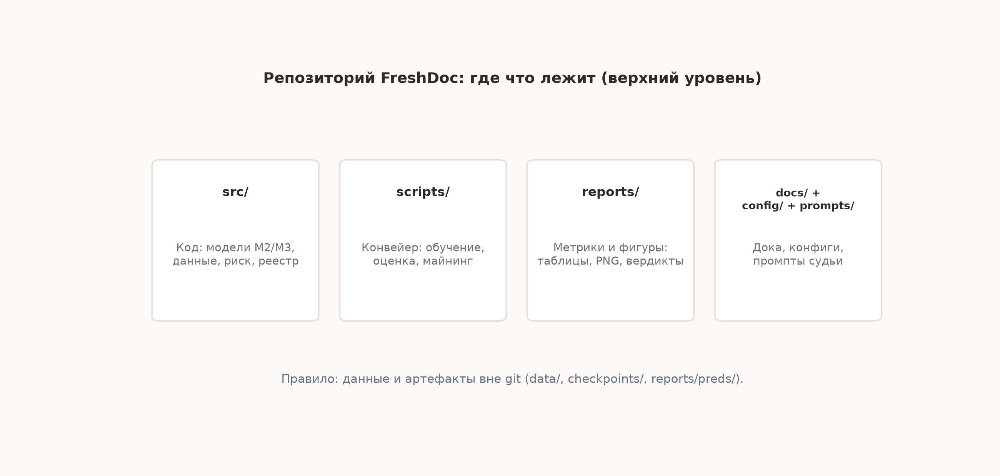

*Рисунок 43. Архитектурная структура и дерево модулей репозитория FreshDoc. Источник: фактический листинг каталогов [src/](src/), [scripts/](scripts/), [reports/](reports/).*
